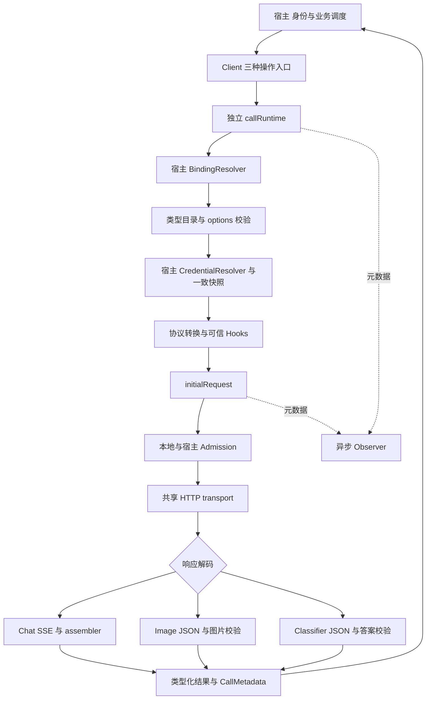
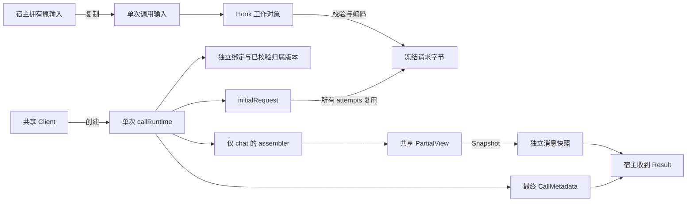
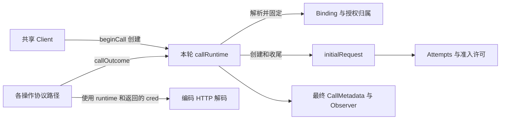
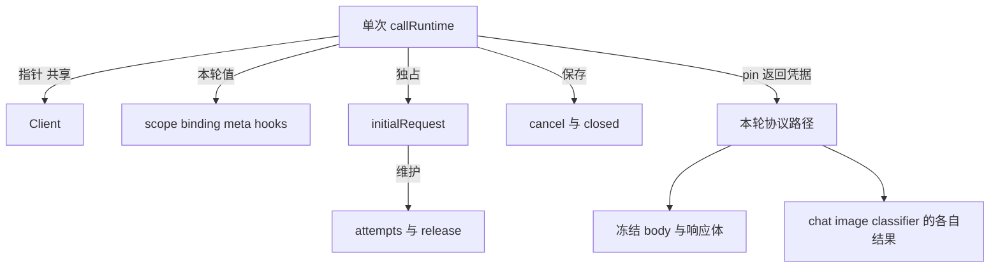
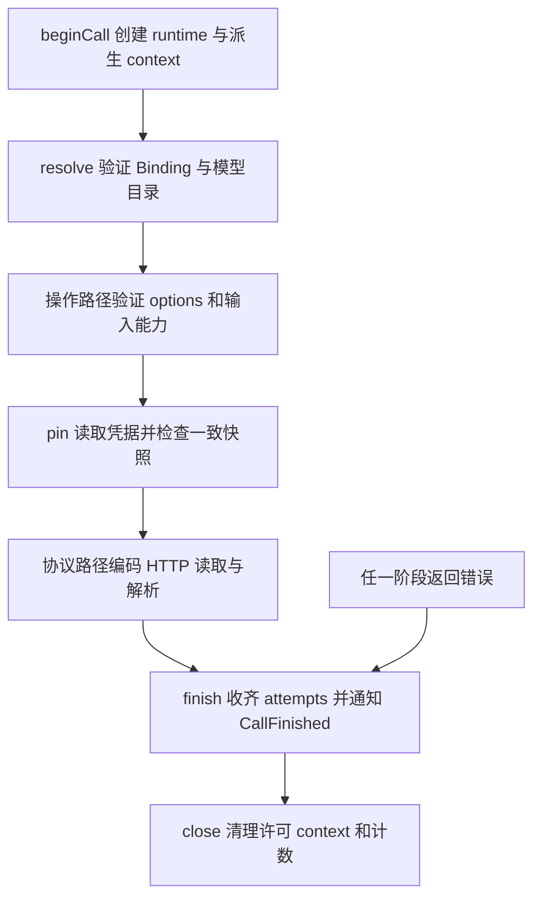
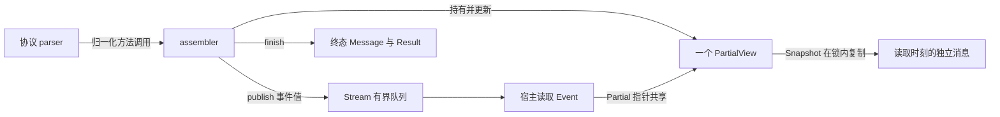
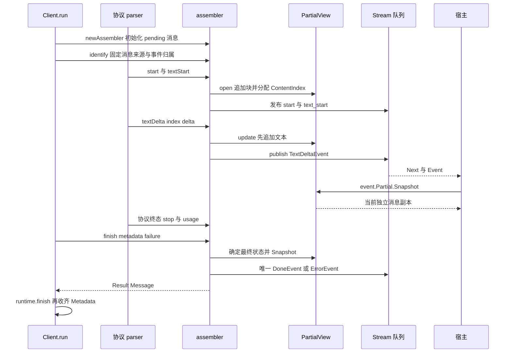
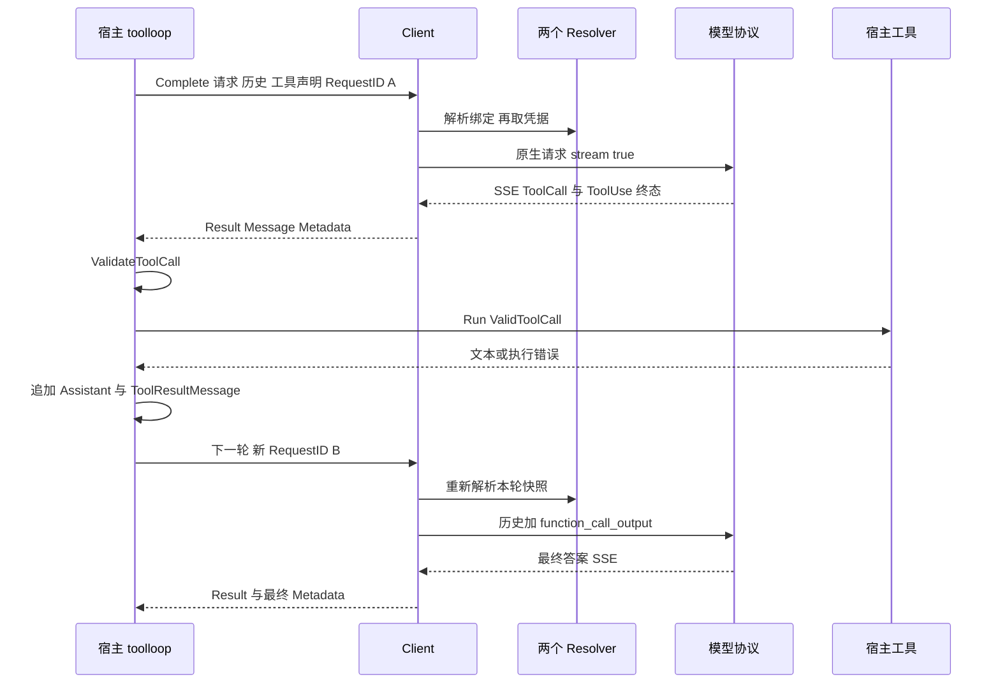

# barness ai 调用链读码报告

本模块完成一次 chat、image 或 classifier 操作。宿主提供可信身份与配置解析，模块固定授权快照、转换协议、执行有界请求并回传类型化结果。工具执行、下一轮调度与分类阈值属于宿主。下文按所给流程图从入口走到结果，在参数真正影响行为的阶段解释分支。

## 1 分析范围与运行环境

目的：梳理三类模型的主要调用链、协议深层路径、options 差异，以及 resolver、Hook、Admission、Observer 和工具执行的交互边界。

代码快照为 `39ab6a5f4c3e838340b46027e84f19b7a37d9fcf`，目录版本为 `2026-10-08.5`。环境为 darwin/arm64、Go 1.26.2；OpenAI SDK v3.66.0、Anthropic SDK v1.75.0。实际运行了 `go test ./ai/e2e -count=1 -json -run ...`，27 个顶层测试通过，证据 manifest 内有 675 个 PASS 场景。准确命令见 [verification.json](verification.json)，运行记录见 [e2e.jsonl](e2e.jsonl)，各场景带 replay 命令和内容哈希，见 [manifest](evidence/20261009T022501.419467000Z/manifest.json)。本次没有调用线上模型。

标注约定：**[verified]** 表示测试实际观察到的输入、请求、事件、结果或断言；**[static]** 表示源码追踪。内部函数链主要是 [static]，测试没有逐帧记录 Go 调用栈，不能把 wire 回放当作内部栈观测。

主线范围：`ai/` 的入口、共享运行时、九条内置协议路线、参数映射、历史回放、结果解析和宿主交互。支线只深入与这条调用链相关的 SDK 请求执行、JSON/SSE 和工具校验；不展开应用数据库、业务 resolver 的内部存储、真实工具实现及完整 Go 网络栈。

## 2 横向架构

[static] `Client` 是可并发复用的配置容器。构造时复制目录、建立完整模型键索引、注册四个 chat adapter、安装共享 HTTP transport 与本地 admission；每次调用创建独立 `callRuntime`。image 和 classifier 保持各自固定分派，没有为了复用而共享聊天输入或结果模型。入口与构造见 [ai/client.go:92](/Users/cyber/RestoX/barness/ai/client.go:92)、[ai/call.go:32](/Users/cyber/RestoX/barness/ai/call.go:32)。

[static] 目录键由 operation、provider、API、model ID 共同组成。现有九种组合：OpenAI / DeepSeek × Responses / Chat Completions 四种，Anthropic Messages、Google generateContent 两种 chat；OpenAI Images、Google Interactions 两种 image；TypeSafe System One 一种 classifier。同一 provider 下也可能使用不同 adapter、鉴权方式、重试规则和结果模型。

## 3 核心数据结构与所有权

| 数据 | 创建与持有 | 可变边界与寿命 | 定义 |
|---|---|---|---|
| Config / Client / Catalog | 宿主配置，Client 构造时复制目录 | Client 长期复用；每次调用不能改目录与固定 transport | [ai/client.go:27](/Users/cyber/RestoX/barness/ai/client.go:27)、[ai/catalog.go:9](/Users/cyber/RestoX/barness/ai/catalog.go:9) |
| CallScope / Target | 宿主创建；每轮新的 RequestID | Scope 是可信身份；入口覆盖 Operation；Target 只有 BindingID / ModelID | [ai/binding.go:13](/Users/cyber/RestoX/barness/ai/binding.go:13)、[ai/binding.go:29](/Users/cyber/RestoX/barness/ai/binding.go:29) |
| Request / ImagesRequest / ClassifierRequest | 宿主输入，入口复制可变字段 | chat 先复制再校验；unary 先限制已知大小再复制；不得并发修改调用中的输入 | [ai/request.go:12](/Users/cyber/RestoX/barness/ai/request.go:12)、[ai/images.go:11](/Users/cyber/RestoX/barness/ai/images.go:11)、[ai/classifier.go:11](/Users/cyber/RestoX/barness/ai/classifier.go:11) |
| Binding / Credential | 两个宿主 resolver 依次返回 | 绑定列表被复制；credential 仅在通过租户、账户、引用与版本检查后固定到该逻辑调用 | [ai/binding.go:82](/Users/cyber/RestoX/barness/ai/binding.go:82)、[ai/binding.go:135](/Users/cyber/RestoX/barness/ai/binding.go:135) |
| callRuntime / initialRequest | 每次 beginCall / pin 创建 | runtime 管 context、快照和 metadata；initialRequest 管 attempts、permit 与 retry；结束释放 | [ai/call_runtime.go:11](/Users/cyber/RestoX/barness/ai/call_runtime.go:11)、[ai/retry.go:118](/Users/cyber/RestoX/barness/ai/retry.go:118) |
| Payload 与最终 body | adapter 创建可变 Hook 工作对象 | Hook 可编辑；重新授权与编码后冻结为字节；所有 attempts 复用它 | [ai/hooks_run.go:86](/Users/cyber/RestoX/barness/ai/hooks_run.go:86) |
| assembler / PartialView | chat 每轮创建 | parser 更新共享 live view；Snapshot 才复制；事件与最终结果不等同 | [ai/partial.go:25](/Users/cyber/RestoX/barness/ai/partial.go:25)、[ai/assembler.go:296](/Users/cyber/RestoX/barness/ai/assembler.go:296) |
| Result / ImagesResult / ClassifierResult | 操作路径构建后回传宿主 | 最终 metadata 收齐 attempts；image / classifier 全部验证后整体发布 | [ai/result.go:52](/Users/cyber/RestoX/barness/ai/result.go:52)、[ai/images.go:53](/Users/cyber/RestoX/barness/ai/images.go:53)、[ai/classifier.go:18](/Users/cyber/RestoX/barness/ai/classifier.go:18) |
| Observation | runtime 与 initialRequest 生成快照 | 只含元数据，异步有界发送；投递失败不改变调用结果 | [ai/observer.go:55](/Users/cyber/RestoX/barness/ai/observer.go:55) |

### callRuntime 怎样管理一次模型调用

`callRuntime` 是每次 chat、image、classifier 调用的生命周期负责人，定义在 [ai/call_runtime.go:11](/Users/cyber/RestoX/barness/ai/call_runtime.go:11)。它将本轮身份、配置归属、超时、请求尝试与结束清理放到同一个对象中；消息编码和结果解析仍由各操作路径完成。一个共享 Client 可以同时服务多次调用，每次调用各有自己的 runtime。

本节范围是这个结构及其五个生命周期方法。代码快照仍为 39ab6a5，与既有离线运行一致；运行依据复用 `TestUnaryFrozenRetry` 的请求、Observer、resolver 次数和资源计数。下文内部方法顺序标为 [static]，运行观察标为 [verified]，没有额外声称逐帧调试栈。

[static] 横向职责：

#### 字段分别解决什么问题

[static] 这九个字段记录的是本轮执行状态，而不是模型对话内容。

| 字段 | 本轮用途 | 何时设置或变化 |
|---|---|---|
| `client *Client` | 引用共享目录、两个 resolver、HTTP、准入、Observer 与策略 | beginCall 设置，调用过程中复用 |
| `scope CallScope` | 固定 tenant、RequestID、actor、job 与 operation，传给宿主接口 | beginCall 覆盖 Operation 后按值保存 |
| `meta CallMetadata` | 收集可回传的授权归属、版本、attempts 和降级统计 | 开始时尚未 resolved；pin 后补身份版本；finish 收齐 attempts |
| `started time.Time` | 本轮开始时间，供 Observer 计算调用耗时，chat 也据此初始化消息时间 | beginCall 设置 |
| `cancel context.CancelFunc` | 结束本轮派生 context，释放定时器并通知下游取消 | beginCall 创建，close 调用；ctx 本身由 beginCall 返回给调用路径 |
| `closed bool` | 保证 close 重复执行时只清理一次 | close 第一次置 true；不是并发锁 |
| `binding Binding` | 保存已验证、复制的绑定配置，固定本轮 endpoint、account、Retry 等 | resolve 成功后设置 |
| `hooks boundHooks` | 把可信 Hook 与本轮 scope、已解析归属绑定起来 | pin 成功后设置 |
| `initial *initialRequest` | 持有初始请求的 attempts、retry、准入回调和成功 attempt 的 release | pin 成功后创建；finish / close 调用 done |

所有权关系如下。**runtime 没有 Credential 或 APIKey 字段**；`pin` 返回凭据给操作路径，runtime 保存的是一致性检查后的归属与版本。它也不直接持有请求正文、SSE parser、assembler 或响应体。

#### 五个方法怎样形成主线

[static] 正常路径为：

**1. beginCall 建立本轮身份与时间边界。** [ai/call_runtime.go:29](/Users/cyber/RestoX/barness/ai/call_runtime.go:29) 用实际入口 operation 覆盖 scope.Operation，增加活动调用计数，通过 `context.WithTimeout` 建立总 CallTimeout，然后构造 runtime 并发 CallStarted。此时 metadata 只有入口归属，`Resolved=false`。输入校验随后进行，所以入口校验失败的调用也有自己的生命周期和开始 / 结束记录。

**2. resolve 先决定本轮允许访问哪里。** [ai/call_runtime.go:71](/Users/cyber/RestoX/barness/ai/call_runtime.go:71) 调宿主 BindingResolver，经 Client.resolveBinding 验证租户、绑定、启用状态、endpoint 等，再检查 operation、支持的 API、AllowedModels 与完整目录键。成功保存 r.binding，返回模型索引。它没有读取凭据，也没有发送 HTTP，更不会在这里把 Resolved 标为 true。

**3. pin 完成一致快照，再建立请求 owner。** [ai/call_runtime.go:117](/Users/cyber/RestoX/barness/ai/call_runtime.go:117) 根据已解析 binding 读凭据，调用 checkSnapshot 对齐 tenant、credential ref、account、版本配对。只有全部通过，才标记 Resolved=true，写 provider / API / model / account 和各版本，建立 boundHooks 与 initialRequest。initial 的准入回调闭包固定本轮 tenant 和 account；Retry 来自 binding。最后把 cred 返回给协议路径。绑定与凭据冲突会结束本轮，不在这里反复重读 resolver。

**4. finish 将业务终态收成共同的调用记录。** [ai/call_runtime.go:39](/Users/cyber/RestoX/barness/ai/call_runtime.go:39) 接收 `callOutcome{stop, usage, failure}`，而不是 AssistantMessage、图片或 Answers。它先 initial.done，结束成功 attempt 并释放许可；复制 attempts 到 metadata；再发送 CallFinished，最后 close。若调用在 pin 前失败，initial=nil，因此不会虚构 attempts。

**5. close 负责无条件清理。** [ai/call_runtime.go:50](/Users/cyber/RestoX/barness/ai/call_runtime.go:50) 通过 closed 防止重复清理，再调用 initial.done、cancel 和 CallEnded。chat、image、classifier 都在创建 runtime 后立即 `defer close()`；正常路径调用 finish 后，defer 的第二次 close 会直接返回。initial.done 也通过 release=nil 防止重复释放和重复发送成功 AttemptFinished。

这里的幂等性是清理语义：`finish` 本身没有同样的 closed 检查，调用路径应只调用一次 finish。defer close 在 panic 展开时也释放许可和 context，但不 recover panic，也不承诺 panic 时完成正常的 Result 或 CallFinished。响应体由协议路径关闭；close 的职责是许可、context 和活动调用计数。

#### 放回一个真实入口看

[static] chat 的 [run](/Users/cyber/RestoX/barness/ai/call.go:32) 做的是：创建 runtime 并 defer close → 创建 assembler → execute 使用 runtime.resolve / pin / initial → assembler.finish 构造消息 → runtime.finish 收尾 → 把 runtime.meta 放到 Result。

image 的 [generateImages](/Users/cyber/RestoX/barness/ai/images.go:71) 和 classifier 的 [classify](/Users/cyber/RestoX/barness/ai/classifier.go:44) 也采用这个创建与结束方式，但独立构造自己的 Content / Answers。三条路径复用“身份、授权快照、请求生命周期与清理”，各自保留协议输入和结果模型。

#### 429 重试场景证明了什么

[verified] [TestUnaryFrozenRetry](/Users/cyber/RestoX/barness/ai/e2e/unary_retry_test.go:77) 在第一次 429 到达时修改宿主绑定、凭据、目录和 Hook 留下的工作对象。第二次请求仍使用本轮原来的 endpoint、凭据、头和冻结字节；Binding 与 Credential 各解析一次，Headers / Payload / Response 各执行一次。最终记录两个 attempts，活动 calls、permits、waiters、bodies 等计数归零。证据见 [assertions](/Users/cyber/RestoX/barness/.scratch/barness-ai-call-chains/evidence/20261009T022501.419467000Z/P07-E05-unary-frozen-snapshot/assertions.json)。

Observer 实际记录的顺序是：`CallStarted(resolved=false) → AttemptStarted(resolved=true) → AttemptFinished(429) → AttemptStarted → AttemptFinished(200) → CallFinished`。

这个场景解释了 lifetime 的大小：**一次逻辑调用只有一个 runtime，网络重试是在其 initialRequest 内增加 attempts。** 工具执行后的下一轮则使用新 RequestID，重新 beginCall、resolve 和 pin，创建新的 runtime。

#### 有意保持黑盒的接口

| 接口 | 输入到输出 | 对 runtime 的影响 |
|---|---|---|
| BindingResolver | scope + bindingID → Binding / error | 提供并接受模块验证的配置；不展开数据库存储 |
| CredentialResolver / checkSnapshot | scope + Binding → Credential / 一致性错误 | 决定是否能 pin；本节只分析版本与归属契约 |
| Admission | tenant + account + attemptID → release / error | 由 initialRequest 每次尝试调用；不展开集群限流算法 |
| 协议编码与解析 | 输入及返回的 cred → 类型化结果 / error | 提供 callOutcome；SSE / JSON 细节由前文各路径解释 |
| Observer | 调用与 attempt 元数据 → 异步投递 | 记录本轮生命周期；不承担业务结果转换 |

#### 设计取舍与后续问题

[static] 将 operation 无关的执行状态集中到一个 owner，使三类操作都遵循一致的 resolve / pin / finish / close 顺序，也使某轮失败或重试时的归属保持稳定。`callOutcome` 用 stop、usage、failure 作为结束接口，让 runtime 不必知道三种 Result 的内部结构。

我会保留这个职责边界，优先补强内部阶段约束的说明：目前 resolve、pin 和 finish 依赖调用路径按正确顺序使用，没有显式阶段状态机；finish 的重复调用与 close 的幂等也不同。当前调用方满足这个约束，不需要立即增加推测性状态机；若将来新增调用编排，再决定是否增加阶段断言或显式状态。

需后续核实的范围：若排查宿主 Hook panic，应该单独观测 defer close 的资源释放与缺失终态记录；本节的运行证据验证正常、失败重试和最终释放，没有把 panic 清理声明为动态验证结果。runtime 是单次路径内部使用的可变对象，closed 不是跨 goroutine 的同步机制。

### assembler 与 PartialView 怎样把流合成消息

`assembler` 是 chat 的内容合并与事件发布者；`PartialView` 是它维护的、可并发读取的当前消息。前者负责动作和终态，后者负责存储、同步与快照。image / classifier 有各自的结果解码，不使用这套聊天消息合并机制。定义见 [assembler](/Users/cyber/RestoX/barness/ai/assembler.go:20)、[PartialView](/Users/cyber/RestoX/barness/ai/partial.go:25)。

本节范围是 parser 归一化进度 → 内容更新 → 事件消费 / Snapshot → 最终 Result。2026-10-10 在相同代码快照下执行两组离线 E2E，启用 `-race`，14 个证据场景全部通过，无竞态报告。包含交错块、并发快照、Complete 无队列和 Stream 队列超限；命令与哈希验证见 [assembler-verification.json](/Users/cyber/RestoX/barness/.scratch/barness-ai-call-chains/assembler-verification.json)。内部方法链标 [static]，测试实际观察标 [verified]。

#### 横向职责与数据所有权

| 对象 | 保存什么 | 谁操作它 |
|---|---|---|
| protocol parser | provider 事件、块 ID 到内容索引的映射、原始工具参数缓冲 | adapter / parser 把 wire 进度归一化成 assembler 方法调用 |
| assembler | view 指针、事件归属 call、可选 emit、tool JSON 上限、首个资源限额错误 | chat 的单次生产路径调用；本身不是给多个 goroutine 并发写的容器 |
| PartialView | RWMutex、当前 AssistantMessage、待解析工具参数块索引 unparsed | assembler 在锁内更新；消费者调用 Snapshot 可并发读取 |
| 非终态 Event | 事件自己的 Delta / ContentIndex / end 内容，以及同一个 PartialView 指针 | Stream 队列保存，宿主单消费者读取 |
| Snapshot / 终态消息 | AssistantMessage 的独立副本 | 宿主可保存或修改，不改变当前 chat view |

[static] 这不是每来一个 token 就重造完整消息的设计。事件保存自身的增量，同时共用一个 view；只有宿主需要整份消息时才 Snapshot。[AssistantMessage.clone](/Users/cyber/RestoX/barness/ai/message.go:136) 复制 Content slice，现有 chat 内容块里的文本、参数和签名是值；未来若块类型持有 slice / map，该方法需要相应深复制。Stream 队列的字节计数不重复计入共享 PartialView，见 [eventBytes](/Users/cyber/RestoX/barness/ai/stream.go:95)。

#### 从创建到终态的一条完整路径

**创建与归属。** [static] [Client.run](/Users/cyber/RestoX/barness/ai/call.go:32) 为每轮创建 assembler；[newAssembler](/Users/cyber/RestoX/barness/ai/assembler.go:32) 创建唯一 view，初始消息为 pending。凭据一致性通过后，identify 写 API / Provider / Model、可信 NativeState 与事件归属。成功取得初始响应且响应 Hook 通过后，adapter 才 start；入口失败可只发 ErrorEvent。

**打开块。** [static] [open / textStart](/Users/cyber/RestoX/barness/ai/assembler.go:112) 将块追加到 Content，返回该块固定的 ContentIndex。thinking 与 text 可以交错，但已有索引不会因后续开块变化。以 Responses 为例，response.output_item.added 由 parser.open 映射到 textStart、thinkingStart 或 toolCallStart。

**合并增量再发布。** [static] [textDelta](/Users/cyber/RestoX/barness/ai/assembler.go:128) 先调用 view.update，在写锁内追加 delta，再 publish 一个带 Delta、ContentIndex 和 view 指针的事件。thinkingDelta 同理。provider 的 done 内容可成为权威最终内容：textEnd / thinkingEnd 会设置最终文本，不保证一定等于之前所有 delta 的拼接。

**读快照。** [static] [Snapshot](/Users/cyber/RestoX/barness/ai/partial.go:37) 在没有待解析工具参数时用读锁复制；如果有 unparsed，则释放读锁、取得写锁、parseArguments 后复制。update、streamToolArguments、endToolArguments 同样在写锁内更新。MarshalJSON 也通过 Snapshot，所以序列化 view 读取的是当时的消息。

**终结。** [static] [assembler.finish](/Users/cyber/RestoX/barness/ai/assembler.go:296) 优先采用已锁定的资源限额错误；失败时写 error / aborted 和 ErrorMessage，保留已收内容，然后 Snapshot 形成 Result.Message，另复制一份作为 DoneEvent / ErrorEvent 的 Message。终态不再携带 Partial 指针，view 在生产路径收尾后不再变化。run 随后调用 runtime.finish 收齐 attempts，更新 Result.Metadata。因此 assembler 管消息终态，runtime 管调用记录与资源收尾。

#### 事件时刻与读取时刻必须区分

[static] 假设 parser 先追加 `Hi`，发布 Delta=`Hi`，随后追加 ` there`。宿主稍后才消费第一条事件时：事件 Delta 仍是 `Hi`，但 `event.Partial.Snapshot()` 已可能是 `Hi there`。如果生产者更快，快照甚至已是最终消息。

Event 描述这条事件发生了什么；PartialView 描述读取时本轮走到哪里；Snapshot 固定这次读取结果。需要逐条增量就用 event.Delta；需要当前整份消息就用 Snapshot。不能把每个 Partial 当成事件发布时保存的历史快照。

[verified] 并发读取场景确认所有非终态事件引用同一个 view，view 不落后于已读 delta，快照都是实际经过的状态；终态后 Snapshot 等于 Result.Message。修改返回快照的 Content 和追加块，不影响下一次 Snapshot。证据见 [并发快照断言](/Users/cyber/RestoX/barness/.scratch/barness-ai-call-chains/assembler-evidence/20261010T081952.949438000Z/E01-live-partial-concurrent-reads/assertions.json)，测试见 [stream_lifecycle_test.go:73](/Users/cyber/RestoX/barness/ai/e2e/stream_lifecycle_test.go:73)。

#### 工具参数为何多一层处理

[static] 流里的工具参数可能是不完整 JSON。toolCallStart 建块并初始化 Arguments=`{}`；[toolCallDelta](/Users/cyber/RestoX/barness/ai/assembler.go:256) 接收 parser 累积后的完整 raw 和本次 delta，先检查 MaxToolJSONBytes，再更新 RawArguments，把索引标记为 unparsed 并发布事件。

它不在每个 delta 后重新解析整份参数。Snapshot 的首次读取才通过 [parseArguments](/Users/cyber/RestoX/barness/ai/partial.go:95) 调 displayArguments，得到适合展示的恢复值，并清空待解析索引。同一 raw 未变化时，后续读不再重复解析；如果每个 delta 都 Snapshot，仍会支付每次解析的成本。

provider 给出最终参数时，toolCallEnd 设置最终 raw / Arguments、清除 unparsed 并发 ToolCallEndEvent。Responses 的 arguments.done 可以补发最终参数中超出已流片段的尾部；不延续已有片段时也可替换 raw。见 [argumentsDone](/Users/cyber/RestoX/barness/ai/responses.go:198)。

displayArguments 可恢复不完整 JSON，是展示语义；ToolCallEnd 也只是块结束。只有整轮正常 ToolUse 终态，再经过 ValidateToolCall，宿主才可执行。Snapshot 不执行 schema 校验或工具。JSON 恢复内部算法与工具执行校验作为支线，本节只保留输入 / 输出契约，见 [displayArguments](/Users/cyber/RestoX/barness/ai/tool_json.go:339)。

#### Stream 与 Complete 为什么能共用

[static] Stream 给 assembler 的 emit 是 Stream.push；Complete 给 nil。两者仍用同一 adapter、parser、view 与 finish。publish 在 emit=nil 时直接返回，所以 Complete 合成最终消息但不建事件 backlog。

[verified] 相同交错输出在 Complete 中 peak queued events=0，在未消费的 Stream 中为14；两种入口最终消息均正确。证据见 [队列计数](/Users/cyber/RestoX/barness/.scratch/barness-ai-call-chains/assembler-evidence/20261010T081952.949438000Z/E01-complete-queues-no-events-complete-full/probe.json)。

#### 资源超限怎样结束这条链

[static] publish 若被 Stream.push 拒绝，assembler.limited 锁定首个错误，停止后续普通事件发布，parser 在下次 failure 检查结束。由于更新 view 先于 publish，无法入队的那次 delta 已在消息中；finish 保留它并发唯一 ErrorEvent。工具 JSON 超限则在增长 raw 之前检查，超出的参数不会写入 view。

[verified] 队列设50且不消费事件时，测试观察到最多51条（50条已入队事件加保留的 ErrorEvent），StopReason=error、resource_limit/event_queue，最终消息包含未能入队的那次 delta。同策略的 Complete 成功。证据见 [队列失败断言](/Users/cyber/RestoX/barness/.scratch/barness-ai-call-chains/assembler-evidence/20261010T082039.595207000Z/E08-queue-events-overflow-mid-deltas-result-only-stream-full/assertions.json)。

#### 设计取舍与后续问题

共享 live view 避免把增长中的完整消息复制进每个事件；Snapshot 在读取时复制，使宿主保存的消息稳定。工具参数按需解析减少不必要的重复工作，但首个读者需要持写锁，频繁读取仍可能阻挡生产者并增加复制 / 解析成本。

我会保留这种分工，优先在宿主使用示例明确“Delta 是事件时值、Partial 是当前值”，并避免每个 token 都取得全量快照。若将来排查性能，应针对实际参数大小和 UI 刷新频率测量 Snapshot 锁等待与解析成本；当前测试验证正确性和竞态，没有提供这些性能结论。若新增含引用的内容块，应同步审查 clone 的所有权保证。

## 4 按阶段纵向追踪

### 01 Client 操作入口

[static] chat 有 `Stream`、`StreamSimple`、`Complete`、`CompleteSimple`；image 为 `GenerateImages`；classifier 为 `Classify`。四个 chat 入口最终都走 `run → execute → adapter.stream`。`Complete` 仍请求上游 SSE，只把本地 emit 设为 nil；`Stream` 创建 goroutine 和有界事件队列，调用者消费 `Next / Envelope`，并通过 `Result` 等待最终结果。见 [ai/entry.go:11](/Users/cyber/RestoX/barness/ai/entry.go:11)、[ai/stream.go:55](/Users/cyber/RestoX/barness/ai/stream.go:55)。

参数分支：Simple 使用统一意图选项映射到协议 options，Full 使用闭合的协议 options。image / classifier 没有 Simple 入口。`WithHooks` 返回带可信宿主回调的包装；回调不能通过 JSON options 注入。

### 02 复制输入与结构校验

[static] chat 的 `newCall` 先复制 Request 和 options，再由 `execute` 检查 Scope、消息结构与内联图片限额。image / classifier 在 beginCall 后先检查 Scope、启用策略和已知输入大小，再复制参考图、Mask 或 State / Questions。见 [ai/call.go:19](/Users/cyber/RestoX/barness/ai/call.go:19)、[ai/images.go:71](/Users/cyber/RestoX/barness/ai/images.go:71)、[ai/classifier.go:44](/Users/cyber/RestoX/barness/ai/classifier.go:44)。

参数分支：`Policy.Image=nil` 或 `Policy.Classifier=nil` 会在 resolver 前失败；不支持的结构、过多参考图、超大状态或损坏 base64 也能在这一层停止。Mask 需要参考图且尺寸匹配。复制隔离 resolver 在后续回调中对原输入的修改，但不是调用者并发写输入的同步机制。

### 03 Binding 操作与目录授权，并处理 options 和历史

[static] `callRuntime.resolve → Client.resolveBinding → 宿主 ResolveBinding(ctx, scope, bindingID)`。宿主返回租户绑定、operation、provider、API、endpoint、AccountScopeID、CredentialRef、Version、AllowedModels、Retry、AllowedHostedTools。模块校验启用状态、归属、API、endpoint 等，再检查 operation、AllowedModels 和完整目录键。失败时没有凭据读取或网络发送。见 [ai/call_runtime.go:71](/Users/cyber/RestoX/barness/ai/call_runtime.go:71)、[ai/preflight.go:23](/Users/cyber/RestoX/barness/ai/preflight.go:23)。

[static] 随后 chat 做 `SimpleOptions.resolve → adapter.simpleOptions → validateOptions → prepareTranscript`；image 检查 options / 图片能力；classifier 检查 options / choice、score、bool 能力。provider 的少量编码能力检查还会出现在请求阶段，因此不能把所有 options 失败都说成发生于凭据之前。

参数分支：

- Simple 的 Reasoning 在 Responses、Chat、Gemini 上裁到模型支持等级，优先更高等级；Full 的 Responses / Chat 按映射编码，不做同样裁剪。内置 DeepSeek flash 的 Simple medium 会映射为 high，Full medium 仍可发 medium。[static]
- Simple MaxTokens 取模型默认或显式值，再限制到估算上下文余量；通常没有再次统一限制显式值到模型 MaxTokens。Anthropic budget thinking 单独调整预算。它不会裁剪历史。
- NativeState 只在可信来源、租户、账户、provider、API、model 全匹配时重放；不匹配则降级可见内容、去签名并同步工具 ID。持久化后必须由宿主先校验完整性和租户，再调用 TrustNativeState。
- 缺失工具结果由 `settleTurns` 补成 `No result provided` 的错误结果；这里不会执行工具。不接受图片的 chat 模型把历史图片降级为文字占位。

见 [ai/options.go:93](/Users/cyber/RestoX/barness/ai/options.go:93)、[ai/reasoning.go:97](/Users/cyber/RestoX/barness/ai/reasoning.go:97)、[ai/history.go:45](/Users/cyber/RestoX/barness/ai/history.go:45)、[ai/history.go:106](/Users/cyber/RestoX/barness/ai/history.go:106)、[ai/native.go:135](/Users/cyber/RestoX/barness/ai/native.go:135)。

### 04 凭据快照与账户一致性

[static] `pin → resolveCredential → 宿主 ResolveCredential(ctx, scope, binding)`。再由 `checkSnapshot` 对齐 tenant、credential ref、AccountScopeID 和 BindingVersion，要求绑定与凭据各自版本非空；active 与 key 也必须有效。通过后才写 `Resolved=true`、模型归属、绑定 / 凭据 / 目录版本，并创建唯一 initialRequest。见 [ai/call_runtime.go:117](/Users/cyber/RestoX/barness/ai/call_runtime.go:117)、[ai/preflight.go:107](/Users/cyber/RestoX/barness/ai/preflight.go:107)。

参数分支：请求 options 没有权力选择 endpoint、account 或 secret。一致性冲突结束本轮，模块不会再次调用 resolver 拼接新旧配置；宿主可用新的 RequestID 开始新逻辑调用。之后的网络重试保持同一份快照。

### 05 构造原生请求与可信 Hooks

[static] adapter 根据历史与 options 构造原生 JSON。`OnHeaders` 在鉴权合并后执行，但保护值向 Hook 显示为 REDACTED，禁止修改鉴权、Host、账户和缓存亲和等受保护字段；成功后恢复原值。`OnPayload` 可 Keep（含原地修改）或 Replace，数字保留 json.Number。`OnResponse` 只接收状态、头和归属，不能修改结果正文。见 [ai/hooks_run.go:40](/Users/cyber/RestoX/barness/ai/hooks_run.go:40)、[ai/hooks_run.go:86](/Users/cyber/RestoX/barness/ai/hooks_run.go:86)、[ai/hooks_run.go:130](/Users/cyber/RestoX/barness/ai/hooks_run.go:130)。

参数分支：ToolChoice 影响原生工具选择指令，不会让 Client 直接执行函数。SessionID 与 CacheRetention 在支持的 chat 路线派生 tenant / account 隔离的缓存字段；Gemini Simple 忽略缓存、Metadata、TimeoutMs、SamplingParams。Anthropic metadata 只发送字符串 user_id。managed effort 与 budget thinking 改变原生 thinking、max_tokens、temperature 和 beta 头。

[static] OpenAI image 在 Hook 前根据 `ReferenceImages` 是否为空选 `/images/generations` 或 `/images/edits`；Hook 不能跨越已选操作。Google image 总是 `/interactions`，参考图只改变有序 input，允许 Hook 在授权预算内添加参考图。TypeSafe 把公共 bool 编码为 wire 类型 noul；Hook 可修改问题集，最终问题集必须成为后续校验依据。

### 06 最终授权检查与有界编码

[static] 回调结果再次检查 model、权威字段、托管工具与资源限额，编码并冻结为独立字节。image / classifier 还独立解码最终字节，重验结构、输入、options 和模型能力；chat 主要做其协议的权威字段与边界检查，不能假定它也完成同样的全量结构重解码。见 [ai/openai_images_guard.go:94](/Users/cyber/RestoX/barness/ai/openai_images_guard.go:94)、[ai/google_images_request.go:89](/Users/cyber/RestoX/barness/ai/google_images_request.go:89)、[ai/typesafe.go:10](/Users/cyber/RestoX/barness/ai/typesafe.go:10)。

参数分支：OpenAI N 与最终输出格式决定响应数量 / MIME 校验；transparent 只允许 png / webp，compression 显式 0 有效但需要 jpeg / webp。图片 nullable 显式 null 拒绝；nil options 表示默认，typed nil 指针拒绝。Google 不允许 delivery、外部 URI 或延续状态。classifier 最终 Questions 的键、类型、criteria 顺序决定每个答案的合法性。

### 07 Attempt、Admission、HTTP 与 Retry

[static] `initialRequest.send` 每次尝试分配 `RequestID#ordinal`，先本地准入再宿主 Admission，然后发送。拒绝准入不会产生网络请求或 Attempt。失败先释放许可，再按 Binding.Retry 判断退避和重试；成功许可保持到读取、解析、验证结束。SDK 自带 retries 关闭。见 [ai/retry.go:183](/Users/cyber/RestoX/barness/ai/retry.go:183)、[ai/admission.go:56](/Users/cyber/RestoX/barness/ai/admission.go:56)、[ai/unary.go:15](/Users/cyber/RestoX/barness/ai/unary.go:15)。

[static] 一般可重试无响应连接失败及 408、409、429、5xx，x-should-retry 优先，资源超限不重试；上游等待超出 MaxRetryDelay 则直接失败。Gemini chat 的连接失败不重试，HTTP 错误也不保留重试头；Google image 遵循通用 unary 规则。HTTP 成功后 Hook、读取或解析失败均不重放。

参数分支：Binding.Retry 默认无重试；它不来自模型 options。CallTimeout 覆盖 resolver 到最终结束；TimeoutMs 仅部分 chat 路线限制每 attempt 取得响应头前的时间；策略还有 connect、header、read-idle、输出字节和事件队列限额。Stream 不消费事件可能队列超限；Complete 没有这条队列路径。

### 08 操作分流与最深有效调用路径

下面是 [static] 的关键执行片段，箭头包含阶段顺序、回调和返回后的处理，不代表一刻同时存在的调用栈。JSON / schema 有递归，HTTP 栈受运行时调度影响，不能给出固定的全程序最大栈深度。

| 路线 | 发送侧继续展开 | 读取侧继续展开 |
|---|---|---|
| OpenAI / DeepSeek Responses | `responses.stream → buildResponsesBody → NewResponseService.NewStreaming → requestconfig.ExecuteNewRequest → NewRequestConfig → RequestConfig.Execute → http.Client.Do → watchedTransport.RoundTrip → 配置的 RoundTripper`；`POST /responses` | `readResponsesStream → SSE decoder → responsesParser.handle → assembler`；函数参数 delta 与 done authoritative args 汇合，protocol terminal 才算成功 |
| OpenAI / DeepSeek Chat | `chat.stream → buildChatBody → ChatCompletionService.NewStreaming → SDK requestconfig → http.Client.Do → watchedTransport.RoundTrip → RoundTripper`；`POST /chat/completions` | `chatParser.read → event → chunk → text / reasoning / toolCalls → closeBlocks → settle → assembler`；需要 finish_reason |
| Anthropic Messages | `anthropic.stream → buildAnthropicBody → BetaMessageService.NewStreaming → SDK requestconfig → http.Client.Do → watchedTransport.RoundTrip → RoundTripper`；`POST /v1/messages?beta=true` | `newSSEDecoder → anthropicParser.read / handle → decodeAnthropicEvent → assembler`；message_start、stop reason 与 message_stop 缺一不可 |
| Google chat | `gemini.stream → buildGeminiBody → initial.send → http.Client.Do → watchedTransport.RoundTrip → RoundTripper`；`POST /models/{id}:streamGenerateContent?alt=sse` | `geminiParser.read → Gemini decoder → functionCall / text / thought → assembler`；function call 参数整体到达；需要 finishReason |
| OpenAI image | `generateOpenAIImages → sendUnary → initial.send → http.Client.Do → watchedTransport.RoundTrip → RoundTripper`；生成 / 编辑 endpoint 分支 | `decodeOpenAIImagesResponse → readOpenAIImagesEnvelope → usage / count / format → validImageBase64 → Strict decoder 固定缓冲读取 → imageHeaderMatches`；全组通过后发布 |
| Google image | `executeGoogleImages → generateGoogleImages → sendUnary → initial.send → http.Client.Do → watchedTransport.RoundTrip → RoundTripper`；`POST /interactions` | `decodeGoogleImagesResponse → readGoogleImagesEnvelope → readGoogleImageStep → decodeGoogleImageBlock → inline bytes / MIME 校验`；只取 model_output 的 text / image |
| TypeSafe classifier | `classifyTypeSafe → sendUnary → initial.send → http.Client.Do → watchedTransport.RoundTrip → RoundTripper`；`POST /systemone` | `io.ReadAll 有界 body → decodeTypeSafeResponse → decodeChoiceAnswer / decodeScoreAnswer / decodeBoolAnswer`；score 可到 `typeSafeRoundedScoreConsistent`、JSON value / decimal 比较 |

所有响应读取还经过 idle-body 超时包装。Chat SSE 受总输出与单帧上限；unary JSON 受总输出上限，图片另有数量、单张与总图片字节限额。图片验证文件头和严格 base64，不做完整图像栅格解码。

[static] classifier 要求答案键精确等于最终问题键。choice 校验 criteria 键、概率范围 / 总和、选择最大概率；score 校验区间、分布期望、legend，并支持特定两位小数舍入一致性；bool 返回 Probability，不自动变成布尔决策。

### 09 类型化 Result 与 CallMetadata

[static] chat 通过 `assembler.finish → runtime.finish → initial.done` 收齐消息、usage 与 attempts 后回传；Stream 同时有事件终态和独立 Result 等待。image / classifier 全部合法才发布 Content / Answers。失败时 chat 保留已收内容和工具片段；image Content=nil、classifier Answers=nil，但已解析 usage、响应身份与 metadata 仍保留。见 [ai/assembler.go:296](/Users/cyber/RestoX/barness/ai/assembler.go:296)、[ai/call_runtime.go:39](/Users/cyber/RestoX/barness/ai/call_runtime.go:39)。

宿主必须同时处理 result 和 error。HTTP attempt 成功只表示取得成功响应，其 Code 可能为空；之后的解析错误在调用 Error 上。零值 Usage 不能代替 UsageReporting 判断。ResponseModel 是 provider 报告字段，不会改写授权的 Metadata.ModelID。

### 10 Observer 是异步旁路

[static] Observer 在 beginCall、attempt start / finish、call finish 时接收独立元数据，不仅在结果返回之后触发。它不含 prompt、图片、工具参数、结果正文、密钥或错误正文。队列有界，丢弃 / 投递错误只记录统计，不改变调用结果。这个节点在用户流程图里应画成旁路，而不是 Result 的内容接收者。见 [ai/call_runtime.go:29](/Users/cyber/RestoX/barness/ai/call_runtime.go:29)、[ai/observer.go:55](/Users/cyber/RestoX/barness/ai/observer.go:55)。

## 5 四个实际运行场景

### Chat 工具往返

[verified] `TestToolLoopExample/responses` 实际发送两次 `/v1/responses`。第一轮返回 get_weather 与 get_time，宿主分别以已验证参数执行一次，第二轮请求重放 function call 和宿主结果，模型最终 stop。两轮 RequestID 不同。证据：[assertions](evidence/20261009T022501.419467000Z/P01-E10-example-tool-loop/assertions.json)、[requests](evidence/20261009T022501.419467000Z/P01-E10-example-tool-loop/requests.json)、[turns](evidence/20261009T022501.419467000Z/P01-E10-example-tool-loop/turns.json)。

[static] 深层宿主路径是 `Loop.Run → Complete → … → Result → execute → ValidateToolCall → compileToolSchema → parseJSONWithRepair / normalize / schema validate → tool.Run → ToolResultText → history append → 下一轮 Complete`。ValidateToolCall 要求正常 ToolUse 终态、已声明工具和完整参数；不能把流中修复展示的部分 JSON 当作可执行参数。失败 / aborted / length 即便已有完整样子的 ToolCall，宿主示例也不执行；验证和工具运行错误变成 IsError=true 的模型可见结果。见 [ai/examples/toolloop/toolloop.go:55](/Users/cyber/RestoX/barness/ai/examples/toolloop/toolloop.go:55)、[ai/tool_validate.go:100](/Users/cyber/RestoX/barness/ai/tool_validate.go:100)。

四种协议的第二轮编码分别是 Responses `function_call_output`、Chat `role=tool`、Anthropic `tool_result`、Gemini `functionResponse`。托管工具与宿主函数工具不同：前者在服务端运行且受 Binding.AllowedHostedTools 授权，不能据此调用宿主 Run。

### Image 编辑输入冻结

[verified] `TestOpenAIImagesEditingSnapshot/value` 的 BindingResolver 修改原参考图和原 Mask；实际请求仍保留入口副本，发往 `/v1/images/edits` 并返回一个合法 png。指针 options 场景也通过。证据：[assertions](evidence/20261009T022501.419467000Z/P08-E07-edit-snapshot-value/assertions.json)、[requests](evidence/20261009T022501.419467000Z/P08-E07-edit-snapshot-value/requests.json)。

[static] 对应路径：`GenerateImages → checkImageInput → clone references / mask → resolve → image capabilities → pin → generateOpenAIImages → edits → Hook / final decode → sendUnary → JSON / image guards → ImagesResult`。可变原输入没有跨过 resolver 边界泄漏进 frozen body。

### Classifier Hook 改变问题集

[verified] `TestClassifierMixedCallbacks/final-questions` 将最终问题改成 score changed 和 bool yes；输入原问题集保持不变，结果为 changed.Score=0.25、yes.Probability=0.2，ResponseModel 为 actual-version，Metadata.ModelID 仍为授权的 host-jev。证据：[assertions](evidence/20261009T022501.419467000Z/P07-E04-mixed-final-questions/assertions.json)、[result](evidence/20261009T022501.419467000Z/P07-E04-mixed-final-questions/result.json)。

[static] 路径：`Classify → clone → resolve → capability → pin → encode bool as noul → OnPayload → decodeTypeSafeRequest → final question capability → /systemone → exact keys / type / probability / legend checks → Answers`。这里 final Questions 的顺序与类型就是响应校验的契约。

### 429 冻结快照重试

[verified] `TestUnaryFrozenRetry` 观察到 429 后等 10ms，再取得 200；两个请求的目标、凭据、头和字节相同。Binding / Credential 各解析一次，Headers / Payload / Response 回调各一次；有两个 attempts、一组 CallStarted / CallFinished，结束后 bodies、permits、waiters 等资源计数全部为零。证据：[assertions](evidence/20261009T022501.419467000Z/P07-E05-unary-frozen-snapshot/assertions.json)、[observations](evidence/20261009T022501.419467000Z/P07-E05-unary-frozen-snapshot/observations-req-frozen.json)、[resources](evidence/20261009T022501.419467000Z/P07-E05-unary-frozen-snapshot/resources.json)。

[static] 路径：`一次 resolve / pin / Hook → frozen body → admit #1 → HTTP429 → release → backoff → admit #2 → HTTP200 → OnResponse → parse → done / release`。重试不回到阶段 03–06；解析失败也不会回到 retry。

## 6 参数放回它影响的阶段

| 参数 | 首次影响点 | 后续可见行为 |
|---|---|---|
| Stream / Complete | 01 本地发布方式 | 都走 SSE；Stream 有有界队列，Complete 无队列 |
| Simple / Full | 03 模型映射 | reasoning 裁剪、预算、默认值不同；Full 不等于 Simple 展开后的同义写法 |
| API 选项类型 | 03 协议校验 | 与 Binding API 不匹配在凭据前拒绝 |
| MaxTokens nullable | 03 映射与 05 编码 | Full Responses / Chat 的 unset、null、0 省略；Anthropic unset / null 为型号默认而 0 发送；Gemini unset / null 省略而 0 发送 |
| Temperature / thinking | 05 原生请求 | Anthropic thinking 时省略 temperature；Gemini null 省略；Responses / Chat null 可发送 |
| SamplingParams | 05 原生请求 | Responses / Chat：命名字段 → model defaults → call params → Hook；保留字段拒绝；Simple Anthropic / Gemini 忽略 |
| CacheRetention / SessionID | 05 原生请求 | 支持的协议写缓存字段 / 标记；Gemini Simple 忽略；缓存 key 派生且隔离 tenant / account |
| ToolChoice / Tools | 03 历史与 05 编码 | 工具声明和选择指令；08 得到 ToolCall；09 后由宿主验证执行 |
| NativeState / managed effort | 03 历史与 05 编码 | 可信且同源重放，否则降级；managed effort 经每轮历史标记编码 |
| Image references / Mask | 02 输入、05 endpoint | OpenAI refs 选择 edits；Google input 增加 image；Mask 的能力和尺寸约束 |
| N / format / compression | 03 能力、06 最终字节 | OpenAI 用最终 N / format 验响应；全部图像合法后整体发布 |
| choice / score / bool | 03 能力与 08 答案 | TypeSafeOptions 为空；问题类型决定 wire 与答案路径，bool 为概率 |
| Binding.Retry | 07 Attempt | 同快照增加 attempts；不会重跑 resolver / 请求 Hook |
| ResourcePolicy / TimeoutMs | 全程 / 07 HTTP | 宿主总预算与部分协议 attempt 头超时；不是所有 Simple 字段对所有协议都有效 |

完整字段与 nullable 细节见 [交互图的参数对照](http://127.0.0.1:8941/show-me-call-chains.html#parameters)。

## 7 有意保持黑盒的接口

| 接口 | 输入与输出 | 影响与未展开原因 |
|---|---|---|
| 宿主 BindingResolver | Scope / BindingID → Binding 或 error | 负责业务授权与配置来源；模块边界已追到返回值校验，数据库实现不是本次主线 |
| 宿主 CredentialResolver | Scope / Binding → Credential 或 error | 负责秘密管理与版本来源；只分析一致性契约，不展开 KMS / 持久化 |
| 宿主 Admission | tenant / account / attempt → release 或 error | 参与共享准入；具体集群限流策略由宿主定义 |
| 工具 Run | ValidToolCall → 文本 / error | 业务副作用由宿主承担；只展开执行前校验、错误结果及下一轮传递 |
| 配置的 RoundTripper | http.Request → http.Response / error | 网络发送终点；标准库 TLS、DNS 和 socket 调度不是固定业务路径 |
| provider 服务 | 原生 HTTP → SSE / JSON | 离线回放验证 wire 与响应处理；线上能力与可用性没有由这些测试证明 |
| JSON / schema 内部递归 | 文本 / schema / value → 值或校验错误 | 本次解释边界、修复限制和关键比较，未枚举所有输入导致的递归深度 |

## 8 设计判断与待核实问题

[static] 三种操作共享生命周期与请求 owner，保持输入 / 输出各自独立，符合不同协议模型的边界；为只有一个协议的 classifier 引入通用 adapter registry 没有当前收益。固定快照与 frozen bytes 让 retry 的归属、计费和资源释放可解释；不在 HTTP 成功后重试也避免重放已生成或可能有副作用的操作。

我会优先调整调用者看到的 SimpleOptions 语义说明：当前 cache、Metadata、TimeoutMs、SamplingParams 在部分协议被忽略，且 Simple / Full reasoning 裁剪不同。若未来改契约，应明确这些字段在哪些协议生效、哪些被忽略，并同步迁移调用者；当前报告不更改实现，也不把忽略直接判为错误。

两个可进一步核实的问题：Gemini chat 没有 OnResponse，且与 Google image 的初始重试行为不同，宿主是否依赖统一回调契约；chat Hook 后的校验深度与 unary 不同，是否应把保证范围写入对外 Hooks 文档。两点目前是可观测差异，需要结合正式契约判断，而非据静态差异直接报告 bug。

## 9 后续深入方向

- 如果要分析实际产品层 resolver，可继续选择一个真实租户调用，追踪绑定 / 凭据在数据库或秘密存储中的来源、版本事务边界。
- 如果要验证线上 wire，应单独执行有授权的 live 场景；当前 offline replay 只能证明已收集协议快照及本地处理。
- 如果要调查固定输入的真实 Go 栈深，可对选定 E2E 构建无优化二进制并用 debugger 采样；这里给出的是有效调用路径，不是栈深测量。
- 对 Hook 文档、SimpleOptions 支持矩阵和 Gemini chat 差异形成明确契约，再决定是否需要实现修改。
