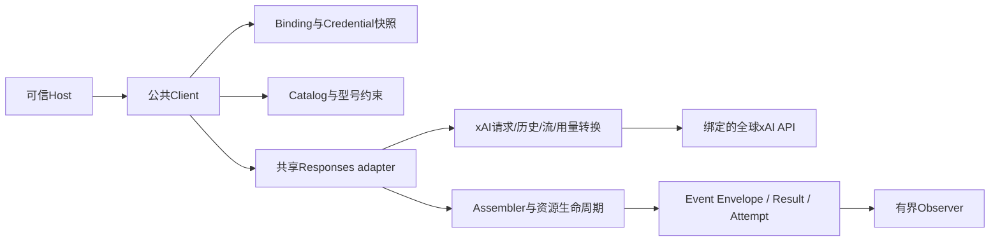

# barness-ai Grok Responses 详细设计

Status: ready-for-agent
Updated: 2026-10-26

交付契约见[spec](spec.md)，官方依据及其歧义见[research](research.md)，关键取舍见[ADR-0054](../../docs/adr/0054-barness-ai-xai-responses.md)。实现与验证的唯一当前状态维护在[spec](spec.md#唯一当前状态)。本文记录候选实现采用的设计；实施进度、真实资格和正式发布以该唯一当前状态为准。

## 1. 目标与确定的交付边界

首期身份固定为 `(chat, xai, openai-responses, grok-4.7)`，生产目标固定为全球 `https://api.x.ai/v1`，最终请求是 `POST /v1/responses`。提供文本、PNG/JPEG内嵌图片、推理摘要、加密推理续接、函数工具往返及准确的用量/估算状态。

不设计或实现Messages；也不接入Chat Completions、xAI自有协议、US endpoint、priority/fast/flex、其他型号或托管工具。对已知xAI身份的未实现组合做前置拒绝，防止误入原厂默认分支；这只是公共路由边界检查。

复用DeepSeek的架构取舍，而非复制其能力取值。DeepSeek不发送的store和encrypted include，在xAI上反而是必须明确处理的字段。当前已有多家Provider使用共享Responses adapter，继续采用内部配置与私有codec，不新增通用Provider插件框架。

## 2. 领域边界、责任与依赖

| 主体 | 负责 | 不向下层转移的责任 |
| --- | --- | --- |
| Host | Tenant/Actor认证、Binding授权、凭据与历史存储、工具执行、预算和业务重试 | 用户身份与工具副作用仍由Host担保 |
| Client/调用运行时 | 固定快照、选择Model/协议、准入、时限、归属、结果与观测 | 不拥有会话或Agent loop |
| Responses adapter | 一次生成轮次的SDK发送、SSE读取、协议终态 | 不自行选择其他目标或执行工具 |
| xAI私有转换 | 请求/历史/事件/用量的厂商事实和校验 | 不持有全局账户、Key或可变当前模型 |
| Catalog | 不含秘密的型号约束和固定价格快照 | 不表达调用者授权，不因发现型号自动允许调用 |

依赖方向为Host→公共Client→共享协议adapter→xAI私有转换；事件回到assembler→Result/Attempt/Observer。协议DTO、领域消息与Host持久化模型各自拥有数据，在边界独立校验和复制。

## 3. 当前源码基线与最小修改面

源码基线为`2f58c68d8fbb30a07e71b9666feed9979c791d01`。以下是已有接缝，具体新文件名由职责拆分决定，每个代码文件低于500行。

| 现有模块 | 设计变更 |
| --- | --- |
| [Binding/Provider](../../ai/binding.go)、[调用运行时](../../ai/call_runtime.go) | 新增ProviderXAI；已知xAI只允许本操作、协议、型号和目标，在凭据前收敛 |
| [协议注册](../../ai/adapter.go) | 继续复用responsesAdapter，不增加registry项 |
| [Responses profile](../../ai/responses_capabilities.go) | 明确xAI实现分支与自动字段配置，不能落OpenAI default |
| [构建/选项](../../ai/responses_request.go)、[选项编码](../../ai/responses_options.go) | system角色、独立预算规则、默认也请求密文、最终子集守卫 |
| [Responses流](../../ai/responses.go)、[原始流解码](../../ai/responses_stream.go) | xAI原始形状检查、整块/final-only工具、权威快照和用量接线 |
| [原生状态](../../ai/native.go)、[历史](../../ai/replay.go) | 复用信任判定；xAI工具ID codec及输入投影保护状态与关联 |
| [Usage](../../ai/usage.go)、[CostEstimate](../../ai/cost_estimate.go) | 字段形状不改；新增xAI私有换算并复用已有成本状态 |
| [Catalog](../../ai/catalog.go)、[目录校验](../../ai/catalog_validate.go) | 候选与正式激活分开；自带目录不得突破已实现子集 |
| 公共E2E与现有testkit | 增加本组合夹具及捕获回放，复用既有场景和证据基础设施 |

SDK继续使用现有OpenAI Go v3.66.0；标准库、现有JSON工具与JSON Schema依赖足够。请求服务按每次调用显式构建，SDK默认重试关闭，SDK构造器不得读取环境凭据。

本方案不改变Target、Binding、Credential、Request、Options、Result或四个聊天入口的签名，不新增公共价格、账单、ModelCompat或协议选项字段。CostEstimate已有语义扩展到xAI场景；只更新相关注释及消费说明，不保留Kimi专用的错误描述到xAI结果中。

## 4. 路由、目标及型号契约

### 4.1 精确服务身份

ProviderXAI值为`xai`；BindingID由Host命名，示例可用`grok-responses`。AccountScopeID表示实际xAI账户/项目别名，不能用Key或ProviderID代替。Key来自该Tenant的CredentialResolver，不接受请求中的endpoint、key或provider覆盖。

首期目标只允许规范化后的`https://api.x.ai/v1`，可接受一个末尾斜线；拒绝userinfo、query、fragment、非标准端口、US主机和其他目标。配置错误在读取秘密前失败。严格目标是为了绑定当前全球费率，不是宣布xAI不支持其他地址。

受控E2E仍使用同一公开Config.Transport接缝：Binding声明官方目标，测试RoundTripper只将测试流量导向已有本地HTTP/SSE服务并保留原始目标断言。核心没有localhost例外、测试开关或TrustedGateway新权限。生产Host可以显式注入受信transport，但测试transport不能成为正式live证据。

### 4.2 候选元数据

| 字段 | 本次候选值/规则 |
| --- | --- |
| ID / Name | grok-4.7 / Grok 4.7；不使用latest或自行添加日期后缀 |
| Operation / Provider / API | chat / xai / openai-responses |
| Input | text、image；图片仅JPEG/PNG |
| ContextWindow | 依据官方500k标签保守声明500000；是本次上限，不等于厂商精确硬上限或容量实测 |
| MaxTokens | 128000；主动收窄的支持上限并用于默认预算 |
| Reasoning / RequiresThinking | true / true |
| DefaultThinkingLevel | high；用于默认采样选择，不自动发送effort |
| ThinkingLevelMap | off/minimal/max=null；low/medium/high/xhigh=同名wire值 |
| 其他Compat | 不授予OpenAI缓存期限、strict:false或Anthropic扩展；中途system消息以完整历史原位表达 |
| 基础价格 | Input2、CacheRead0.5、Output6、CacheWrite0，USD/1M tokens |
| 长上下文价格 | P≥200000时Input4、CacheRead1、Output12；整请求替换基础价 |

官方没有为本报告提供可固定权重的日期快照ID；grok-4.7仍按厂商发布生命周期变化。Catalog版本、抓取日期、来源摘要及本次实际ResponseModel进入资格记录，不能声称已锁定模型权重。

Host可在既有自带Catalog中降低上下文/输出、移除图片、收窄非默认档位或显式提供自己的估算价格；必须保留high默认与有效映射、必需推理，以及不高于本次上限的能力。xAI其他型号、其他协议、伪造off映射或扩大输入类型在NewClient/Catalog.Hash配置边界拒绝。调用边界再次核对Binding，不能仅依赖目录构造检查。

候选与正式内置数据分离；候选存在不改变BuiltinCatalog。正式激活更新目录版本及内容哈希，只包含得到本组合证据的身份。旧目录不回写，价格变化另建快照。

## 5. 一次Logical Call的数据流

1. 复制Request、Options和可信Hooks所需快照；验证CallScope、输入结构与Host字节/图片限额。
2. Resolver取得Tenant/Actor获准的Binding；核对操作、xAI目标、协议、型号白名单、Catalog交集及本次子集。
3. Simple选项先执行现有映射；对Full结果、型号约束、工具/图片硬限制及能静态检查的sampling进行preflight。失败时CredentialResolver和HTTP均未调用。
4. 以目标tenant/account/provider/API/model处理Transcript和原生状态降级；不裁剪、不查询服务端历史。
5. 读取并固定Credential Snapshot，校对BindingVersion/账户；随后才确定Resolved归属和原生封套。
6. 构建单一Bearer认证头，执行header transform；校验保护头与xAI禁止的二次缓存会话头。
7. 构建私有请求DTO，按已有顺序应用型号采样、分档采样、调用sampling；OnPayload只执行一次。
8. 无论有无Hook都执行授权检查、xAI子集校验、精确数字/原生结构检查和最终请求字节限额；通过后冻结字节。
9. 每个获准初始Attempt单独取得Admission，SDK发出同一冻结请求；不重复运行payload回调。
10. HTTP成功后先运行OnResponse，再领域start；原始SSE验证后转换为assembler操作，逐Attempt固定usage和成本状态。
11. 终态、错误、取消或限额均经共享生命周期关闭正文、释放许可，返回唯一领域终态；Result与Observer各取独立快照。

最终守卫必须处理采样及Hook对控制字段的覆盖；只在构建前验证一次不满足合同。

## 6. Responses profile与请求DTO

### 6.1 能力取值

| 内部能力 | xAI首期值 | 请求行为 |
| --- | --- | --- |
| store | true | 必须显式store:false；这里的true代表可声明无状态，不代表允许存储 |
| encryptedReasoning | true | 默认与显式effort均include密文 |
| promptCacheKey | true | 满足SessionID条件才发派生键 |
| promptCacheRetention / sessionAffinity | false / false | 不发TTL与OpenAI会话亲和头 |
| reasoningSummary | false | 不发送摘要风格；仍接收4.7返回的摘要 |
| serviceTier | false | 不开放显式选项，保持厂商default |
| strictFunctionTools | false | 函数声明省略strict，保留厂商自身schema语义 |

不能仅开启encryptedReasoning而继续使用原编码器的“有显式effort才include”条件。xAI实现分支需要独立补足默认请求；也不能通过伪造summary:auto或effort来间接触发include。

### 6.2 最终顶层字段表

| 字段 | 允许形状 |
| --- | --- |
| model | 必须等于授权型号 |
| input | 完整、有序数组；按第8节投影，不能用字符串替换整个历史 |
| stream / store | 必须分别存在且严格为true/false |
| include | 必须为只含reasoning.encrypted_content的数组，不接受null、遗漏或额外项 |
| max_output_tokens | 必须为精确整数1..Host型号上限 |
| reasoning | 可省略；存在时仅含已支持的effort字符串 |
| temperature / top_p | 可省略；存在时必须在第7节的数值子集 |
| tools / tool_choice | 可省略；存在时按第9节 |
| parallel_tool_calls | 可省略或布尔 |
| prompt_cache_key | 当且仅当本次派生了键时存在且逐字相等 |
| text | 只允许显式默认文本格式，即format仅含type:text；不集成JSON输出 |

其余顶层字段均不集成，包括instructions、metadata、truncation、context_management、background、previous_response_id、conversation、prompt、文件、服务等级和logprobs。系统指令已经在input中，不新增第二个可被回调改写的指令来源。

授权检查复用已有规则：扩大型号/缓存/资源授权为tenant_denied。回调删除store:false、删除include、设置false stream或加入未集成字段属于破坏请求合同，按callback_failed；没有回调时同类错误来自调用/构建校验则为invalid_request或内部实现缺陷，不能发HTTP再等待忽略。

## 7. Full / Simple选项与数值语义

| 输入 | 行为 |
| --- | --- |
| Full ReasoningEffort省略 | reasoning省略，服务默认high；仍请求密文 |
| Full low/medium/high/xhigh | 校验型号收窄后发送同名wire值 |
| Full minimal/max或sampling中的off/none | 拒绝，不借Simple clamp修正Full非法值 |
| Simple Reasoning省略 | 保留默认；DefaultThinkingLevel只选择采样默认 |
| Simple minimal / max | 按现有clamp映射low / xhigh；支持档位保持 |
| Full MaxTokens省略/null | 发送Host型号上限；null不表示无限 |
| 显式MaxTokens | 1..上限，0/负数/分数/溢出拒绝；1和15不抬成16 |
| Simple MaxTokens | 先沿用上下文剩余量估算，再检查是否超出型号支持上限 |
| Temperature | 省略或有限数字[0,1]；null或>1拒绝 |
| Sampling top_p | 省略或有限数字(0,0.95]；null拒绝 |
| ReasoningSummary / ServiceTier | 任意显式值均拒绝，包括auto/default/null层级选项 |
| ThinkingBudgets / Simple Metadata | 维持现有Responses协议“不编码”的合同，不创造xAI预算/元数据字段 |

研究中记录厂商允许更宽temperature/top_p并静默cap；本设计主动只接受有效采样范围，避免回显值与执行语义分离。该范围收窄必须体现在Host说明和E04，不冒称厂商拒绝所有更宽值。

最终JSON数字检查使用数字原文及有界精确整数/范围校验，不先经float64截断token计数。普通非法Full选项在凭据前失败；Hook修改后的非法值在请求阶段失败。对模型默认sampling也检查，Host Catalog不能借分档默认绕过请求子集。

max_output_tokens不限制reasoning或function-call tokens；上下文估算也不是总消耗承诺。费用预留、组织级限制和业务取消属于Host；不新增本地“准确tokenizer”或在线计数请求。

## 8. Transcript、原生状态与输入投影

| 领域内容 | xAI输入 | 状态处理 |
| --- | --- | --- |
| SystemMessage | system message，保留原位顺序 | 不自动换developer，不通过instructions重复发送 |
| User Text | message/input_text | 保留文本，不做替换模板 |
| User Image | input_image + data URL | 严格内嵌JPEG/PNG，受实际解码大小及请求限额约束 |
| Assistant Text | assistant message/output_text | 同源真实item ID可保留；跨来源省略，无msg_pi合成ID或64字符截断 |
| Thinking且有可信Signature | 完整reasoning JSON item | 原样保留id、summary/content、encrypted_content及非资源附加字段 |
| 无原生条目的可见Thinking | assistant可见文本 | 不把文本伪造为可原生续接的reasoning item |
| ToolCall | function_call，真实call_id/name/arguments | 同源可信时保留真实item ID；降级后省略账户item状态 |
| ToolResult | function_call_output，按call_id关联 | 文本直接编码；图片见下文 |

完整reasoning以原始JSON语义保存，不能从SDK较窄结构重建并丢字段；密文字符串、part边界、顺序与数据类型不变，不要求无意义的空白/对象键顺序相等。未知附加字段保留不授予新工具类型或file_id/item_reference等资源引用。无法解释的原生形状明确失败，不能静默删除来获得成功。

同源完整assistant文本可由已有Text.Signature保存真实id及已知phase；只回放当前输入schema明确允许的字段，phase不自动添加。非工具内容的annotations、logprobs和SDK包装不成为新公共状态。消息投影不修改原始Result。

只有Native State Envelope匹配同tenant/account/provider/API/model且经Host担保时才原生回放。JSON持久化读回必须TrustNativeState；无担保、跨账户或跨型号沿既有规则降级。降级丢密文与账户item引用，保留可见推理为文本，并同步重写工具调用/结果。凭据版本轮换不使同账户历史失效。

工具结果图片沿既有Responses自含历史形状处理：function_call_output只承载该结果文本及图片提示，紧接一个user消息承载该结果的内嵌图片；多个结果不重排，绝不把另一调用的图片合并到一起。此投影属于明确候选转换，正式资格必须取得真实图片工具往返；若xAI拒绝，保留失败证据，更新设计与失败E2E后再实现有来源的替代，不直接静默丢图。

图片验证包括严格base64、声明MIME与真实PNG/JPEG一致、单图不超过20×1024×1024 bytes，以及Host更低MaxImageBytes/完整请求限额。大图只为验证输入头不分配整幅解码像素；使用现有图片依赖及流式/有限读取能力。图片不能因Model收窄为text而被最终Hook偷偷加入。

## 9. 函数工具、schema与ID

### 9.1 首期函数合同

tools仅允许type:function及name/description/parameters，最大350；parameters根为object schema。350是文档冲突下的交付上限，不宣布1000无效。既有公共Tool校验继续验证声明与参数schema，不引入第二个通用JSON Schema实现，不强制改写required/additionalProperties或自动补充strict:false。

tool_choice省略/auto/none/required；null、具名对象和allowed-tools拒绝。required且无工具在前置阶段失败；正常completed时required至少有一个合法函数调用，none不能出现函数调用。parallel_tool_calls为false时正常完整输出不能包含多个并行函数调用。length、refusal、上游失败不伪造成满足required。

最终函数arguments必须为完整JSON object；来自partial的显示修复结果只用于PartialView，不能替代最终参数。Host仍可调用既有ValidateToolCall按业务schema检查后再执行；库不自动运行工具，也不把“厂商隐式strict”当本地验证证明。

即使Binding.AllowedHostedTools列出了某项，xAI首期能力仍不放行；先授权后能力校验。schema/参数中的业务属性file_id、store等不受顶层字段黑名单误伤。其他类型输出如web_search_call或MCP不能被忽略后返回假完整历史，必须明确protocol失败。

### 9.2 Opaque ID表示

本地ToolCall.ID采用`xar1|`加base64url无填充的JSON二元组`[call_id,item_id]`。它是本地表示，绝不直接作为厂商call_id发送。call_id必须非空，item_id可为空；不以工具名、fc_前缀、固定长度或未转义的分隔符推导任何一部分。

解码严格检查版本、base64、数组长度和字符串类型；同源结果中畸形本地ID视为无效输入，不截断或降级为{}。同源但不可信时，保留解码出的调用关联并去掉item ID；来自其他Provider/API的历史将整个旧ID作为关联源，不解释其分隔符，确定性产生本目标的调用标识，并对调用/结果使用同一映射。不同源ID映射冲突必须在发送前检测。

一轮生成中重复call_id、不同item复用call_id、工具结果找不到对应调用或同一调用被矛盾回答均明确失败；完全相同的流item快照重发不产生第二个ToolCall。

现有MiniMax/Kimi也使用版本化opaque pair；本次复用其语义与标准库实现方式，协议来源校验和版本前缀由xAI私有codec拥有。若实现保留小段重复，注释说明它为各Provider独立持久化合同演进，不能调用另一厂商的decoder充当兼容层；不为本功能重构既有已保存ID。

## 10. SSE解析与状态约束

### 10.1 原始检查与状态

继续使用SDK HTTP与原始SSE decoder。xAI分支先校验原始JSON形状、事件类型、精确索引和关联，再交既有typed转换；不通过修改transport把厂商事件“修成”OpenAI，原始reasoning由原文保留。状态均属于单次调用并受字节限额限制。

| 状态 | 可接受事件 | 转换/拒绝 |
| --- | --- | --- |
| 尚无内容 | created/in_progress、item added/done、合法delta、终态 | 可支持缺created的final-only；不能猜delta所属item |
| 内容进行中 | 已关联item的part/delta/done、其他item、终态 | 按output_index及part索引独立合并 |
| 已有终态 | 相同终态重发、[DONE]、EOF | 相同快照幂等；新增内容或冲突终态为protocol |
| 任意未终态 | EOF或只有[DONE] | protocol；保留已收可见内容，不报成功 |
| 任意状态 | error/取消/限额 | 相应失败；完成共享释放与唯一终态 |

不要求所有可选中间事件都出现：item.done或终态output可以一次给出完整文本、reasoning或function_call。孤立delta若没有可证明的item/索引归属则失败，不能放到“当前块”。

### 10.2 内容与权威快照

1. output_index映射item；同index出现不同type/id，或同item id挪到冲突index时失败。消息part与reasoning part各保留边界。
2. delta只增加未完成部分；对应text/arguments done给出完整值时校验已收前缀，补齐剩余内容。重复done相同则不重复emit。
3. item.done完成领域块；终态output按数组索引检查或补建未出现的item，已完成的文本/参数不得改变。terminal可回填此前缺失的密文，已有非空密文若冲突则失败。
4. 不因为先收到item.done就丢弃整块arguments；工具完成只在完整object验证之后交付。
5. 最终only-output仍必须发出完整的领域start/block/end/terminal生命周期；Complete与Stream最终Result一致。

reasoning_text和reasoning_summary_text按同一item/逻辑part分别跟踪，不能简单都拼入同一Thinking。首个有效通道驱动增量，另一个通道仅校验；同一内容重复表达只交付一次。终态的summary/content给出权威可见内容，必须与已交付部分一致。若两个通道为同part表达不同内容且无法用权威part结构解释，明确protocol失败并保留捕获，不静默丢弃一条或按字符串包含关系猜测去重。此为本模块的安全合并合同，双通道真实行为仍属资格核实项。

### 10.3 终态映射

| 原始终态 | 领域结果 |
| --- | --- |
| completed，无工具 | stop |
| completed，有合法函数调用 | toolUse；同时核对tool_choice约束 |
| incomplete，max_output_tokens | length；保留全部已确认内容和reported usage，不强制补出工具 |
| incomplete，其他原因/content_filter | 按既有upstream_error合同结束，保留RawStopReason |
| failed / error | upstream_error；HTTP200仍为失败 |
| 不一致status、矛盾输出、未知会改变结果的item | protocol |

保持现有Responses失败usage合同：response.failed不借本次恢复旧路径已明确舍弃的消息usage；其Attempt仍按既有unreported规则，不把失败正文数字冒充已采纳费用。合法incomplete保留已报告用量；EOF/取消前没有终态usage就是unreported，不能推算零消费。更改失败计费合同须另立范围。

## 11. 用量：从歧义到确定的转换规则

### 11.1 定义与设计依据

P=input_tokens，O=wire output_tokens，R=reasoning_tokens，C=cached_tokens，T=total_tokens，B=规范的全部输出。研究中的官方示例P32/O9/R110/T151与OpenAI包含关系不同；本设计不预先固定“所有xAI都外加R”，而要求**同一报告内部的总量等式成立**。

仅函数工具、无托管资源的本次子集中，完整总量合同为T=P+B。实现规则由本模块选择，并须用非零reasoning的真实捕获确认。出现第三种无法解释的总量不临时放宽公式，应保留失败、重新核实来源。

### 11.2 数字与presence

每项区分missing/null与合法0；只接受有界精确非负整数，布尔、字符串、分数、负数、超int64和恶意指数明确失败。加减和费用均检查溢出/有限性。若C与P均存在则C≤P；已知正cache_write_tokens或额外收费类别超出本次已实现语义，protocol失败，不能套Anthropic写价。

| 报告形状 | 转换 |
| --- | --- |
| P/T完整且T≥P | B=T−P；Usage.Output=B，TotalTokens=T |
| O/R亦完整 | 只接受B=O且R≤B，或B=O+R；R=0时两式重合，结果相同 |
| 仅O已知而R缺失 | O必须≤B，不推造R；总输出仍使用B |
| R完整 | 必须R≤B；Reasoning=显式R，已含于Output |
| C完整 | CacheRead=C，Input=P−C，CacheWrite=0 |
| C缺失/null但P已知 | 兼容数字CacheRead暂为0、Input暂为P；Reporting=partial，不能宣称C观测为0，成本按区间 |
| O或R缺失而P/T已知 | 保留可推导B；未知R保持Nullable未设置；Reporting=partial，不虚构推理计数 |
| P或T缺失 | 仅保留已知字段；Output取已知O/R共同给出的不高估下限，Reporting=partial、CostEstimate=partial；不将请求预算代入 |
| 整体usage缺失/null或无任何计数字段 | UsageUnreported及CostUnreported |
| 数字存在但关系矛盾 | protocol，不用max(0,…)掩盖 |

“Output不高估下限”在总量不能确定时具体为max(已知O,已知R)，缺项仅在兼容数字中取0；不代表确认R已经计入O。此时不得把Usage.Cost当成完整金额。T存在时保留原值，但只在完整P/T时承诺规范输入/输出的可核对分区。

UsageComplete要求P/O/R/C/T均明确报告且关系合法；缺任一必要计数即partial。合法全零是complete零用量，不等同没有报告。用量完整性与CostEstimate独立：即使R缺失，P/T/C足以定价时成本仍可resolved。

例如P32、C8、O9、R110、T151→Input24、CacheRead8、Output119、Reasoning110、Total151；同一输出若wire O119/R110/T151，则规范结果相同，R不会加两次。这是设计验算，不是宣称两种shape均已真实出现。

## 12. 成本、阈值与不确定性

### 12.1 固定快照

先按P选择整请求价，再对规范Input、CacheRead、Output计价。P包含缓存，不能用P−C判断长上下文。复用现有ModelCost.Tiers时，因InputTokensAbove为严格大于，≥200000应编码为InputTokensAbove=199999；不新增公共比较符字段。

| P | 标准输入价 | 缓存输入价 | 输出价 | 规则 |
| --- | ---: | ---: | ---: | --- |
| 0..199999 | 2 | 0.5 | 6 | USD/1M |
| ≥200000 | 4 | 1 | 12 | 所有输入、缓存及输出都用该档 |

P/T/C完整时，CostEstimate=resolved，Minimum=Maximum=固定快照估算；Usage.Cost取此金额。P/T完整而C缺失时，允许C∈[0,P]，分别计算全部非缓存/全部缓存两种端点场景，在该P选中的同一档价格上取最小/最大；CostEstimate=bounded，Usage.Cost为下界，计数组仍保持“未知C”的partial。Host预算消费Maximum，不能把构造费用场景当缓存观测。

P或T不足以确定全部输出时CostEstimate=partial，Minimum/Maximum均不设置，只保留已知部分估算；未报告计数为unreported。零费率或端点费用相等可收敛resolved，但不能因此升级UsageReporting。

### 12.2 可重复验算

| 输入条件 | 预期USD估算 |
| --- | ---: |
| P32/C8/B119 | 0.000766 |
| P32/C未知/B119 | [0.000730,0.000778] |
| P199999/C0/B1000 | 0.405998 |
| P200000/C0/B1000 | 0.812000 |
| P200001/C0/B1000 | 0.812004 |

实际响应service_tier缺失或default沿默认价；返回priority/fast等未实现等级时保留失败内容及已知计数，成本标partial并protocol失败，不能套OpenAI倍率。US endpoint在凭据前拒绝，因此不会套用全球价格；不按endpoint猜测给同一目录动态乘价。

cost_in_usd_ticks与cost_in_nano_usd不进入首期公共模型或计算，不互相转换来覆盖估算。脱敏资格原件可保留厂商费用作对照，明确ticks的10^10与nano的10^9单位；差额用于核实，不回写旧目录。单个Attempt保存自身报告，Result的Usage不跨重试累加。

## 13. 缓存、回调和隐私语义

沿用现有cacheScope：tenant/provider/account/session派生稳定哈希，凭据轮换不变、跨租户/账户/Provider不同；不增加协议维度或改变旧Provider键格式。只有有SessionID且CacheRetention不为none才派生prompt_cache_key。short/long行为相同，不发送TTL/retention；none只是省略路由提示，无法关闭厂商自动缓存。

不自动发送session_id、x-client-request-id或x-grok-conv-id。后者可替代body缓存路由，xAI header transform若补入它则拒绝，防止绕过既有派生键合同；不把所有自定义诊断header一律当缓存字段。缓存miss、驱逐及无命中不重试、不改变调用成功性。

最终Hook授权仍以Host信任边界为准，不建立新的进程内密封、消息指纹或正文比较系统；原生回放的担保来自Native State Envelope。Hook不能新增未担保的服务端资源引用；不能因state来自一个普通JSON字符串就获得信任。回调产生的JSON必须唯一可解码，控制字段重复键拒绝，避免校验器与SDK解释不同。

store:false只关闭可续接会话资源存储，不承诺团队级ZDR；模块不管理团队设置。响应回调可读取厂商ZDR标识作Host策略判断，但其值不授予协议、账户或历史权限。默认观测和错误不保存正文、密文或Key。

## 14. 故障、资源与可观测性

既有Code/Phase优先，不新增Grok错误枚举。HTTP状态沿现有分类，未知业务码只保留安全诊断分类，避免返回厂商完整echo文本。请求ID头在获得本组合来源/真实确认前保持未验证；缺失不生成假的厂商ID。HTTPStatus在已收到响应时保留，包括流内失败。

使用已有ResourcePolicy/Admission/Observer，重试固定同一Binding、Key、目标、预算、编码字节及callback结果。默认0重试；仅初始请求按显式策略，流开始后不重放。取消、deadline、body关闭、permit释放、唯一终态均复用现有所有者，不新增xAI后台goroutine或第二套队列。

密文与完整终态可能显著大于可见回答；MaxFrameBytes必须由Host设计负载容纳最大终态，MaxOutputBytes计入全部重复帧、密文和工具参数。超过限制明确resource_limit，不以隐藏/截断原生状态维持成功。顺序合并不能在每个delta重新扫描整份工具JSON，保留已有有界增量/按需显示解析，避免二次复杂度。

既有ResponseModel可保留实际厂商型号，requested Model保持授权身份。不同actual model不自动改目录或续接封套；只接受已由本次型号来源说明的等价标识，其他型号/变化为protocol，先修正来源后扩展。Observer继续只消费元数据，用量/CostEstimate必须在其快照发布前同步固定。

## 15. 验收设计：同一个公共接缝

用户已确认公共Client E2E。通过现有Resolver、Transport和Hooks注入边界；观察最终HTTP字节、事件顺序、Result、Usage/CostEstimate、Observer及探针资源计数，不直接测试内部helper。Catalog的NewClient/Hash/查询是额外必要的公开配置边界，不增加新测试接口。

完整验收组E01–E18及需求映射以[spec](spec.md#testing-decisions)为准。实现前先为本需求列失败，再写公共失败场景；普通运行只读取合成或已脱敏夹具，不隐式启动厂商、race或压力。

| 先失败的重点 | 外部断言 |
| --- | --- |
| 删除store/include或写入另一缓存头 | 凭据后/HTTP前明确拒绝，0 provider请求，错误类别符合来源 |
| 型号、协议、endpoint或Full选项非法 | CredentialResolver未读秘密，0 HTTP，归属未伪造为Resolved |
| 仅final tool/终态密文 | 完整Result和下一轮正确请求，工具参数/状态不丢 |
| 双摘要与重复快照 | 相同内容只一次；矛盾内容失败，已交付块不被静默改写 |
| ID含分隔符/Unicode/超64字符 | 原值可逆，多个工具结果一一配对，跨来源无碰撞 |
| 两种usage等式/缺字段 | 规范输出相同、Reasoning只计一次、partial与cost状态独立 |
| 恰好200000且缓存占大部分 | 使用长上下文整档，阈值不按uncached数或严格>200000 |
| 取消/限额/重试中的并发租户 | 目标Key和版本固定，正文/许可/队列释放，旧Provider隔离 |

证据复用现有原生manifest/audit格式，包含有限case ID、受控请求/响应脚本、事件、Result、断言、来源及实际命令和退出；可重复回放并通过脱敏审计。纯文档核对不生成假的程序PASS。

## 16. 实施顺序、资格与回滚

| 阶段 | 交付与依赖 | 验证/停止条件 |
| --- | --- | --- |
| A 基础 | 身份、候选、静态约束、首批前置失败E2E | E01/E02/E04；正式目录保持未激活 |
| B 请求与历史 | profile、最终guard、完整Transcript、图片、native与ID | E03/E07/E08/E09；先red后green |
| C 生成结果 | SSE关联、整块/final-only、工具合同、用量与成本 | E05/E06/E10/E11/E12；合成示例与捕获来源分开 |
| D 运行集成 | Host装配、缓存、错误、并发、回滚、旧路线回归 | E13–E16/E18及完整受影响普通包，来源冻结 |
| E 自身live | 本路线有限场景及脱敏捕获回放 | E17：取得范围/模型/账户/预算的本次明确授权后才运行 |
| F 正式晋升 | 独立价格/型号资格、正式目录、当前来源、人工race/压力及只读判定 | 按SOP满足所有适用条件；缺阶段不报发布通过 |

live必须覆盖四入口文本、low/medium/high/xhigh及默认行为、非零reasoning算术、密文完整续接、auto/none/required工具、并行配对、用户图片与工具结果图片、缓存与usage完整性。缓存未命中不是厂商故障，不靠无界重复“刷出命中”；可用合法0报告确认无命中形状，非零命中另有明确有界场景/来源。大上下文的真实容量/价格边界不强制购买20万token负载：普通E2E以真实schema验证阈值，正式价来源固定；若另做真实长上下文场景，单独列预算并授权。

本次设计不发放live、race、压力授权。实施造成共享源码变化时，按影响列所有受影响自身路线，不因共享adapter曾经通过就免除新证据；没有影响的项目给出依据。先live，再人工选择race，再人工选择适用压力，失败保留原件并停在当前阶段，不自动扩大或重买场景。

回滚首选禁用/更新xAI Binding与停止正式激活；新调用拒绝，固定调用按原快照完成或由Host取消。保留已生成消息、Native State Envelope、价格快照、失败及资格原件。代码回退时不新增旧内部实现shim，不把xAI历史自动改投DeepSeek/OpenAI；本次没有数据库迁移。

## 17. 设计就绪、待证事实与交付核对

当前已确定的设计包括唯一目标、候选上限、请求字段、选项、状态合并、ID编码、原生来源、用量算法、价格阈值、成本不确定性、测试接缝和晋升顺序。它们是实现者应遵守的合同，不是自由发挥项。

待真实证据关闭的是厂商流的实际形状、双摘要是否同时出现、非零reasoning实际计数关系、图片工具结果投影、真实request-ID头及实际返回model标识。上述事实均有明确E2E与live场景；没有证据时不宣称已确认，也不影响编写失败测试和候选实现。与设计不符须保留捕获、更新来源与失败用例后改进方案，不静默放宽守卫。

本文沿用[ADR-0001](../../docs/adr/0001-barness-ai-protocol-boundary.md)、[ADR-0005](../../docs/adr/0005-barness-ai-payload-hosted-tools.md)、[ADR-0010](../../docs/adr/0010-barness-ai-usage-reporting-and-price-snapshot.md)、[ADR-0014](../../docs/adr/0014-barness-ai-deepseek-responses.md)、[ADR-0018](../../docs/adr/0018-barness-ai-catalog-inclusion-criterion.md)、[ADR-0032](../../docs/adr/0032-barness-ai-provider-automatic-fields.md)、[ADR-0052](../../docs/adr/0052-barness-ai-kimi-cost-estimates.md)和[当前测试SOP](../../docs/agents/verification.md)。xAI新转换不取代旧Provider的语义；ADR-0054记录本路线已采用的取舍，accepted不授予真实资格或正式支持。
