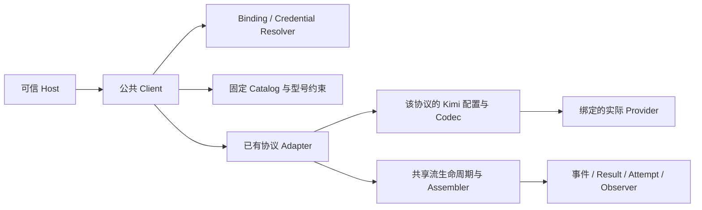

# barness-ai Kimi 接入设计

Status: ready-for-agent
Updated: 2026-10-22

交付契约见 [spec](spec.md)，官方事实见 [research](research.md)。本文定义实施方案；本功能的实现、验证和发布状态只维护在 [spec 当前状态](spec.md#唯一当前状态)。下文的规划交付检查保留实施前的历史事实，不代表当前程序验收或型号资格。

## 1. 目标、取舍与设计依据

复用 DeepSeek 的 Provider/API 分离、协议 adapter 复用、按 Provider 决定自动字段及协议独立目录结构。Kimi 的三种请求、响应和原生历史形状由各协议内部拥有，公共 Client 继续提供已有四种聊天入口，不让 Host 手工修补 wire。

沿用 [GLOSSARY](../../GLOSSARY.md)、[ADR-0001](../../docs/adr/0001-barness-ai-protocol-boundary.md)、[ADR-0014](../../docs/adr/0014-barness-ai-deepseek-responses.md)、[ADR-0015](../../docs/adr/0015-barness-ai-deepseek-chat-completions.md)、[ADR-0032](../../docs/adr/0032-barness-ai-provider-automatic-fields.md) 和 [ADR-0049](../../docs/adr/0049-barness-ai-regional-provider-identities.md)。Kimi 不照搬 DeepSeek 的 thinking toggle、max_tokens 或缓存形状。验证采用 [ADR-0051](../../docs/adr/0051-scoped-verification-receipts.md)，不恢复历史差分门禁。

选择首批 text-only K3 与 131072 输出支持上限，以便在现有 Model 接口内准确表达默认行为。百万 token 输出、图片及 K2.x 都是后续独立扩展；不得把接入收窄写成厂商缺少这些能力。

Chat 缓存 TTL 无法从当前响应证明，是一个真实的计价信息缺口。选择在 Attempt 上补充小型、可选的成本区间元数据，保持调用可用并暴露不确定性。拒绝每个自动写入的 Chat 调用会使该协议不可用；只猜 5m 则会误导成本消费者。取舍记录于 [ADR-0052](../../docs/adr/0052-barness-ai-kimi-cost-estimates.md)。

## 2. 独立服务身份与六条路线

| 服务 | 常量 | ProviderID |
| --- | --- | --- |
| Kimi 国际站 | `ProviderMoonshot` | `moonshot` |
| Kimi 中国站 | `ProviderMoonshotCN` | `moonshot-cn` |

`ModelID=kimi-k3`、`Operation=chat`。完整身份仍是 `(Operation, Provider, API, ID)`，不增加 Site、品牌别名或型号地区后缀。

| Route ID | API | Binding.Endpoint | 最终 POST URL |
| --- | --- | --- | --- |
| `kimi-cn-chat` | `openai-completions` | `https://api.moonshot.cn/v1` | `https://api.moonshot.cn/v1/chat/completions` |
| `kimi-cn-responses` | `openai-responses` | `https://api.moonshot.cn/v1` | `https://api.moonshot.cn/v1/responses` |
| `kimi-cn-messages` | `anthropic-messages` | `https://api.moonshot.cn/anthropic` | `https://api.moonshot.cn/anthropic/v1/messages` |
| `kimi-intl-chat` | `openai-completions` | `https://api.moonshot.ai/v1` | `https://api.moonshot.ai/v1/chat/completions` |
| `kimi-intl-responses` | `openai-responses` | `https://api.moonshot.ai/v1` | `https://api.moonshot.ai/v1/responses` |
| `kimi-intl-messages` | `anthropic-messages` | `https://api.moonshot.ai/anthropic` | `https://api.moonshot.ai/anthropic/v1/messages` |

Route ID 是测试/文档标识，BindingID 在租户内由 Host 配置。两站均显式选择协议配置，即便当前字段相同也不把实际 Provider 归一化。两站 endpoint 来自[各自官方概述](research.md#21-六条生成路线)，不是账户或物理数据驻留位置的证明。

## 3. 模块职责、接口与依赖

| Module / 现有落点 | Interface 与职责 | 本次变更 |
| --- | --- | --- |
| [Provider 与 Binding](../../ai/binding.go) | 可信配置固定目标与授权 | 两个常量；不新增 Binding/Credential 字段 |
| [Client registry](../../ai/adapter.go)、[调用流程](../../ai/call.go) | 通过已有协议接口驱动一次调用 | 保留 registry；接入 Kimi preflight/final 校验和成本元数据更新 |
| [Chat profile](../../ai/chat_compat.go) | 决定 Chat 的自动字段和实现 | 增加 Kimi 分支，缓存 key/TTL 独立于 OpenAI endpoint 判断 |
| [Responses profile](../../ai/responses_capabilities.go) | 决定额外服务能力和 codec | 增加 Kimi 分支；summary 接收不等于 summary 请求能力 |
| [Messages profile](../../ai/anthropic_capabilities.go) | 决定 Messages 形状与扩展 | Kimi 选择稳定资源、Bearer、独立 effort 和顶层缓存 |
| 协议私有 Kimi codec/guard | DTO 与领域模型各自转换，校验最终形状 | 按请求、流/终态、历史、用量/成本职责拆分；不增加公共驱动接口 |
| [目录](../../ai/catalog_models.go)、[快照](../../ai/catalog_snapshot.go) | 不含凭据的独立型号与价格数据 | 六个候选字面记录；正式纳入另有自身证据 |
| [Attempt](../../ai/retry.go)、[Usage](../../ai/usage.go) | 记录每个 HTTP Attempt 的报告与估算 | 增加可选成本区间；不修改其他 Provider 的计价逻辑 |
| [Native State](../../ai/native.go)、[历史处理](../../ai/replay.go) | 核对真实来源并选择原生/安全降级 | Kimi unsigned Messages thinking 同样作为需担保的原生块 |
| Host 示例 | 校对服务、账户、用途、协议，再读取秘密 | 新增 `kimihost` 标准 API 装配；参考已有地区示例而不合并品牌策略 |
| E2E / 证据模块 | 通过公共 Client 保留外部行为与资格 | 新增 Kimi 自身夹具/候选/有限 live/只读消费；复用既有基础设施 |

协议配置不持有租户、Key、账户、缓冲区或“当前 Provider”。Catalog 不依赖 wire DTO；codec 不访问 Host 秘密存储；Observer 不参与调用成败。新增依赖前核对现有 Go 模块，本方案不需要额外 SDK。

新代码建议按 `chat_kimi_*`、`responses_kimi_*`、`anthropic_kimi_*` 及共同 `kimi_*` 事实命名；共同部分只限两种以上真实路径已有相同业务语义的事实。每文件低于 500 行，不通过统一大 switch 汇聚三种协议生命周期。

## 4. 公共契约与目录

### 4.1 保留的调用接口

Target、Binding、Credential、Request、四种聊天入口及 WithHooks 不改签名。调用者通过 BindingID 与 ModelID 选目标；API 和 Provider 来自已授权 Binding，不接受请求自报身份。

新增公共成本信息仅位于 `Attempt.CostEstimate`，为可省略的值类型。Message.Usage 及现有费用数字的字段形状保持；旧 Provider 不设置新字段。新增公共结构字段会影响位置式 struct literal，迁移这类内部/示例调用者，不增加旧类型 shim。

### 4.2 六份候选元数据

| 属性 | 首批值/规则 |
| --- | --- |
| Input | `[text]`；已有图片占位处理维持文本型号合同，不开启远端资源 |
| ContextWindow | 1048576；文档值，非本次容量实测结果 |
| MaxTokens | 131072；本功能支持上限，同时作为已有 Simple/Messages 默认预算 |
| Reasoning / DefaultThinkingLevel | true / max |
| ThinkingLevelMap | off/minimal/medium/xhigh 为 null；low/high/max 映射同名字符串 |
| Compat | 仅保留该协议需要的硬约束；本子集不支持关闭推理、长缓存可按 Host 收窄 |
| Cost | 本站 USD 估算费率；来源保留原币与 FX，不能从兄弟站/协议运行时派生 |

`RequiresThinking` 在 Chat/Responses 表达公开 K3 约束；Messages 表达本子集不承诺关闭，不用它替厂商消除文档冲突。不得设置 ForceAdaptiveThinking、SupportsMidConvoEffort 或旧 ExplicitPromptCacheMode 来走捷径。

默认 Full Chat/Responses 可省略输出字段，保留服务端 131072 默认；Messages 必填预算由本地目录提供。显式预算必须为整数 1..min(Host 型号上限,131072)，0、负数、非整数、溢出或超限拒绝。Simple 仍按已有上下文算法收窄，不新增网络 token-count 请求。

Kimi 自定义 Catalog 同样受这份已实现子集限制：型号只能为 K3，输入/上限不可扩大，能力不能高于 Provider profile。元数据不合法在构造/Hash 处拒绝；完整身份、选项与权限在调用 preflight 再核对。其他未知自定义 Provider 的既有默认行为不全局收紧。

已知 Kimi Provider 只允许上述三个 chat API，不因通用 registry 存在而获得 Gemini 或其他操作授权。Host 不能把 Reasoning 改为 false、恢复 off 映射，或把保留档位映射为未支持 wire 值；可将 low/high 收窄为 null，但本子集保留默认 max 及其同名映射。构造边界检查这些静态事实，调用边界拒绝不匹配的 Binding，均在秘密读取前完成。

候选数据在两个地区、三个 API 各保留独立记录，注明重复是为独立演进。币种、价格或约束变化更换 Catalog.Version/Hash；读取与调用各边界深复制，不能由 Host 后续修改 map/slice 改变当前调用。

## 5. 请求 Profile、选项与执行顺序

### 5.1 明确的首批能力表

| 项目 | Chat | Responses | Messages |
| --- | --- | --- | --- |
| 认证 | Bearer | Bearer | Bearer，省略 x-api-key |
| 资源 | 已有 Chat service | 已有 Responses service | 稳定 MessageService；无 `beta=true` |
| 输出字段 | max_completion_tokens | max_output_tokens | max_tokens 必填 |
| effort | reasoning_effort | reasoning.effort | output_config.effort |
| effort 值 | low/high/max；省略为 max | 同左 | 同左 |
| 工具选择 | 省略/auto/none/required | 省略/auto | 省略/auto/any/none |
| 函数工具 | function 包装 | 平铺 function | input_schema / tool_use |
| 缓存键 | 有 SessionID 时派生 | 有 SessionID 时派生 | 无会话头/缓存键 |
| TTL 控制 | prompt_cache_options | prompt_cache_options | 顶层 cache_control |
| 自动扩展 | include_usage=true | 无 include/encrypted/store/tier | 无原厂 beta/browser/adaptive/budget/display |

当前 [Chat 缓存判断](../../ai/chat_options.go) 含 OpenAI host/long-retention 条件，不能仅将 promptCache=true 就认为 Kimi short 已能派生键；增加协议内 Kimi 路径，保留旧 Provider 的判断。

### 5.2 选项规则

- Simple minimal→low、medium→high、xhigh→max；已支持的 low/high/max 保持；空值表示未选，最终默认仍为 max。`off` 从来不是公开 ThinkingLevel 输入，不能复用内部 clamp 结果表示禁用。
- Full Chat/Responses ReasoningEffort 和 Messages Effort 只接受 low/high/max；明确未支持值在凭据读取前拒绝。最终 sampling/hook 的 wire 值再校验，不以模型映射帮它纠正非法输入。
- Messages Simple 直接把 clamp 后的档位写入 Effort，不生成 adaptive/预算。Simple ThinkingBudgets 延续仅用于预算协议的语义，不为 Kimi 生成预算；Full 的预算/display/interleaved/ThinkingEnabled 显式请求则拒绝，包括“先 enabled 再转换 effort”的形状。
- Chat 显式 temperature 只接受 1；可接受的固定 sampling 值为 top_p=.95、n=1、presence/frequency penalty=0，省略不自动补齐。Responses/Messages 首批不接纳显式 temperature 或这些 sampling 字段；不是所有协议共用 Chat 的固定参数表。
- 不支持的工具选择、null/畸形 wire choice、具名选择、allowed-tools、结构化输出/strict=true、托管工具在发送前拒绝；required/any 必须存在声明的函数工具。
- cache none 不支持；默认/short=5m，long=1h。型号已收窄 long 时拒绝，不静默改 short。Messages 的 cache 控制只在顶层有效，不输出块内标记。

### 5.3 调用数据流与校验顺序

1. 复制请求、options、Hooks 所需快照，建立 CallScope；输入结构/字节检查失败不解析秘密。
2. Resolver 校对 Tenant/Actor 的 Binding；检查 Operation、Provider/API/型号目录交集与 Kimi 子集。
3. Simple 映射后进行协议、型号和命名选项 preflight；非法条件到此失败，CredentialResolver 尚未调用。
4. 使用目标真实身份处理历史，计算封套降级；读取凭据并核对配置/账户版本，固定本次 Logical Call。
5. Adapter 构建自身 DTO 和单一认证头；TransformHeaders 仍受 guardedHeaders 限制，不能补第二套凭据。
6. 应用模型采样、分档采样、调用 sampling，再运行 OnPayload；授权校验先于 Kimi 能力/格式校验，最终 guard 即使无 hook 也必跑。
7. 校验最后预算、字段、历史、工具、缓存选项及请求字节；通过后才 Admission/HTTP。重试发送同一已固定请求，不重复运行 OnPayload。
8. SSE → 协议 decoder/校验 → assembler；按合法已报告数据更新 Attempt usage 与成本元数据，再向 Result/Observer 提供各自快照。
9. 终态或错误时关闭正文、释放许可/队列/上下文；一次逻辑调用仅一个终态，不在流中故障后续写或切站。

最终 guard 使用有界解码及数字原文，避免先转 float64 再判断整数预算。允许字段以本功能构建的 DTO 和上文显式扩展为准；Kimi 不因通用 SamplingParams/HostedToolAllowance 而自动开放整份厂商 API。

强制工具选择还要在正常完整终态核对至少一个实际函数调用；required/any 返回无工具的普通 stop/end_turn 为 protocol，不悄悄接受约束失效。length、refusal 或上游失败沿各自既有终态合同处理，不虚构工具。工具终态与实际调用矛盾、重复且无法配对的 ID 也不得作为正常成功交付。

## 6. 三协议的具体接线

### 6.1 Chat Completions

在 [chat_request](../../ai/chat_request.go) 的现有构建流程选择 Kimi profile：system 角色、max_completion_tokens、stream_options.include_usage，省略 store/thinking/developer 和 OpenAI retention。函数 strict 首批省略；显式 false 可按 schema 接受，true 属于未交付的约束采样能力。

沿用 `reasoning_content`、content、tool_calls 增量解析和按 index/ID 合并工具参数。finish_reason 是生成终态信息，不能在它出现时停止读取 usage；同时支持 finish chunk 和独立空 choices chunk 携带用量。现有 [chat_usage](../../ai/chat_usage.go) 已能读 nested cache_write_tokens 与旧 cached_tokens，复用数字转换，再增加 Kimi presence/约束校验。

同源回放保留真实 reasoning_content（空则保持真实空/缺失，不造推理正文）及完整工具调用/结果。默认不丢跨轮保留推理，不通过合并可见回答重建厂商字段。跨来源走共享原生降级后再按 Kimi 输入编码。

### 6.2 Responses

Kimi capabilities 只启用本次实现的 cache key/TTL 与函数工具子集；请求 summary、encrypted include、store/service tier/retention/affinity 均关闭。不要启用现有 SupportsExplicitPromptCacheMode：当前 encoder 的 explicit/30m 不符合 Kimi implicit/5m/1h。

在 [responses](../../ai/responses.go) 的事件流程处理 summary_text delta/done、item/content、工具参数及 completed/incomplete/failed/error。summary 输出和终态条目保留为原始 native 内容；不因为 encrypted_content=null 把合法 reasoning 当空，也不凭 null 推导加密能力。

历史输入使用专用投影：system 指令、user/assistant message 只带 Kimi input schema 的字段；reasoning 从真实 summary 数组投影 type+summary，逐 part 保留顺序与文本，不生成另一份 content 覆盖 summary。输入不得带 OpenAI 合成 msg_pi ID、phase、annotations、输出 status 或无意义的 encrypted_content。原始输出/签名在结果里仍完整保留，投影不原地修改。

工具输出 type/name/arguments/call_id 与结果配对；item ID 保存在本地原生表示中，输入只送公开 InputFunctionCall 需要的字段。不假定调用 ID 有 fc_ 前缀、不按工具名推导 ID。

completed 正常结束；max_output_tokens 的 incomplete 保持 length；content_filter/failed/error 按既有 upstream error 合同处理。提前 EOF、非法事件、矛盾 item/终态为 protocol；失败响应 usage 沿用 ADR-0010 规则，不借本功能恢复过去已明确舍弃的失败 usage。

### 6.3 Messages

当前 [anthropic adapter](../../ai/anthropic.go) 使用 BetaMessageService 与 x-api-key。按私有 profile 选择稳定 MessageService 及 Bearer，而不是让 Host Hook 绕过认证保护；同一 SDK 的稳定资源继续复用相同 HTTP 选项、initial request、SSE parser 和清理过程。SDK默认 `anthropic-version:2023-06-01` 在受控 wire 检查及自身 live 中核对，不附带 beta=true。

独立编码 output_config.effort；Kimi 不开启 Anthropic managesEffort，不能生成逐轮 output_config 消息、block_binding、adaptive 或 beta。顶层 system、messages、max_tokens、stream、函数 tools 和工具结果按现有 DTO 转换；只有明确支持的 metadata.user_id 可沿现有规则传递，不自动加入 Tenant/Actor。

message_start、content_block_start/delta/stop、message_delta、message_stop 沿既有协议 parser；处理 thinking/signature/input_json 增量，结束后形成稳定工具参数。end_turn/max_tokens/tool_use/refusal 分开映射，缺 message_stop 不作正常完成。

thinking 有真实 signature 则原样保留，unsigned thinking 不合成签名。同源 unsigned 块回放同样受 Native State Envelope 约束；这可与现有 GLM unsigned-native 事实抽出一个小型私有能力，但不得借用 GLM profile 来获得 Kimi 身份。

## 7. 工具 ID、历史和原生状态

Responses 复用现有 MiniMax 的无分隔歧义 JSON-pair/base64url 思路：Kimi 新编码前缀为 `kmr1|`，负载是原始 call ID 与 item ID 的二元组；它只是本地工具 ID，不发给厂商。若抽出共享私有 helper，保持 MiniMax 既有 `mmr1|` 字节合同，不增加旧新双写路径。

解码须校验版本、非空 call ID、对数及输入限额；字符串内的竖线、Unicode、长值不能改变配对。target codec 从本地表示还原厂商 call_id，结果引用同一个值。跨协议归一化先预留完整历史碰撞域，有界分配替代 ID，调用和结果同时映射；新增 Kimi source 不破坏既有 GLM 碰撞规则。

封套继续包含 Tenant/AccountScope/Provider/API/Model，不新增 Site 或凭据版本维度。同账户轮换 Key不使来源失效；即使账户别名同名，跨 Provider 也不是同源。Host 从可信存储恢复时调用既有 TrustNativeState，不能把客户端 JSON 标记当认证。

无封套、错账户、跨模型/站/协议时走已有降级并记录原因。可见推理文本按原规则处理，签名、opaque item、redacted 数据与其他原生权限不转移。Kimi unsigned thinking 的“块类型”本身也是要保护的原生表示。

## 8. 缓存、用量与成本接口

### 8.1 请求偏好及实际证据

| 输入偏好 | Chat/Responses | Messages |
| --- | --- | --- |
| 空 / short | implicit，ttl=5m | 顶层 ephemeral，ttl=5m |
| long | implicit，ttl=1h | 顶层 ephemeral，ttl=1h |
| none | preflight 拒绝 | preflight 拒绝 |

Chat/Responses 有 SessionID 时使用 [cacheScope v2](../../ai/cache_key.go)，无 SessionID 省略 prompt_cache_key；键不是缓存断点，也不承诺命中。Kimi 的 org 级缓存隔离以官方[缓存指南](https://platform.kimi.com/docs/guide/context-caching)为准，Host 不能用派生键替代 org 隔离。

请求 TTL 只证明偏好，不能证明既有前缀实际写档。Responses 的 actual options 若明确覆盖全部写量，可作为该响应证据；Messages 使用 reported 5m/1h 明细。Chat 当前无实际 TTL 证据，正写量默认进入 bounded；合法的实际证据缺失/多档不清也进入 bounded，不用请求值填充 CacheWrite1h。

### 8.2 计数校验与报告

Chat/Responses：Input=vendor total input−read−write，Total=Input+Read+Write+Output。Messages：Input=vendor input，Total=Input+Read+Write+Output；厂商若报告 total，按自身 schema 校验，不重复加入明细。Reasoning 已含在 Output。

Kimi 的计数解析保留缺失、null、零，拒绝负数、非整数、越界及加法溢出；读写和不得超过总输入，reasoning 不超过 output，TTL 分项不得超过 write。完整提供 5m/1h 明细时两者之和须等于 write；仅提供一项的剩余写量保持 TTL 未知，不补为另一档。

Kimi Chat/Responses 的 cache_write_tokens 缺失使 UsageReporting 为 partial，区别于既有 Provider 的可选写量规则；Chat/Responses reasoning 细分仍遵循各自合同。Messages 四个主计数齐全才 complete，thinking_tokens 可选。保留合法已知用量，非法矛盾导致 protocol 错误，不能用 max(0,...) 掩盖非法分类。

### 8.3 Attempt.CostEstimate 的明确合同

拟新增 `CostEstimate` 值结构：Status（枚举字符串）、Minimum 与 Maximum（各为可缺省的 USD UsageCost 值）。Attempt 的 JSON 字段名为 `costEstimate`，子字段为 `status`、`minimum`、`maximum`；无上下界时省略两个金额字段，不输出 null 或伪造零界。零值整体省略；内部仅值和 Nullable，不含 map/slice/共享指针。旧 Provider 保持省略，不从“字段不存在”推断可靠或免费。

| Status | 条件 | Minimum / Maximum | Message 与 Attempt 的 Usage.Cost |
| --- | --- | --- | --- |
| resolved | 全部计价必要计数、价格与实际写档可证；或写量为显式零 | 两者都有且相等 | 等于该已知估值 |
| bounded | 计价计数齐全，只有正写量中的实际 TTL 未知，5m/1h 价格均已知 | 都有，低≤高 | 等于 Minimum，须连同 bounded 展示 |
| partial | 其他计价必要计数/费率缺失，或不能建立完整有限区间 | 两者省略 | 保留按现有缺项规则算出的非完整点值，不称上下界 |
| unreported | 没有可计价 usage（包括现行 failed 响应语义） | 两者省略 | 维持既有零值；不表示免费 |

成本状态与 UsageReporting 独立：reasoning 明细缺失但已含于已知 output，不妨碍金额 resolved；cache_write_tokens 缺失即不能假装完整。非法计数先报 protocol，不以 partial 接受坏数据。

用合法已知计数计算已知金额 C；未知 TTL 的写量 W，则区间为 `[C + W×rate5m/1e6, C + W×rate1h/1e6]`。如果部分写量已有实际档位，C 包含这些分项，只有剩余 W 进入范围；不得把正未知写量套成免费或用 1h token 数伪造观测。

Messages 可复用 CacheWrite1h；Responses 有充分 actual 证明时可设置实际 1h 子集，Kimi 特殊成本 path 用同一份证据更新点值和区间；其他 Responses 不改变该字段原有行为。typed SDK 未暴露的 actual options 可从有界原始终态提取，不能依赖 SDK 默默丢字段后的值。

在 parser 每次接受 usage 时同步登记 UsageReporting、Usage 和 CostEstimate，保证最终 Result 与 AttemptFinished/CallFinished 内容一致。不能在 Observer 已入队后补成本状态；取消/中断保留此前最后一份合法快照。新值的 clone/序列化/观察者投递必须通过公共 Client 验证。

已固定为 Kimi 的 Attempt 在建立时即标记 CostEstimate=unreported，AttemptStarted 与没有 usage 的 HTTP 失败也明确保留该状态；发送前拒绝仍不建立 Attempt。状态可随当前报告在 partial/bounded/resolved 间更新，不只增不减：后续报告纠正或省略的字段必须按该协议的汇总规则重新判定，不能保留过期的确定结论。

### 8.4 价格与 FX 的确定方案

单位均为每百万 token：

| 服务 | 原币 Input / 5m Write / 1h Write / Read / Output | 目录基础 USD Input / Write / Read / Output |
| --- | --- | --- |
| 国际 | USD 3 / 3 / 6 / .30 / 15 | 3 / 3 / .30 / 15 |
| 中国 | CNY 20 / 20 / 40 / 2 / 100 | 2.9753049688 / 2.9753049688 / .2975304969 / 14.8765248438 |

Kimi 原币事实取[两站价格表](research.md#73-两站独立价格快照)。FX 复用 [CFETS 留存来源记录](../../ai/internal/testkit/regional/source-files.json)中的 `fx-2026-10-16`，原始 SHA-256=`80922f3101d7f18366502258e4f93ce418b2369044aded64c8a650eea0e87020`，1 USD=6.7220 CNY。只复用经济数据，不继承 MiniMax 的账号、价格或资格。

基础费率分别以 CNY/6.7220、十位小数 half-even 转换。1h 估值遵循现有 `Input×2` 运算次序，故中国表示值为 5.9506099376；与将原币 40 独立舍入后所得 5.9506099375 的末位差异明确属于估算约定。来源保留 CNY 40，不反向改写原价或引入第二套费用函数。

价格 provenance 为留存输入：本站完整身份、原文/抽取事实 Hash、URL、读取日、原币、单位、基础费率、TTL倍率、FX 原文与换算规则、目录版本/Hash。价格或 provenance 内容变化换版本并重新验证；实际支持不能凭研究中孤立 Hash 晋升，实施须留存完整官方原文与抽取记录。

首批 Kimi 标准目录四项基础费率均须为有限正数，不使用未公布的价格阶梯；Host 自带目录同样不能把缺价零值声明为免费。运行时只能依据已固定的 Host 价格配置估算，来源真实性仍由可信 Host 的审阅记录和正式目录/证据消费证明，不宣称构造 Client 就能认证官方价格。

CostRates/UsageCost 继续为 USD；不新增运行时货币、在线汇率或厂商账单模块。Host 预算预留取未知 TTL 的保守 1h 上界并考虑全部请求尝试，不能用区间下界释放预算；税费与真实账单仍不在估算合同内。

## 9. Host 示例、错误和资源

`kimihost` 按已有 [glmhost](../../ai/examples/glmhost) / [minimaxhost](../../ai/examples/minimaxhost) 模式提供标准 API 的 Binding 装配与凭据 Resolver。本地和云端都显式给 Provider、Tenant、AccountScope、CredentialRef、配置版本及协议放行；示例注入秘密读取函数，不扫描全局环境或读取另一站 Key。

官方模式解析 URL 并核对 scheme/host/port/path，拒绝 userinfo、fragment、额外 query、串站和错协议路径；允许既定尾斜杠规范化。可信网关作为显式配置；回环测试使用现有 AllowLoopbackHTTP。核心不新增全局域名推断或品牌路由系统。

| 情况 | 外部行为 |
| --- | --- |
| 越权、原生资源引用/认证变更 | 现有 tenant_denied 及对应阶段；不发送 |
| 命名能力不支持 | invalid_request / capability；不读秘密 |
| 最终 sampling/hook 形状非法 | invalid_request / request；不发送 |
| HTTP 401/403 | upstream_auth；不换 Key/站 |
| 429 exceeded_current_quota | rate_limited，内部 permanent 标记阻止重试 |
| 429 rate_limit_reached/engine_overloaded | rate_limited，只按 Binding 有界重试 |
| 其他未识别 429 | 保守不重试，避免把未知业务错误当瞬时限流 |
| 5xx/连接故障 | 按现有初始重试策略；SDK retries=0 |
| SSE error/failed、非长度 incomplete | upstream_error / stream；不重放 |
| 坏协议/坏计数/无终态 | protocol / stream，留存已知合法前缀 |
| 取消、超时、字节/队列限制 | 现有 classified error、一个终态与资源释放 |

Kimi 错误摘要仅含固定文案、已识别类型、HTTP/request ID 等诊断元数据；未知厂商文本、HTML 页面、prompt/工具/Key 不进入错误字符串或 Observer。request ID 响应头在自身来源确认后加入明确映射；没有证据时保持缺失，不编造。

共享 Admission 继续按 Tenant 和实际 Provider/AccountScope 归属；输出、SSE 帧、工具 JSON、请求体、事件队列与 Observer 队列限额保持。没有全局 Kimi current-account 状态或无限错误累积；流打开后不续写/重试，read-ahead 与关闭仍走已有资源合同。

## 10. 公共 Client 验证与有限真实资格

### 10.1 主要 Seam 与普通 E2E

用户已确认公共 Client E2E。使用 [fixture/受控服务](../../ai/e2e/protocol_suite_test.go)及现有 Host、Evidence、Audit、Probe，经实际 SDK/adapter 执行。参考 [DeepSeek](../../ai/e2e/deepseek_suite_test.go) 和 [地区协议](../../ai/e2e/regional_protocol_fixture_test.go)，新夹具表达 Kimi 自身事实，不把另一服务响应改 Provider 就认证。

spec 的 K01–K16 是必需验收组；K01、K03–K12 中可适用的组在六条路线逐一实例化，K02/K08/K13/K14/K15 追加双站、双租户、同账户别名和混合 Provider 场景。实例 ID 使用 `KIMI-{CN|INTL}-{CHAT|RESPONSES|MESSAGES}-Kxx-<场景>`；不是一个父测试 PASS 代替有限展开清单。

重点反例在实现前固定：错误 Provider/模型/用途，凭据读取顺序，非法档位/预算/固定参数，三种强制工具差异，Hook 改 auth/model/cache key，summary 输入输出泄漏，unsigned thinking 无担保，opaque ID 冲突，缓存无实际 TTL、写量缺失/矛盾/溢出，非 JSON 504、余额 429、半帧取消、背压、观察者拥塞与归零。

数字示例：完整国际用量 Input=100、Output=50、Read=20、Write=80，未知 TTL 时成本区间为 0.001296..0.001536 USD，点值取下界、CostEstimate=bounded；write=0 时上下界相等。缺 write 字段不能用这两个有限界替代 partial。相同请求 TTL=5m 的合成响应也必须覆盖实际 1h、缺失和混合明细，证明没有按请求猜价。

新成本值只含数值，不需要新的测试注入接口。通过 Result、Observer、并发复制和 JSON round trip 检查；其他 Provider 成本新字段省略，旧数值保持。Snapshot/Catalog/来源 Hash 通过公共 Client 和公开 Catalog 操作核对。

### 10.2 验证范围和证据

先留存红例，再实现/转绿；普通阶段交付完整受影响 `./ai/e2e ./ai`，若新增证据 consumer/CLI 则追加其包和无厂商子进程测试。用 [SOP](../../docs/agents/verification.md) 的 run.py 隔离环境记录真实命令、发现用例、退出和主 bundle，不能直接在继承 live/凭据环境运行。

每次独立 attempt 保留请求、脚本/捕获响应、事件、Result、Attempt、Observer、资源 Probe、assertions、manifest/audit、源与输入 Hash、精确重放命令。官方来源、合成、真实捕获、受控模式分别标识。取消/坏帧也保留原件；不覆盖旧失败、不复制整个历史胶囊。

未来 race 候选：双站/多租户调用、共享 Admission、取消与 Observer、Request/Result/CostEstimate 快照、混合旧 Provider。压力候选：Kimi 工具参数增量、正文/帧/队列上限、背压与取消、双站并发和共享设计负载；不得只跑一个“压力测试”代替实际影响集合。由人选择精确范围与有限负载后执行。

### 10.3 每条路线自身的有限 live 计划

采用已有真实捕获、脱敏、回放和只读消费设施，新增 Kimi route/contract；不修改旧路线已批准 grant，不建立新全库控制器。六个进程分别只持该路线 Key，以自己的官方 endpoint、SDK、型号、目录/source/binary Hash、账户别名和新的一次授权执行。

| Case | 该路线的 Logical Call |
| --- | --- |
| L01 | Full Stream 文本、默认 max；在发任何请求前固定为 native-history 来源 |
| L02 | Full Complete 文本、high |
| L03 | Simple Stream 文本、low |
| L04 | Simple Complete 文本、medium→high |
| L05 | 沿 L01 精确 user/assistant 前缀进行本协议原生历史继续 |
| L06 | 函数工具调用；Chat required、Messages any、Responses auto |
| L07 | Host 执行确定性工具后，携带真实 L06 与匹配结果继续 |
| L08 | 实际内容到达后取消，记录合法观察前缀和资源释放 |
| L09 | 新 Logical Call 恢复文本调用，证明旧取消不污染资源/身份 |

工具往返与 native-history 分开证明。L01 没有必需原生推理时该项失败，不能临时改选 L06 的推理替代；工具回合没有推理本身不等于工具失败。Responses auto 未产生工具调用则如实 FAIL，不隐式重试或换协议。

计划上限每路线 9 Logical Calls、9 HTTP Attempts、零重试；每调用输出≤4096，总输出预留≤36864；累计输入预留≤131072，最终 wire 按既有保守字节计量核对；单调用≤120s、单进程≤1800s。六路线合计最多 54 调用，但各自授权和预算独立，不能互借。

美元上限、有效期、来源及测试账户必须在真实执行前明确填写、审阅并获本次批准；输入/输出预留不等于付费授权。消费按 1h 最坏写价保守预留，失败/取消仍占用实际授权记录，不用未上报零值返还预算。

候选通过后审阅六份目录再晋升，各自 formal 使用新的批准和当前来源完成同样有限合同；候选捕获不替代正式执行。只读 consumer 校对精确身份、所有必交 case、原生前缀/工具配对、真实 usage/成本状态、资源归零、完整性与脱敏；离线回放不联网。

bounded 是本功能正式定义的成本结果，不导致合法调用失败；formal 消费器须核对范围确由真实计数及本站价格得出，不能要求编造 resolved。关键用量缺项、原生来源缺失或其他合同不符保持失败，不从别站补证。

共享代码变化对既有路线的 live 影响依实际差异评估，不能在规划中预先豁免所有旧 Provider；未变的执行来源/选定输入只有按原消费者规则核对后才能沿用。最终发布仍只消费功能当前状态与五项回执，不启动任何阶段。

## 11. 实施依赖与回滚

| 顺序 | 交付内容 | 完成条件 |
| --- | --- | --- |
| 1 | K01–K15 相关红例、六份官方候选事实/价格来源 | 失败可复现；不创建假正式目录 |
| 2 | Provider/Host/目录约束与公共成本值 | 授权、价格、快照与旧 Provider 回归就绪 |
| 3 | Chat、Responses、Messages 私有接线 | 每协议的 wire/历史/用量红例分别转绿；共用生命周期 |
| 4 | 六路线组合、资源与失败审查 | 完整普通 E2E 和实际输入/source 冻结 |
| 5 | 获准的候选、审阅晋升、获准的 formal | 六条自身资格与只读消费齐备 |
| 6 | 人工 race、人工压力、只读发布与文档 | 五项事实满足 SOP；否则保留未完成状态 |

新增 Kimi source、真实捕获或 consumer 若改变冻结来源，按 SOP 回到适用阶段；不通过刷新旧 pin 或增加“恢复轮次”逃避原有失败和消费记录。需要拆实施工单时使用逐票文件，本文不生成单一合并工单列表替代 tracker。

回滚顺序：禁用六条 Binding → 从将由旧进程加载的 Catalog 移除 Kimi → 回滚代码/目录版本。保留原 Provider 身份、历史封套和全部证据，不将 Kimi 映射为 DeepSeek/OpenAI/Anthropic。旧消费者可忽略新增 Attempt 字段，但不能把忽略字段当成已知成本；Kimi Host 的升级/回滚须一起更新展示与预算消费规则。

## 12. 规划交付检查

本次只检查 Markdown 结构、本地引用、状态与 spec/设计/ADR 一致性、官方事实追溯、保守 FX 换算和成本示例算术，不运行 Go 测试、真实 API、race 或压力。检查结果写入 spec 的唯一当前状态。

规划基线为 `68b7da0a3400f909dc535d7f585c93771df1569c`。新增文档及 GLOSSARY 的 Estimated Cost 语义补充不参与运行时价格/证据消费；未来实现一旦将数据录入候选或 consumer，按行为变更验证，不沿用本次文档检查作程序证据。
