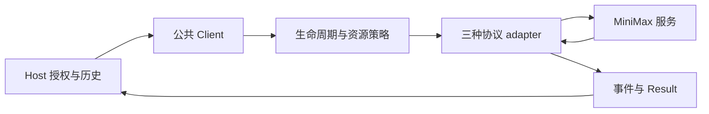

# barness ai MiniMax 交付过程复盘

最主要的问题是验证和收尾形成了反复返工的依赖链：关键边界审查偏晚，修复使已有真实证明失去当前来源资格；完整门禁反馈昂贵；证据保存又不断引入新的程序、测试、审查和保存工作。协议实现、真实服务失败和区域调整确实有成本，但不足以单独解释整个周期。

本次覆盖从 2026-10-18 06:02:53 开始实施，到 2026-10-19 20:10:02 最终关闭，上海时间跨度约 **38 小时 7 分钟**。其中包含跨轮对话、授权和等待，不能当作连续执行时间。既有 [session-analysis/report.html](session-analysis/report.html) 只覆盖最初 **8 小时 41 分钟**，其中“当前失败”是当时状态；最终交付已通过，不能用旧快照描述最终结果。

## 范围与实际验证

固定代码比较范围为 `ecfd4b4…c8ff7ef`；依据是 spec、22 份工单、两段实施聊天记录、Git 时间、实际命令回执及最终证据索引。这里 review 的对象是交付过程和支持它的实现，不是一次新的全仓逐行缺陷审查。

本次实际执行既有公共 Client E2E：

```sh
BARNESS_AI_EVIDENCE_DIR=/tmp/barness-minimax-process-review-20261019 \
go test ./ai/e2e \
  -run '^(TestMiniMaxChatText|TestMiniMaxResponsesNativeRoundTrip|TestMiniMaxMessagesNativeReplay)$' \
  -count=1 -timeout=2m
```

结果为 **42 PASS、audit 0**，Go 包测试耗时 **1.492 秒**；三种协议的受控服务路径可达。该定向执行只验证阅读涉及的调用路径，不替代最终发布门禁，也不能与全量测试按相同工作量比较。产物路径和 SHA 记录在 [复盘指标](process-review-metrics-2026-10-19.json)；未新增厂商调用。

## 时间与工作量

| 观察 | 实际记录 | 解释 |
| --- | --- | --- |
| 初期三协议及相关模块 | 10 月 18 日 07:00 已合入初版协议、生命周期、Host/回滚工作 | 尚未完成真实支持认证；说明后续周期不能都算作编写 adapter |
| 国际 M3 目录激活 | 10 月 18 日 10:59，`8900034` | 后续仍有正式验收、GLM 和全发布要求 |
| 最终 Messages payload 修复 | 10 月 18 日 20:52，`2306917` | 已进行多轮真实验证后，才修正最终发送边界 |
| 倒数第二次完整门禁 | 62.85 分钟，普通 10.80、race 48.87 | 最终因视觉取消证据失败，整体 FAIL |
| 最后一次完整门禁 | 62.72 分钟，普通 11.13、race 48.54 | PASS；race 占本轮外层时间约 77.4% |
| 最后门禁结束至关闭提交 | 76.11 分钟 | 留存、审查、复制器修正、文档和集成等收尾；不等于单纯复制时间 |
| 最后完整门禁原件 | 285,150 份，2,732,518,298 字节 | ordinary/race/outer 三个不重叠范围；不含后续 publication/history 侧记录 |
| 续期账本累计 | 873 calls / 870 HTTP Attempts | 跨 GLM、旧路线和业务效果等范围；原 M3 阶段另列，不能称为 MiniMax 调用了 873 次 |

两次门禁分别来自 [失败轮回执](../../.evidence/minimax-current-eleven-gate-2/full-gate-result.json) 和 [通过轮回执](../../.evidence/minimax-current-visual-gate-1/full-gate-result.json)；机器指标保存了准确路径和原件哈希。

交付契约本身包含 80 个 User Stories、28 组 R、20 组 A，以及旧 Provider 回归、业务效果和完整发布门禁。这部分广度是既定要求。可以优化的是安排顺序、依赖范围和重复工作，不能把删减这些验收项当作等价提速。

### 全程 race 执行补充统计

截至最终关闭，两个实施聊天及其子任务的原始执行记录、脚本内子进程回执和留存归档去重后，确认 **76 次外层 `go test -race` 执行**：完整门禁 5 次，记录累计约 3 小时 31 分钟；定向回归 71 次，约 1 小时 38 分钟；合计约 **5 小时 9 分钟**。包括失败及超时，排除编译而不运行、查看日志、重复归档和同一轮的各个包；单条 `-count=3` 命令计一次启动。

这是累计执行时间，包含并行重叠，不是独占用户等待时间。部分早期记录是混合 shell 命令计时，包含少量准备、普通回归或 vet；首次全量只保留主 E2E 包计时，一次超时的子进程最终退出时刻也未精确记录。因此总量按分钟给近似值，不将记录之和写成秒级精确的 race 进程墙钟。逐次身份、范围、计时依据和来源见 [76 次明细](race-run-audit-2026-10-19.json)。

### race 的覆盖 发现与优化

race 是运行现有测试并启用 Go 数据竞争检测。五轮全量执行均包含当时整套测试、差分与压力、证据生产和审计，不只运行专门的并发测试。MiniMax 的实际并发场景包括两租户三协议共享 Client、独立工具续接、队列背压、Result 与事件消费并发、取消与关闭、Admission 等待隔离、Observer 和资源释放。

2026-10-20 补充核对：两个实施聊天及子任务的 7,990 条命令执行输出中，没有找到 `WARNING: DATA RACE`、`race detected during execution of test` 或检测器的 `Found N data race` 报告；五轮完整门禁原始日志也均没有行首 `WARNING: DATA RACE`。这说明没有已记录的数据竞争发现，不证明所有未执行路径都没有竞争。

五轮全量日志分别位于：`minimax-global-final-keyless/actual-releasegate.log`、`minimax-routed-final-compiled-1/actual-releasegate.log`、`minimax-release-repair-incomplete-gate-1/actual-current-releasegate.log`、`minimax-current-eleven-gate-2/full-releasegate.log`、`minimax-current-visual-gate-1/full-releasegate.log`，均在仓库 `.evidence/` 下。前三轮失败主要涉及 GLM 来源资格、映射和夹具，普通运行也有同类失败；第四轮普通 12,495 PASS，race 出现一个视觉取消记录/回放失败和零字节 request.json 审计问题；第五轮通过。第四轮是在 race 较慢时序下暴露真实取消边界缺陷的有效发现，属于时序/功能问题，未触发数据竞争检测告警。后续票 20 的若干 RED 是该缺陷修复过程的复现，不应都算作独立新发现。

优先优化顺序是：先让普通测试及资格快检通过；开发阶段按实际影响的并发路径运行 race；来源稳定后执行一次完整 race；源码或依赖未变的文档更新不触发重跑。保留取消各阶段、Close/Result/事件消费、Observer、队列与租户边界的显式同步场景，不能因为没有检测器告警就删除这些测试。

进一步缩短单轮需要区分测试体、子进程构建、证据序列化、哈希与审计的时间，先在下一次必要运行采集 test-json/profile。可优先减少重复的大夹具副本、重复封存与工具重复构建；不得用旧 PASS 跳过当前原件验证。将纯静态契约移出每轮完整 race 的方案需要先建立真实调用路径覆盖，并前瞻修改完整发布契约；当前仍要求 `go test -race ./...`，不能直接添加排除标记规避。并行和缩短超时应在资源隔离、有效同步及测量支持后采用。

Go 检测机制与覆盖限制依据：[Go Data Race Detector](https://go.dev/doc/articles/race_detector)。

比较范围内共有 211 次提交，其中 40 条提交标题包含 merge。Git 变更足迹中，功能证据目录为 2,354 个文件、约 30.2 万新增文本行；功能 tools 为 34 个变更文件、4,640 新增行；`ai/` 根运行代码为 51 个变更文件、2,351 新增行。这说明证据与工具占据了很大的交付面积，**文件数和行数不能换算为耗时比例**。

## 业务与验证边界

产品主线是 Host 提供已授权 Binding、Credential Snapshot 和历史，公共 Client 执行一次 Generation Turn，三种既有协议 adapter 处理 MiniMax 差异，返回事件和 Result。Host 继续负责工具执行和下一轮调用。这个边界沿用了现有架构，新增 MiniMax 独立 Client 或重试系统并不是本次需要的优化。



交付路径则包含另一组独立对象：执行来源、二进制、计划与批准决定哪些操作能运行；真实捕获和账本记录运行事实；消费者判定来源适用性和支持状态；发布门禁决定能否交付；归档索引负责后续复核。这些结论不能相互替代。


## 原因与对应优化

### 1 关键源码审查偏晚，放大重验范围

现有 [implement-spec](</Users/cyber/.agents/skills/implement-spec/SKILL.md:36>) 把整合 code review 安排在所有票完成之后。它没有为付费验证设置前置的整体边界审查。票 17 才发现 MiniMax Messages 在可信 `OnPayload` 之后，对消息容器、角色、内容和函数工具必需字段的最终校验不完整；修复增加 44 个公共场景，包括 42 个非法输入与两个合法业务输入。

这是实质性的输入边界缺陷，修复合理。但它发生在多轮验收之后，旧 M3、GLM、文本、protocol114、视觉的完整来源集合都不能认证修复后的代码，随后需要重新取得十一组严格证明。[票 17](issues/17-final-payload-review-gaps.md) 和 [票 19](issues/19-current-source-eleven-renewal.md) 有明确记录。

**优化：**在真实验证前完成整合源码审查，重点检查最终 payload、Native State、取消、超时、usage、资源释放及租户边界。发现问题先做失败先行的公共 E2E，再修复、复审并冻结。保留最终审查，但对已审且字节未变的源码复用原结论，只检查新增差异与整体契约覆盖。

### 2 完整门禁成本高，缺少完整的分层快检

[releasegate/main.go](</Users/cyber/RestoX/barness/ai/release/cmd/releasegate/main.go:111>) 依次执行双 vet、全仓普通和全仓 race；命令列表会全部求值，前一命令失败也继续下一项。trace、ledger、matrix 虽然先读取，但部分语义结果、业务效果及完整消费在昂贵命令之后才汇总。早期多次门禁已经知道存在 GLM 资格缺口，仍执行了整套普通/race。

票 14 记录了可提前发现的 mapping hash、可选诊断 NOT_RUN、夹具 inventory 等缺口。票 20 则说明取消记录及回放缺陷直到完整 race 才暴露。race 的 49 分钟是**整套证据 E2E 加竞争检测**的时间，不能解释为全部在检测并发，也不能把 GLM 资格 FAIL 解释为 DATA RACE。

**优化：**给现有 releasegate 增加 `preflight`，先检查 trace/hash、输入齐全、来源适用、支持矩阵、公开消费者、夹具 inventory 及影响边界的定向回归。它只能表示预检通过，不能发布。正式认证模式在普通测试失败时停止后续 race 并输出不完整失败报告；需要收集全部故障时显式选择诊断模式。最终源码稳定后仍真实执行完整发布要求。

### 3 来源边界耦合使小修复影响多组证明

这里有不同层次的冻结，不能混在一起：

- [paid_core.py](</Users/cyber/RestoX/barness/.scratch/barness-ai-minimax/tools/paid_core.py:68>) 冻结几乎全部 `ai` Go/JSON 和该目录所有 Python 工具，`guard` 还要求 HEAD 相同；适合固定一轮收费执行，但任意选定工具变化都会让准备失效。
- [MiniMax ExecutionSource](</Users/cyber/RestoX/barness/ai/internal/testkit/minimaxlive/source.go:13>) 使用另一份运行与捕获来源选择器。
- [visual sourceFiles](</Users/cyber/RestoX/barness/ai/examples/visualeval/bundle.go:77>) 收集 `ai` 下所有非测试 Go 文件，连其他示例和工具的修改也会影响它。

因此，新增 MiniMax 能力同时触及 GLM 与视觉的证明，并不全是厂商本身有问题。这些校验保护了证据真实性；问题是依赖范围和冻结顺序造成了代价。

**优化：**每次冻结前输出“变更文件→受影响原生来源集合→必须重验组合”报告，分别表达执行、工具授权、目录及展示数据。立即可做的是减少冻结后的修改，并沿用已存在的完整集合相等性复核。未来若要缩小新报告的来源闭包，应先证明构建与调用依赖、必要时调整模块边界，再通过 ADR 版本化生产者和消费者。旧报告、旧 selector、旧 map 和失败保持原字节，不能直接缩小列表或刷新 hash 来提速。

### 4 收尾变成了辅助工具持续开发

已有多个真实返工实例：

| 实例 | 造成的工作 | 应前置的约束 |
| --- | --- | --- |
| 未发送取消写出零字节 `request.json`；已发送取消未正确处理 null/unset 型号 | 票 20 修复、三组来源补验、再跑完整门禁 | 取消阶段与实际发送状态由明确数据结构表达，提前跑同一公共回放路径 |
| 票 21 候选矩阵已归档，观察清单遗漏该角色，reader 报 `KeyError` | 修正元数据、重新读取、独立复核 | 生产者与消费者共用必需角色契约，封存前验证可消费 |
| 固定收尾复制器先读任意路径再比 hash，路径授权过宽 | 精确白名单、16 项验证、两轴复审及新增历史记录 | 先校验整份来源清单和授权，再打开目标文件 |
| 负向夹具缺父目录、审计钩子计数方式错误 | 首轮验证无效，继续修测试工具 | 有效对照先通过；负例必须按指定原因拒绝 |

依据是 [票 20 留存](evidence/ticket-20/README.md)、[票 21 actual-retained](evidence/ticket-21/actual-retained/README.md) 和 [最终关闭](evidence/ticket-21/final-closure/README.md)。最后一次复制回执为 0.052 秒，说明这段收尾的主要问题是流程、程序和审查反复变化；不能把 76 分钟简单归为磁盘复制。

**优化：**把已重复出现的有界读取、清单授权、封存和验证能力收敛到仓库级稳定工具。首轮只统一 `prepare / seal / verify` 三个动作，批次文件名和角色作为受验证的数据。付费执行保持独立授权边界。复用现有代码，不另建通用工作流平台。审查依赖只允许“执行记录→验证→审查→最终索引”，不要求审查报告自含最终索引或自身 hash。

### 5 区域和验收环境确认偏晚

中国区实际 HTTP 401 后，用户改为国际站；后续又明确中国区直连、国际站代理。GLM 专属 CallTimeout 为 120 秒，却继承 90 秒响应头限制，票 16 为此增加真实 91 秒 TLS 边界证明。真实 MiniMax Chat 镜像推理和 Responses 原生历史还暴露了原实现缺陷。

地区、账号用途和服务可用性需要预检；协议缺陷需要 wire 与回放验证。没有证据证明 Chat 镜像或 Responses 历史缺陷来自中外站协议差异，也不能把切换国际站后整轮 3 小时 19 分钟都算作改 endpoint。

**优化：**实施前固定地区、端点、凭据用途、资格、代理和各层超时；先做无凭据连通检查。对最不确定的协议行为，在已有授权范围内做有限探针并立刻转成脱敏回放夹具，再扩大正式验收。M3.1 无资格继续明确 NOT_RUN；不依赖自动换区、换 Key 或重试掩盖失败。

### 6 细粒度协作和状态维护增加串行依赖

implement-spec 默认每票独立实现工作树并由独立 merger 合入，且每票都调用 TDD。这个策略适用于独立复杂模块；用于纯文档、审查索引和少量清单时，会增加准备、同步、合并与上下文更新。双轴审查可以并行，但下一阶段仍要等两轴、留存和合入完成。提交数量只能佐证工作粒度，不能单独证明多代理一定更慢。

spec、map、delivery-status 和多份票反复保留长段当前统计，后期状态更新本身又需要审查、路径展示与保存。

**优化：**按独立模块或完整验收阶段拆分工作；小型文档与数据整理由主代理完成，复杂冲突才使用独立 merger。行为代码继续失败先行，文档改动使用引用与一致性检查。统计集中在一个机器状态文件，其他文档链接到当前状态；历史采用不可变事件记录。

### 7 能量化整轮，却无法充分归因测试内部时间

现有 evidence manifest 有整轮起止时间，没有每个 case 的持续时间。[Run.Finish](</Users/cyber/RestoX/barness/ai/internal/testkit/evidence/evidence.go:119>) 会递归读取并哈希产物，随后 Audit 再遍历读取；release LoadBundle 又校验库存，外层门禁再次审计。大量原件带来可观察的 I/O、JSON 解析和校验工作，但目前没有 profile 可以证明它们分别占 race 的多少。

**优化：**先采集已有下一轮运行的 `go test -json`，区分测试执行、Finish、audit、消费和封存时间，再选择热点优化。优先考虑共享不可变大夹具和有界批量记录，减少重复文件；同一受信任快照内可复用按内容、验证器版本和规则绑定的确定性计算。跨信任边界仍验证原件和库存，不能仅凭路径、时间或旧 PASS 跳过完整性校验。是否拆分测试包、并行运行普通/race，应等 CPU、内存和压力场景测量后决定。

## 可执行改造顺序

| 顺序 | 修改位置与内容 | 完成标准 |
| --- | --- | --- |
| P0 | implement-spec：前置关键源码审查；区分行为、工具、文档任务；明确一次冻结与收尾范围 | 付费执行前完成边界审查；纯文档不走行为 TDD/完整门禁；新增审查报告不产生新复制程序 |
| P0 | releasegate：复用现有消费者增加快检；正式模式遇已知失败及时停止；失败也保留结构化报告 | 旧 mapping、缺输入、NOT_RUN、inventory 和来源缺口在长测前拒绝；未执行项明确，不能认证为 PASS |
| P0 | AGENTS.md 增加简短指针；拟新增 docs/agents/verification.md；tracker 明确唯一当前状态与最小证据集 | 明确四类变更的验证范围；同一统计只维护一次；每项收尾要求能追溯到交付条款 |
| P1 | 从现有实现提取稳定证据工具，下一批次通过清单接入 | 新批次不新增逐轮 creator/reader；有效对照与指定原因负例通过；读取授权先于内容读取 |
| P1 | evidence/门禁增加阶段计时、case 耗时和文件量统计 | 能报告执行、审查、返工、等待；并行区间不相加冒充墙钟 |
| P2 | 基于 profile 优化重复产物、重复校验与真实热点；评估来源闭包版本化 | 保留强制 E2E/race/差分/压力及旧来源语义；用前后测量证明提速 |

建议用四个离线流程场景验收这些改造：纯文档变化；共享 payload 错误；归档遗漏必需角色；实际来源变化但旧证据未重验。它们应分别触发最小一致性检查、付费前拒绝、封存前拒绝和严格资格拒绝。

潜在收益最明确的是减少重跑次数和收尾循环。若在全量门禁前捕获票 20 同类问题，可避免再付出一次约 63 分钟的完整运行；这是反事实优化空间，不是已实现收益。最后通过后 76 分钟的收尾可设置如 15 分钟的工程目标，实际达成需要稳定工具验证。没有完整分阶段账本，不给出“总耗时可降低 X%”的数字。

## 保留的黑盒与后续问题

SDK 内部传输、MiniMax/GLM 服务内部调度、代理内部网络原因作为黑盒：输入是固定请求和网络策略，输出是捕获的响应或错误；现有证据不足以继续定位这些内部耗时。竞争检测 CPU、证据解析 CPU、磁盘 I/O 与多进程资源争用也尚未分摊，需要 profile。

最终交付的 11/11 当前来源资格、17 份自身支持、四项业务效果和完整门禁 PASS 继续成立。本复盘建议调整后续执行方式；未修改已验收运行源码、技能、规范、原生证据或预算规则。

## 全过程门禁清单（2026-10-20 补充）

发布代码定义 **10 项正式门禁**；实施过程中的其他阻断检查在下表另归为 **9 类流程关卡**。这是检查类型的归类，不是执行次数。每个测试断言不另列为一项门禁。完整机器明细、逐轮回执、预检及在线进程的去重身份与回执 SHA256 见 [门禁盘点](gate-inventory-2026-10-20.json)。

计时覆盖上海时间 2026-10-18 06:02:53 至 2026-10-19 20:10:02。累计命令时间包含失败、超时和并行重叠；嵌套检查不重复相加。未单独计时不代表耗时为零。不能用整个代理回合、等待轮询或聊天跨度代替审查执行时间。

### 正式发布门禁

代码定义见 `ai/internal/testkit/release/gate.go` 的 GateID 与 Evaluate，实际顺序见 `ai/release/cmd/releasegate/main.go`。

| 门禁 | 内容 | 触发点 | 全过程可核实的累计耗时 |
| --- | --- | --- | --- |
| go-test | 全仓普通测试，包含单元与 E2E，开启差分和压力 | 完整 releasegate 的双 vet 之后 | **5 次全量约 52 分 40 秒**；不含开发和审查的全部定向普通测试 |
| go-test-race | 完整测试加 Go 数据竞争检测，独立生成产物 | 当前 CLI 在普通测试之后自动执行，普通失败仍继续 | **全程 76 次约 5 小时 9 分**；其中全量 5 次约 3 小时 30 分 44 秒，定向 71 次约 1 小时 38 分 16 秒 |
| go-vet | 普通与 live tag 两种静态检查 | 完整门禁开头；预检、开发和审查中也重复 | 4 轮正式报告中的 8 条约 **4.77 秒**；首轮缺独立计时。另有预检 32 条约 **17.87 秒**；开发中的其他 vet 尚未完整分账 |
| p0-offline | 必需 P0 场景有通过的离线证据，失败不能放行 | 测试生成结果后，发布 Evaluate 验收 | 测试生产包含在普通/race 内；语义汇总未单计时 |
| differential | 冻结 pi 对照、差异账本无 pending、场景和扩展路线完整 | 测试开启 PIDIFF；发布 Evaluate 验收 | 包含在普通/race 和结果消费内，未单计时 |
| live | 必需 Provider/API/model 身份的有效自身真实报告、支持矩阵与原件审计 | 真实收集后、矩阵导入及发布 Evaluate | 判定未单计时；相关在线生产见流程表，不能把全部在线时间只归给本项 |
| redaction-audit | 普通、race、live 和四项效果证据无 Key、Authorization 等泄露 | 每包收尾、外层发布、封存及读回时 | 包含在测试、发布和封存内，未单计时 |
| traceability | 研究条款、用户故事与验收项映射到场景及实际通过的证据 | 发布 Evaluate；来源或映射变化后重新核对 | 未单计时 |
| snapshots | 目录快照、release-plan 映射 hash、classifier 扩展登记及压力约束一致 | CLI 准备检查结果，发布 Evaluate 判定 | 未单计时 |
| required-artifacts | 混合图像设计负载、撤权、本地/云端、多模态、MiniMax 负载、两项中文与两项视觉效果、独立 race 证据完整 | 生产者产出后，CLI 加载校验、Evaluate 验收 | 生产包含在普通/race/在线进程内；加载、哈希、审计未单计时 |

单元测试、E2E、差分与压力没有四个互相独立、可相加的全量执行时长：它们有相互嵌套的生产与判定。这里的 **52 分 40 秒是五轮正式全量普通测试的记录合计，不是全过程所有非 race 测试的总计**。

### 发布程序之外的流程关卡

| 关卡 | 内容 | 触发点 | 全过程可核实的累计耗时 |
| --- | --- | --- | --- |
| 开发失败先行与定向回归 | 公共 Client E2E、必要隔离测试、工具负例先 RED 后 GREEN，修复后回归 | 每项行为实现与缺陷修复 | 定向 race 已计入上表：71 次约 1 小时 38 分 16 秒；定向普通和工具测试尚无完整分账 |
| 独立双轴审查 | Standards 与 Spec；覆盖运行源码、执行/证据工具、文档及实际数据 | 集成、付费前精确冻结、修复后复审和最终关闭 | 未统一计时，无法独立汇总；并行审查不能直接累加为用户等待 |
| 来源冻结、构建与 guard | HEAD、来源文件、二进制、计划、review pins 一致，执行前后检查 | prepare 及每次受控执行前后；冻结内字节变化使旧准备失效 | 分散在准备和执行命令中；来源哈希与 guard 未单计时 |
| 付费前无 Key 预检 | 最终为双 vet、no-key-live、visual proxy、release contracts、release package 六项；早期实际批次为 3/4 项 | 新轮冻结后、读取凭证或建立付费 intent 前；失败拒绝进入付费 | 已追回 **至少 16 批、69 条实际命令，约 46 分 16 秒**；不含独立开发检查 |
| 人工授权、资格、预算与一次性 intent | 区域、代理、模型用途与凭据资格；授权绑定精确来源、二进制、计划和 checks；持久 intent 防重复收费 | 每个新付费轮次及选定任务读取 Key 之前 | 没有统一独立计时；授权等待无法从 38 小时 7 分的日历跨度中完整剥离 |
| 真实研究、候选、正式与续期 | 三协议、旧 Provider、GLM、protocol114、中文/视觉效果；公开消费者校验当前资格，失败原样保留 | 指定轮获批后；来源失效或失败后另行获批补验 | 已追回 **69 个真实在线进程约 59 分 17 秒**；是不完整下界，包含一次 GLM 诊断；与正式 live/required-artifacts 的生产重叠 |
| 目录激活、来源资格与支持矩阵 | 自身正式报告、canonical origin、价格及资格满足规则；17 身份原子审计导入，M3.1 保持 NOT_RUN | 候选转正式、报告导入、来源修改后续期及发布前 | 未单独汇总；部分包含公开消费命令和发布 CLI |
| 证据封存、负向检查与公开读回 | 库存、hash、路径授权、有界读取、失败留存、实际原件及 portable reader 可消费 | 每轮归档、工具修正后和交付前独立复核 | 未统一计时；最后一次复制或单个 verify 的耗时不能代表全程 |
| 最终集成、状态与关闭 | 当前源码、11 组严格证明、17 身份、四效果、完整门禁和双轴审查一致，原件可复核 | 必要检查完成后关闭票 10/09/spec，清理工作树 | 最后完整门禁结束到关闭 **历时 76 分 7 秒**；包含多种活动，不是这一关卡的独占执行时间 |

无 Key 预检的留存回执分账如下，已排除同一命令的归档副本。16 批中包含失败批次和未进入付费的准备批次，不能只统计最终通过的一批。

| 检查 | 已追回实际命令数 | 累计记录时长 |
| --- | --- | --- |
| go vet ./... | 16 | 9.57 秒 |
| go vet -tags live ./... | 16 | 8.30 秒 |
| no-key-live | 16 | 40 分 42 秒 |
| visual proxy | 9 | 59 秒 |
| release contracts | 6 | 45 秒 |
| release package | 6 | 3 分 32 秒 |
| 合计 | 69 | 46 分 16 秒 |

### 五轮完整发布门禁

以下为实际启动的完整 CLI，不将 `-bundle` 重新消费、读取日志、归档副本计为新的一轮。第一轮在 LoadBundle 失败，没有正式发布报告；后四轮生成了报告。因此是 **五次完整执行尝试、四份正式判定报告**，不是十项门禁都独立判定了五次。

| 启动时间（上海） | 外层总耗时 | 普通 | race | 结果 |
| --- | --- | --- | --- | --- |
| 10-18 12:56 | 47 分 05 秒 | 9 分 48 秒 | 37 分 00 秒 | 普通/race 失败，随后读取 bundle 失败，无发布报告 |
| 10-18 16:42 | 51 分 24 秒 | 10 分 11 秒 | 38 分 12 秒 | FAIL，GLM 资格、离线/映射等缺口 |
| 10-18 20:03 | 51 分 54 秒 | 10 分 44 秒 | 38 分 07 秒 | FAIL，普通/race、live/追溯等未过 |
| 10-19 14:48 | 62 分 51 秒 | 10 分 48 秒 | 48 分 52 秒 | 普通 PASS，race 暴露视觉取消证据缺陷 |
| 10-19 17:51 | 62 分 43 秒 | 11 分 08 秒 | 48 分 33 秒 | PASS |
| 累计 | **4 小时 35 分 57 秒** | **约 52 分 40 秒** | **约 3 小时 30 分 44 秒** | 1 次最终 PASS |

首轮普通与 race 只有主 E2E 包时长，不能当作精确子进程墙钟；外层五轮均有完整 seconds 回执。外层与普通/race 的差额还包含 vet、启动、加载、完整性校验、审计和报告生成，不能无 profile 就全部称为“审计耗时”。

当前可以确认：完整门禁重复执行与全程 race 是较大的已计时成本，付费前无 Key 预检也重复了至少 46 分钟；审查、冻结与封存的全程独立耗时仍缺失。各表含嵌套和并行，不应将表格所有数字相加后冒充总任务耗时，也不能把未归因的日历时间全部归给 AI 思考或人工等待。本轮仅补充盘点，没有执行待审的门禁改造方案。
