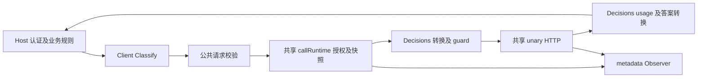
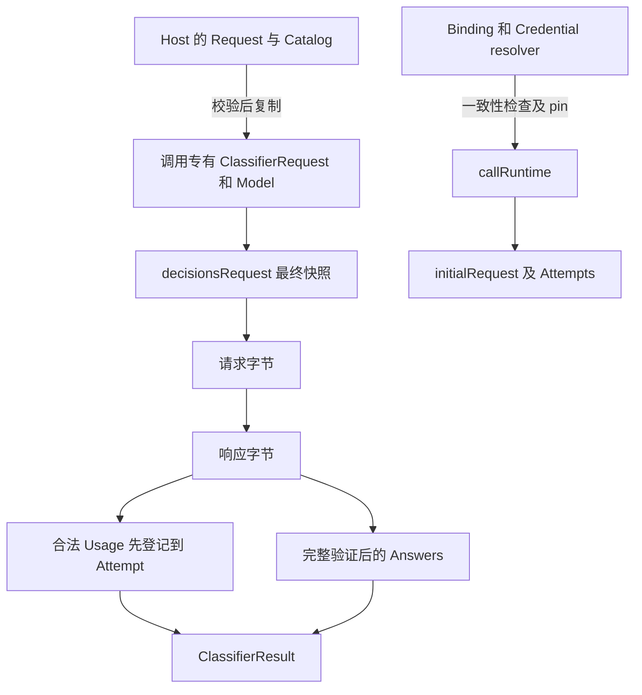
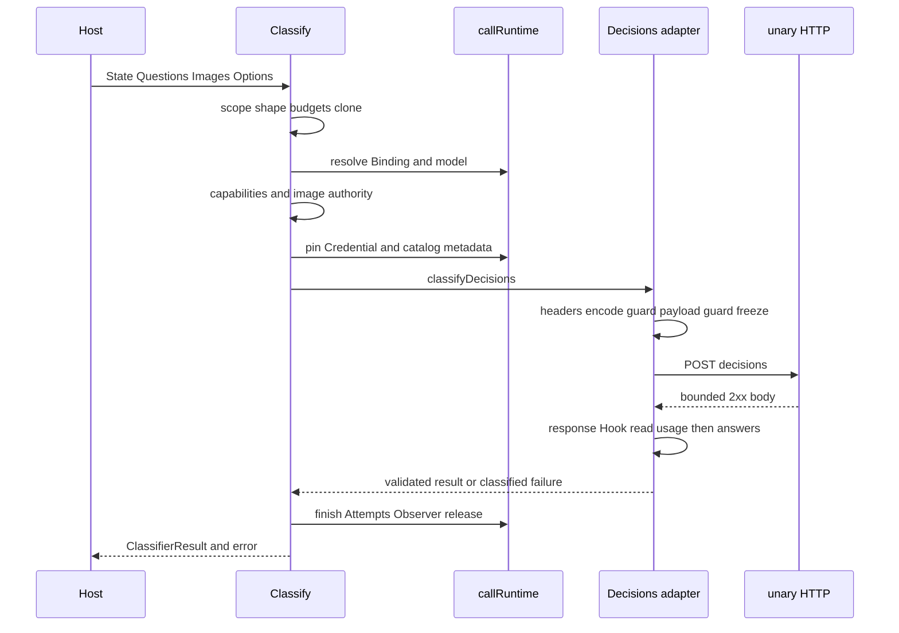

# barness ai OpenAI Decisions 实施追溯

截至 2026-10-13，`barness-ai-openai-decisions` 已完成工单 01–12：公共 Classify、三种题型、逐题拒答、分类图片、用量计费、隔离与撤销、冻结 Pi 差分、容量、候选与正式 live、Host 工具及独立中文效果。工单 13 的自动发布门禁实测 PASS，但旧压力流完整性缺陷尚未确认根因与修复，最终交付为 **FAIL**，工单仍为 **claimed**，ADR-0026 仍为 **proposed**。

状态依据：[逐票交付记录](/Users/cyber/RestoX/barness/.scratch/barness-ai-openai-decisions/release-evidence/README.md:82)、[最终交付 verdict](/Users/cyber/RestoX/barness/.scratch/barness-ai-openai-decisions/release-evidence/delivery-verdict.json:1)、[ADR 实施记录](/Users/cyber/RestoX/barness/docs/adr/0026-barness-ai-openai-decisions-classification.md:30)。

## 范围与行号基准

本报告回答“执行了什么步骤、产生了什么结果、落在哪个模块和代码行”，正文按业务执行顺序，后附工程工单和提交顺序。

- 实施起点：`8ea61b8d70de6c84fe27be34dc7d21c5c40841d9`；当前 HEAD：`73911f0`，两者之间 44 次提交，发生于 2026-10-12 至 2026-10-13。
- 所有源码行号指向本次梳理时的当前工作树；历史执行的源码身份按对应 evidence 的 snapshot/Hash 判断，不能把当前行号当成历史 commit 行号。
- 规划文件中的 `ready-for-agent` 和“尚未生产实现”属于批准计划时的快照；实际完成状态以各工单追加记录和最终 delivery verdict 为准。
- 本次通过已有公共 E2E 实际执行主路径和 Jev 拒绝优先级：两次运行合计 256 个 evidence case PASS，audit findings 均为空。历史 normal/race/live 数字均是原始执行记录，本次没有重新调用厂商。
- 精确提交文件集、当前函数行号及相对实施起点的代码变动行段见 [implementation-index.json](/Users/cyber/RestoX/barness/.scratch/barness-ai-openai-decisions/implementation-index.json:1)。该索引的行段分别标明旧版和当前版，不混用。

## 实施前先固定业务边界

| 步骤 | 实际动作 | 产生的结果与定位 |
| --- | --- | --- |
| 调研新协议 | 核对冻结 Pi 1.1.0 的 classifier、Decisions、Luna、图片与计费；区分同名 chat 和 classifier，识别 Pi 的整次拒答/score 信息丢弃等差异 | [调研结论](/Users/cyber/RestoX/barness/.scratch/pi-1.1.0-openai-decisions/research.md:5)，确定新增 Classify adapter，继续复用已有 unary runtime |
| 明确需求与设计 | 定义 R01–R20、公共契约、授权边界、请求转换、拒答、usage、隔离、来源和发布要求 | [需求](/Users/cyber/RestoX/barness/.scratch/barness-ai-openai-decisions/spec.md:84)、[生命周期设计](/Users/cyber/RestoX/barness/.scratch/barness-ai-openai-decisions/design.md:80)、[ADR-0026](/Users/cyber/RestoX/barness/docs/adr/0026-barness-ai-openai-decisions-classification.md:7) |
| 重拆实施工单 | 经 review 把原 9 张拆成 13 张，修正 P10 必跑差分、图片容量导入、全拒答/历史快照、全线串行及 schema producer/consumer 缺口 | [review](/Users/cyber/RestoX/barness/.scratch/barness-ai-openai-decisions/ticket-review/README.md:8)、[13 票依赖图](/Users/cyber/RestoX/barness/.scratch/barness-ai-openai-decisions/implementation-plan.md:14) |
| 固定验收合同 | 核验 56 条 User Story、R01–R20、OD01–OD58、13 票 DAG、验收归属与链接；保存旧票原字节和 SHA | [规划核验](/Users/cyber/RestoX/barness/.scratch/barness-ai-openai-decisions/planning-verification.md:8)。这个 PASS 只证明文档结构 |
| 固定 Jev 回归基线 | 先保存旧 wire、JSON 说明、单候选、舍入、拒绝顺序、Hook 和 usage，随后才增加 Decisions | [Jev 对照](/Users/cyber/RestoX/barness/ai/e2e/jev_regression_test.go:22)、[拒绝顺序](/Users/cyber/RestoX/barness/ai/e2e/jev_rejection_order_test.go:19)、[固定包](/Users/cyber/RestoX/barness/.scratch/barness-ai-openai-decisions/jev-baseline/README.md:5)：原场景 542 PASS/2 NOT_RUN、新对照 98 PASS、Jev 差分 12 PASS，红灯历史单独保留 |

实施切片遵循“失败清单 → 公共 Client/HookedClient E2E 红灯 → 生产实现 → 绿灯 → 审查修复 → manifest/审计/重放”的顺序。它不是先写私有 parser 测试再推断整个调用成功。[实施原则](/Users/cyber/RestoX/barness/.scratch/barness-ai-openai-decisions/implementation-plan.md:8)

## 模块与数据所有权



Jev 与 Decisions 在公共入口和生命周期处共享业务语义，在 native 请求、最终 guard、答案与用量处独立转换。没有新增动态 classifier registry、第二套 runtime 或全项目 SDK 升级；Decisions 走 native HTTP。[协议分派](/Users/cyber/RestoX/barness/ai/classifier.go:155)、[共享 unary](/Users/cyber/RestoX/barness/ai/unary.go:12)

| 数据结构 | 谁创建及持有 | 转换和独立复制 | 源码 |
| --- | --- | --- | --- |
| ClassifierRequest | Host 提交 State、Questions、有序 Images | 先限额校验，再复制 State、题目及可变 criteria；Images slice 复制，图片字符串不可变 | [公共请求](/Users/cyber/RestoX/barness/ai/classifier.go:11)、[clone](/Users/cyber/RestoX/barness/ai/classifier.go:99) |
| ClassifierModel | Catalog 归属明确的 classifier 型号 | Input、Kinds、DescriptionFormats、MIME、price tiers 独立复制，Hash 纳入所有实际字段 | [型号](/Users/cyber/RestoX/barness/ai/catalog_operations.go:61)、[clone](/Users/cyber/RestoX/barness/ai/catalog_snapshot.go:55)、[Hash](/Users/cyber/RestoX/barness/ai/catalog_snapshot.go:67) |
| Binding 和 Credential | Host 按可信 CallScope 解析 | 固定租户、操作、账户、binding/credential 版本及图片权限 | [Binding](/Users/cyber/RestoX/barness/ai/binding.go:84)、[一致性](/Users/cyber/RestoX/barness/ai/preflight.go:110) |
| callRuntime 和 initialRequest | 每次逻辑调用创建 | 持有快照、hooks、Attempt、permit 和取消函数；不跨调用共享可变身份 | [runtime](/Users/cyber/RestoX/barness/ai/call_runtime.go:12)、[initialRequest](/Users/cyber/RestoX/barness/ai/retry.go:118) |
| decisionsRequest | Decisions adapter 创建 | 公共 map 变为 native 数组；Hook 后重新从最终字节冻结 | [native 类型](/Users/cyber/RestoX/barness/ai/openai_decisions_request.go:14)、[freeze](/Users/cyber/RestoX/barness/ai/openai_decisions_guard.go:65) |
| ClassifierResult | 入口创建，adapter 填充 | usage 先登记；答案临时 map 完整通过后一次性发布 | [公共结果](/Users/cyber/RestoX/barness/ai/classifier.go:20)、[原子发布](/Users/cyber/RestoX/barness/ai/openai_decisions_response.go:44) |
| Chinese evaluation Report | Host 评估工具创建 | 从公共答案转换为评估视图，普通答案、拒答、失败和未执行独立计数 | [报告](/Users/cyber/RestoX/barness/ai/examples/chineseeval/report.go:48)、[Host 答案转换](/Users/cyber/RestoX/barness/ai/examples/chineseeval/report.go:148) |



## 按一次分类调用的业务顺序追溯

下表列的是当前实际执行顺序。工单号说明哪个实施切片建立或验证这一行为；既有共享模块的接线与复用不会被说成全部新建。

| 顺序 | 执行了什么 | 产生什么结果 | 模块和精确位置 | 工单 |
| --- | --- | --- | --- | --- |
| 1 | Host 选择 classifier 身份和独立 Binding/key，发现型号能力 | 同名 `gpt-6-luna` 的 chat/classifier 独立；正式 Luna 是 text/image，choice 2–255、score 2–10、bool、最多 128 张 PNG/JPEG/WebP。这里的 score 范围是 barness 子集 | [API 标识](/Users/cyber/RestoX/barness/ai/binding.go:64)、[正式目录](/Users/cyber/RestoX/barness/ai/catalog_decisions.go:11)、[BuiltinCatalog](/Users/cyber/RestoX/barness/ai/catalog.go:53) | 02、05、10 |
| 2 | 本地或云端 Host 构造可信 CallScope，调用公共入口 | 本地显式装配；云端从认证 Principal 派生 scope；plain/hooked 均进入同一 Classify 生命周期 | [本地装配](/Users/cyber/RestoX/barness/ai/examples/localassembly/operations.go:47)、[云端入口](/Users/cyber/RestoX/barness/ai/examples/hostintegration/operations.go:44)、[两个 Classify 入口](/Users/cyber/RestoX/barness/ai/classifier.go:46) | 02、11 |
| 3 | 创建调用与时限，检查租户和 request ID | 记录 operation/归属及 call-start；scope 错误优先，尚不解析 Binding/凭据 | [beginCall](/Users/cyber/RestoX/barness/ai/call_runtime.go:30)、[入口检查](/Users/cyber/RestoX/barness/ai/classifier.go:54)、[validateScope](/Users/cyber/RestoX/barness/ai/call_runtime.go:63) | 01、02、06 |
| 4 | 检查初始请求形状、State、题数、说明、候选和原始字节 | State 只接受 string/object/array；公共 choice 1–255、score 2–10；保持 Jev 旧拒绝顺序。先 known-size、后编码/复制 | [ClassifierPolicy.check](/Users/cyber/RestoX/barness/ai/classifier_policy.go:33)、[公共题目校验](/Users/cyber/RestoX/barness/ai/classifier_policy.go:160)、[全输入字节](/Users/cyber/RestoX/barness/ai/classifier_policy.go:224) | 01、02、05 |
| 5 | 有图时先检查数量、每图和累计 decoded 字节，再严格校验编码/header | `Classifier.Images=nil` 禁图；严格 base64、MIME/magic，不拉取 URL 或分配 raster；有限政策不足在凭据读取前拒绝 | [图片大小](/Users/cyber/RestoX/barness/ai/classifier_images.go:36)、[图片编码](/Users/cyber/RestoX/barness/ai/classifier_images.go:61)、[入口顺序](/Users/cyber/RestoX/barness/ai/classifier.go:62) | 05 |
| 6 | 复制通过校验的请求，解析租户 Binding | 隔离 Host 后续 mutation；拒绝 foreign/disabled binding、错误 operation/API、非白名单/目录型号 | [复制](/Users/cyber/RestoX/barness/ai/classifier.go:99)、[resolveBinding](/Users/cyber/RestoX/barness/ai/preflight.go:23)、[runtime.resolve](/Users/cyber/RestoX/barness/ai/call_runtime.go:72) | 02、05、06 |
| 7 | 检查 options、型号题型/说明能力及图片授权交集 | nil 是协议默认；typed nil/错协议拒绝。Decisions 说明必须 string、choice 至少 2；图片必须同时有 Policy、Model、Binding 授权 | [executeClassifier](/Users/cyber/RestoX/barness/ai/classifier.go:125)、[Decisions 能力](/Users/cyber/RestoX/barness/ai/classifier_capabilities.go:102)、[Options](/Users/cyber/RestoX/barness/ai/call_runtime.go:103) | 02、03、05 |
| 8 | 解析 Credential 并校验版本一致性，pin 快照 | Tenant/account/ref/version 全匹配；Metadata 固定 Binding/Credential/Catalog 版本与 Hash；后续重试不重读后台 | [resolveCredential](/Users/cyber/RestoX/barness/ai/preflight.go:74)、[checkSnapshot](/Users/cyber/RestoX/barness/ai/preflight.go:110)、[pin](/Users/cyber/RestoX/barness/ai/call_runtime.go:121) | 02、06 |
| 9 | 按 API 分派到独立 Decisions adapter，运行 headers Hook | 保留 TypeSafe adapter；授权 headers 通过现有 Hook 边界；没有动态 registry 或第二套 runtime | [分派](/Users/cyber/RestoX/barness/ai/classifier.go:157)、[Decisions adapter](/Users/cyber/RestoX/barness/ai/openai_decisions.go:10)、[headers Hook](/Users/cyber/RestoX/barness/ai/hooks_run.go:40) | 02、06 |
| 10 | 将 State 和有序 Images 转为 native input | 无图是 input string；JSON object/array compact 后作为文本；有图只有一个 user，先 input_text，再有序 data URL 图片 | [input 转换](/Users/cyber/RestoX/barness/ai/openai_decisions_request.go:35)、[图片 wire](/Users/cyber/RestoX/barness/ai/openai_decisions_request.go:53) | 02、05 |
| 11 | 转换 choice/score/bool 和问题顺序 | choice→choices，score→levels，bool→predicate；true/false 说明追加 instructions；数字式名称按 ECMAScript 顺序，普通名称确定排序 | [问题转换](/Users/cyber/RestoX/barness/ai/openai_decisions_request.go:77)、[bool 说明](/Users/cyber/RestoX/barness/ai/openai_decisions_request.go:112)、[排序](/Users/cyber/RestoX/barness/ai/openai_decisions_request.go:137) | 02、03、07 |
| 12 | 编码后先检查，再运行 payload Hook，之后再检查并冻结最终请求 | Hook 可以合法改问题；不能改 model、endpoint、key、协议、图片权限或加 tools；最终题目集合成为答案校验基准 | [前后 guard 的调用顺序](/Users/cyber/RestoX/barness/ai/openai_decisions.go:19)、[payload 检查](/Users/cyber/RestoX/barness/ai/openai_decisions_guard.go:16)、[最终 freeze](/Users/cyber/RestoX/barness/ai/openai_decisions_guard.go:65) | 02、03、05 |
| 13 | 对 Hook 的 typed/raw/custom JSON 与最终图片树重新限额、授权 | 提前计算实际编码边界；处理 raw text、Unicode surrogate pair、typed struct、byte-slice JSON；逐 message/content 检查，图片权力不由 payload 自报 | [分配前 budget](/Users/cyber/RestoX/barness/ai/openai_decisions_image_payload.go:31)、[raw JSON](/Users/cyber/RestoX/barness/ai/openai_decisions_image_payload.go:60)、[Unicode 文本](/Users/cyber/RestoX/barness/ai/openai_decisions_image_payload.go:364)、[最终 input](/Users/cyber/RestoX/barness/ai/openai_decisions_images.go:22) | 05 |
| 14 | 获得本租户/进程准入，POST `/decisions` | 默认零重试；显式 Binding retry 只处理 initial response 前允许的失败。固定 body、headers、key；限 response/error body、保存 x-request-id | [sendUnary](/Users/cyber/RestoX/barness/ai/unary.go:15)、[initialRequest.send](/Users/cyber/RestoX/barness/ai/retry.go:183)、[有界诊断](/Users/cyber/RestoX/barness/ai/openai_decisions.go:58) | 02、06 |
| 15 | 获得 2xx 后执行 response Hook、读取有界完整 JSON | response Hook/正文读取/解析失败不重新发请求；取消与 deadline 如实返回；body 在 adapter 退出时关闭 | [2xx 后流程](/Users/cyber/RestoX/barness/ai/openai_decisions.go:40)、[读取失败分类](/Users/cyber/RestoX/barness/ai/unary.go:41) | 02、06 |
| 16 | 先解析并登记 usage presence 和费用 | 六项非负 int64：input/output/total/cached/cache_write/reasoning；区分 unreported/partial/complete，验证一致性；inclusive input 只收一次费，严格大于 272000 后全请求用高阶费率 | [usage 优先登记](/Users/cyber/RestoX/barness/ai/openai_decisions_response.go:13)、[presence/一致性](/Users/cyber/RestoX/barness/ai/openai_decisions_usage.go:14)、[input-only 费用](/Users/cyber/RestoX/barness/ai/openai_decisions_usage.go:81)、[目录阶梯](/Users/cyber/RestoX/barness/ai/catalog_decisions.go:21) | 04 |
| 17 | 按最终问题集合匹配完整答案，验证名称/类型/分布 | 缺题、多题、重名、错种类或损坏字段整体失败；choice 全候选分布、单位概率与最高项，score 全档分布/label/期望值，predicate 返回 true 概率 | [匹配与原子 map](/Users/cyber/RestoX/barness/ai/openai_decisions_response.go:36)、[choice](/Users/cyber/RestoX/barness/ai/openai_decisions_answers.go:33)、[score](/Users/cyber/RestoX/barness/ai/openai_decisions_answers.go:82)、[predicate](/Users/cyber/RestoX/barness/ai/openai_decisions_answers.go:72) | 02、03 |
| 18 | 将合法单题 refusal 转为封闭 RefusalAnswer | 混合拒答或全拒答均可 stop/nil error；不补造理由、概率或 false。Jev parser 继续独立，Decisions 不使用 Jev 舍入例外 | [RefusalAnswer](/Users/cyber/RestoX/barness/ai/classifier_answers.go:30)、[refusal 转换](/Users/cyber/RestoX/barness/ai/openai_decisions_response.go:57)、[score 容差](/Users/cyber/RestoX/barness/ai/openai_decisions_answers.go:120) | 03 |
| 19 | 完整通过后一次性发布结果，结束 Attempt/Call 并释放资源 | 协议失败清空 Answers，但已合法登记的 usage/费用保留；Metadata 返回快照与 Attempts；Observer 只报告元数据；成功 permit 保持至完整处理结束 | [答案发布](/Users/cyber/RestoX/barness/ai/openai_decisions_response.go:84)、[终态](/Users/cyber/RestoX/barness/ai/classifier.go:82)、[finish/close](/Users/cyber/RestoX/barness/ai/call_runtime.go:40)、[permit 释放](/Users/cyber/RestoX/barness/ai/retry.go:241) | 02、04、06 |
| 20 | Host 按封闭答案类型处理后续业务 | Choice、Score、Bool、Refusal 各自分支；置信阈值、转人工和业务 fallback 属于 Host；授权撤销阻止新调用，已 pin 请求保持原快照/费用 | [迁移示例](/Users/cyber/RestoX/barness/ai/examples/classifiermigration/README.md:1)、[Host 结果转换](/Users/cyber/RestoX/barness/ai/examples/chineseeval/report.go:148)、[撤销公共 E2E](/Users/cyber/RestoX/barness/ai/e2e/decisions_runtime_rollback_test.go:17) | 06、11 |



错误边界可直接从业务阶段理解：初始请求错为 scope/capability；Hook 越权为 `tenant_denied/request`、坏 schema 为 `callback_failed/request`、超限为 `resource_limit`；损坏响应属于协议错误。逐题 refusal 自身是有效结果，不进入错误路径。

## 从功能实现到支持及发布

| 顺序 | 执行及产出 | 模块和代码行 | 实际结果与证据 |
| --- | --- | --- | --- |
| 21 固定 Pi 差分 | 接入冻结 Pi 自己的 Decisions classify/catalog；比较 wire/共同答案；把 refusal、score 详情、严格校验、精度、usage、retry 等有限差异登记到 case/path/kind 账本 | [P10 差分入口](/Users/cyber/RestoX/barness/ai/e2e/decisions_pidiff_test.go:48)、[catalog](/Users/cyber/RestoX/barness/ai/e2e/decisions_pidiff_catalog_test.go:11)、[proof 校验](/Users/cyber/RestoX/barness/ai/internal/testkit/release/differential_record.go:20) | P10 46 份差分 PASS，49 条有限账本，pending 0；全部七子集共 861 PASS。[证据](/Users/cyber/RestoX/barness/.scratch/barness-ai-openai-decisions/frozen-differential-evidence/README.md:19) |
| 22 容量负载 | 保留原混合负载，新增 Luna 图片成功/取消/恢复三批，各占满本地 4、云端 8 并发；记录 count、decoded/base64/data URL/完整 JSON、分配上界及资源释放 | [负载](/Users/cyber/RestoX/barness/ai/e2e/classifier_image_pressure_test.go:22)、[本地 Policy](/Users/cyber/RestoX/barness/ai/examples/localassembly/mixed_policy.go:24)、[导入校验](/Users/cyber/RestoX/barness/ai/internal/testkit/release/classifier_load.go:57) | 每调用两张 256 KiB、128 KiB state、8 题；完整 JSON 862760 字节，政策最大占用 50%。race 累计分配上界 local 222.05/cloud 448.55 MiB，低于原 256/512 MiB。[容量表](/Users/cyber/RestoX/barness/.scratch/barness-ai-openai-decisions/classifier-load-evidence/capacity.md:5) |
| 23 候选真实调用 | 固定第一方 sources 和 candidate catalog；独立进程、key、预算；先预留 Calls/Attempts/问题/状态/图片，再调用公共 Client；记录失败、NOT_RUN、取消与恢复 | [source pin](/Users/cyber/RestoX/barness/ai/live/decisions_sources_test.go:19)、[harness](/Users/cyber/RestoX/barness/ai/live/decisions_harness_test.go:120)、[预算预留](/Users/cyber/RestoX/barness/ai/live/decisions_harness_test.go:242) | candidate 9/9 PASS，9 Call/9 Attempt、13 题、3 图、零 retry；八个正常结果 input 共 1608/output 0，取消用量 unreported。candidate 不更新正式支持矩阵。[实际证据](/Users/cyber/RestoX/barness/.scratch/barness-ai-openai-decisions/candidate-live-evidence/live-authorized-20261013/README.md:15) |
| 24 正式目录与 schema | 候选通过后纳入 BuiltinCatalog；一次性迁移 support matrix 2→3，保留九行历史，新增十行中的 Decisions；旧 producer/consumer 一起升级 | [builtin](/Users/cyber/RestoX/barness/ai/catalog_decisions.go:11)、[schema 3](/Users/cyber/RestoX/barness/ai/internal/testkit/supportmatrix/matrix.go:21)、[固定九能力](/Users/cyber/RestoX/barness/ai/internal/testkit/supportmatrix/decisions.go:24) | 正式版本 `2026-10-13.1`，Hash `sha256:faae843ac61fea6e3ae59bb75165dc97fcf6aa409dabfe0a2f7c9dccbba12029`；candidate Hash 原样保留，Jev 省略态及同名 chat 内容不变。[实施记录](/Users/cyber/RestoX/barness/.scratch/barness-ai-openai-decisions/issues/10-formal-catalog-and-support-matrix.md:54) |
| 25 正式 live 与原子 merge | 在正式 Hash 下重跑自己的九场景，审计/inventory 完成并同步后才原子发布可接受 Report；CLI 全批通过才保存矩阵 | [正式入口](/Users/cyber/RestoX/barness/ai/live/decisions_formal_test.go:47)、[封套](/Users/cyber/RestoX/barness/ai/live/decisions_formal_test.go:80)、[原子发布](/Users/cyber/RestoX/barness/ai/live/decisions_formal_test.go:101)、[Merge](/Users/cyber/RestoX/barness/ai/internal/testkit/supportmatrix/matrix.go:187)、[batch CLI](/Users/cyber/RestoX/barness/ai/live/cmd/supportmatrix/main.go:36) | 正式 9/9 PASS，84 项 inventory；candidate/controlled/schema 2/错身份/缺能力/超预算拒绝；NOT_RUN 不覆盖历史 PASS，任一 batch 失败不改文件。[正式证据](/Users/cyber/RestoX/barness/.scratch/barness-ai-openai-decisions/formal-support-evidence/README.md:1) |
| 26 Host 评估工具 | 新增显式 Jev/Luna route、schema 2 report、拒答与 null 指标、捕获重放；保留无 route 的旧 Jev 默认及 schema 1，历史包按 recorded snapshot 核验 | [route](/Users/cyber/RestoX/barness/ai/examples/chineseeval/route.go:19)、[执行](/Users/cyber/RestoX/barness/ai/examples/chineseeval/report.go:103)、[metrics](/Users/cyber/RestoX/barness/ai/examples/chineseeval/metrics.go:43)、[历史快照](/Users/cyber/RestoX/barness/ai/examples/chineseeval/recorded.go:17) | 97 项专项 E2E PASS。全拒答可 COMPLETE，整体准确率 0、条件准确率/ECE/Brier null；usage 不完整会阻止任务 COMPLETE。历史可核验与当前适用性独立。[工具证据](/Users/cyber/RestoX/barness/.scratch/barness-ai-openai-decisions/host-tooling-evidence/README.md:36) |
| 27 Luna 独立真实效果 | 在正式目录、固定 24 样本下串行评估；上限 24 Call/Attempt、600 秒、零 retry；新增显式 loopback proxy 后实际执行，原直连失败保留 | [代理校验](/Users/cyber/RestoX/barness/ai/examples/chineseeval/cmd/chineseeval/host.go:84)、[CLI](/Users/cyber/RestoX/barness/ai/examples/chineseeval/cmd/chineseeval/main.go:31)、[完整 verifier](/Users/cyber/RestoX/barness/ai/examples/chineseeval/cmd/chineseeval/verify.go:14) | 2026-10-13 10:49:27–10:49:35，24/24 answered 且正确，0 refusal，24 Call/Attempt，8.157236 秒；input 6238/output 0，估价 $0.0006238。[实际记录](/Users/cyber/RestoX/barness/.scratch/barness-ai-openai-decisions/issues/12-independent-chinese-live-evaluation.md:48) |
| 28 十组合自动门禁 | 固定十路线、P10 第七 Required、R01–R20，实际导入 normal/race 容量及撤销，Jev/Luna 独立当前真实效果；重新采集十组合 schema 3 smoke 和 Jev 当前效果 | [CLI 接线](/Users/cyber/RestoX/barness/ai/release/cmd/releasegate/main.go:46)、[Required 固定合同](/Users/cyber/RestoX/barness/ai/internal/testkit/release/plan.go:24)、[双效果](/Users/cyber/RestoX/barness/ai/internal/testkit/release/evaluation.go:18)、[撤销导入](/Users/cyber/RestoX/barness/ai/internal/testkit/release/revocation.go:21)、[Evaluate](/Users/cyber/RestoX/barness/ai/internal/testkit/release/gate.go:263) | normal/race 各 7616 PASS＝普通离线 6755＋差分 861，109 追溯 PASS、14 包 audit 零发现，自动命令 exit 0。[最终实测](/Users/cyber/RestoX/barness/.scratch/barness-ai-openai-decisions/release-evidence/README.md:14) |
| 29 最终交付与回滚说明 | 更新公共契约、迁移、差异、回滚和 ADR 实施记录；保留未解决的历史压力失败，形成独立 delivery verdict | [契约](/Users/cyber/RestoX/barness/docs/barness-ai/decisions.md:1)、[运行时说明](/Users/cyber/RestoX/barness/docs/barness-ai/decisions-runtime.md:1)、[最终 verdict](/Users/cyber/RestoX/barness/.scratch/barness-ai-openai-decisions/release-evidence/delivery-verdict.json:1) | 自动 gate PASS，delivery FAIL；原压力问题仍未关闭，工单 13 claimed、ADR-0026 proposed；没有执行部署或发布 |

## 十三张工单的实际交付

下面按工程切片列出已执行步骤；各行数字属于不同测试选择集，存在重叠，不能相加作为独立覆盖总数。

| 票 | 主要提交及审查修复 | 交付内容与实际结果 | 状态及证据 |
| --- | --- | --- | --- |
| 01 | `7939308`，`db3a68b`，`a8a4686` | 固定 Jev 基线与 artifact 反篡改；新增 98 公共对照；纠正历史 release FAIL 与起点前代理重测的状态引用，旧包未改写 | resolved；[基线](/Users/cyber/RestoX/barness/.scratch/barness-ai-openai-decisions/jev-baseline/README.md:1) |
| 02 | `0b6a011`，`9fa44f9` | 首个 Decisions choice 闭环、Options、最终 Hook guard、严格答案/拒答、目录省略态；195 新 P10，专项总 653 PASS，保存 6 次红灯及证据固定修复 | resolved；[文本](/Users/cyber/RestoX/barness/.scratch/barness-ai-openai-decisions/text-choice-evidence/README.md:1) |
| 03 | `aa9da73`，`17f2f07` | score/bool/mixed、全档分布/Legend、混合与全拒答；新增 292 case PASS，先前 250 FAIL 保留 | resolved；[混合答案](/Users/cyber/RestoX/barness/.scratch/barness-ai-openai-decisions/mixed-answer-evidence/README.md:1) |
| 04 | `49f119c`，`1e01c9a`，`ffe7005` | 六项 usage presence、一致性、input-only 阶梯、2xx 后答案/读/hook 失败不重放；新增 307 PASS，最初 168 FAIL 保留 | resolved；[用量](/Users/cyber/RestoX/barness/.scratch/barness-ai-openai-decisions/usage-evidence/README.md:1) |
| 05 | `0d823b9`，`9ba77ae`，`e58eed1`，`e7325e9`，`926ed8a`，`26d955b` | inline 图片、三授权、资源和 strict JSON；审查补 message type/raw text/Unicode/typed request/byte-slice 反例；131 图片 case PASS，专项 race 431 PASS | resolved；[图片](/Users/cyber/RestoX/barness/.scratch/barness-ai-openai-decisions/image-evidence/README.md:1) |
| 06 | `c9124ef`，`fb30d25`，`724f09e` | 复用 runtime，只补有界无歧义 JSON 诊断；四路线/租户/价格/图片归属隔离，重试快照、取消、Observer 与三类撤销；最终 73 本票适用 case normal/race PASS | resolved；[runtime](/Users/cyber/RestoX/barness/.scratch/barness-ai-openai-decisions/runtime-evidence/README.md:1) |
| 07 | `dbdd77c`，`6acff6d`，`c4cc495` | Pi 1.1.0 不升级；补 pins、完整 P10 captures/projections/账本与反例；46 P10、全部 861 差分 PASS，pending 0 | resolved；[冻结差分](/Users/cyber/RestoX/barness/.scratch/barness-ai-openai-decisions/frozen-differential-evidence/README.md:1) |
| 08 | `fd1b05a`，`9c3e0ff`，`0856b2b`，`3f97f19` | 分类图片设计负载与强语义 artifact validator；纠正矛盾容量/完成状态和 native 问题 envelope 计量；normal/race 各 182 本票适用 PASS，原 ENOBUFS/timeout 失败保留 | resolved；[容量](/Users/cyber/RestoX/barness/.scratch/barness-ai-openai-decisions/classifier-load-evidence/README.md:1) |
| 09 | `85ea917`，`a7c15ec`，`fc6937e`，`abdb733`，`1c8afce`，`dbb4660` | 有界候选 harness；修复超时/收尾证据丢失；经当时用户授权未知账户信息后实际 live 9/9 PASS；固定 83 项 inventory。配置 FAIL、无 key NOT_RUN 和 race audit timeout 不覆盖 | resolved；[候选真实执行](/Users/cyber/RestoX/barness/.scratch/barness-ai-openai-decisions/candidate-live-evidence/live-authorized-20261013/README.md:1) |
| 10 | `63d6217`，`faed800`，`8683b9e`，`f9bd770`，`9be8fa5`，`efe6d19` | 正式 catalog/schema 3/全 producer 与消费者迁移；修复审计前报告可接受、pending schema、旧 Jev config/fixture pin；正式自身 9/9 live，原子 merge；最终 full 8234 PASS/69 SKIP/0 FAIL | resolved；[正式支持](/Users/cyber/RestoX/barness/.scratch/barness-ai-openai-decisions/formal-support-evidence/README.md:1) |
| 11 | `1ad3dd4` | Host 本地/云端迁移，Jev/Luna route、拒答统计/null、双 schema、recorded snapshot/verifier；97 专项 PASS。完整 normal 的既有等值 deadline 竞争 FAIL 保留并另立票 | resolved；[Host 工具](/Users/cyber/RestoX/barness/.scratch/barness-ai-openai-decisions/host-tooling-evidence/README.md:1) |
| 12 | `d8442da`，`3b8d05b` | 显式 loopback proxy 和收据脱敏反例，正式 Luna 独立中文 live COMPLETE；24/24、24 Call/Attempt、零 retry，完整捕获及 96 Observer；质量报告未写入支持矩阵 | resolved；[中文真实效果](/Users/cyber/RestoX/barness/.scratch/barness-ai-openai-decisions/chinese-live-evidence/README.md:1) |
| 13 | `ee3bf76`，`807ccba`，`73911f0` | 十组合固定合同、双效果和 normal/race artifacts 接线；修复迁移历史比较、空 JSON/live inventory/诊断；实测自动 gate PASS，完整原包及历史失败封存 | claimed；[最终报告及 blocker](/Users/cyber/RestoX/barness/.scratch/barness-ai-openai-decisions/release-evidence/README.md:1) |

## 真实支持与业务效果的结果边界

候选 live、正式 live、中文效果、完整自动 gate、最终 delivery 是五个不同判定。候选自身通过才进入目录；正式自身报告才更新第十组合；中文任务的 COMPLETE 表示固定任务完整，不自动表示达到某个业务阈值。

| 证据 | 已执行结果 | 仍不能据此推断的内容 |
| --- | --- | --- |
| candidate Decisions | 9/9，独立候选 Hash，八个正常结果完整 usage，取消 unreported | 不赋予正式支持，不把取消未知消耗当零 |
| formal Decisions | 正式 Hash 自身 9/9，完整 inventory/audit，支持矩阵自己的行 PASS | 不自动让旧九路线证据适用于新 Hash |
| Luna 中文效果 | 24/24，refusal rate 0；confidence ECE 0.0145833333、chosen-probability ECE 0.0116666667、Brier 0.0006916667；mean/p50/p95 339.870/282.498/376.854 ms | 不保证生产数据质量，不把目录估价当账单；来源：[工单 12](/Users/cyber/RestoX/barness/.scratch/barness-ai-openai-decisions/issues/12-independent-chinese-live-evaluation.md:48) |
| 发布时 Jev 当前效果 | 24/24，24 Call/Attempt、零 retry，估价 $0.000539406，与 Luna 独立 | 不复用旧 Jev recorded Hash 或另一条路线质量；来源：[当前双效果](/Users/cyber/RestoX/barness/.scratch/barness-ai-openai-decisions/release-evidence/README.md:30) |
| final automatic gate | normal/race、十路线、861 差分、109 追溯、容量/撤销及 14 包审计通过 | 不自动关闭历史已记录的压力缺陷 |
| delivery verdict | FAIL、completed=false；13 claimed、ADR-0026 proposed | 功能实现和当前检查通过不能改称已发布 |

候选与正式真实执行的账户、区域、key 专用性和权限材料未独立核实，在当时用户授权下如实记为 unknown。Catalog Hash 固定能力和价格，不固定无日期 alias 的服务权重。[真实运行边界](/Users/cyber/RestoX/barness/.scratch/barness-ai-openai-decisions/release-evidence/README.md:41)

## 本次源码梳理的实际执行证据

2026-10-13 本次执行了以下已有公共测试，命令退出 0、包耗时 1.921 秒。Go 输出有 226 条 PASS（包括父测试）；manifest 有 **218 个业务 evidence case，全部 PASS**，两种计数不混用。此运行没有启用付费 live，也不是完整 normal/race 发布重跑。

```sh
go test ./ai/e2e \
  -run '^(TestJevRegression|TestJevRejectionOrder|TestDecisionsTextClosure|TestDecisionsMixedClosure|TestDecisionsUsagePresence|TestDecisionsUsageInputPricing|TestDecisionsImagesInput|TestDecisionsRuntimeRollback|TestClassifierHostMigration)$' \
  -count=1 -json
```

第一条命令中的 `TestJevRejectionOrder` 没有匹配当前函数，随后以实际函数名单独补跑了拒绝优先级。补跑退出 0、耗时 1.040 秒，38 个 evidence case 全 PASS（Go 父子测试共 40 PASS），audit findings 为空。两次共 256 个业务 evidence case。

```sh
BARNESS_AI_EVIDENCE_DIR=/Users/cyber/RestoX/barness/.evidence/decisions-reading-priority-20261013 \
  go test ./ai/e2e \
  -run '^(TestJevRegressionRejectionOrder|TestJevRegressionAuthorizationOrder)$' \
  -count=1 -json
```

补跑证据：[manifest](/Users/cyber/RestoX/barness/.evidence/decisions-reading-priority-20261013/20261013T070115.422598000Z/manifest.json:1)、[audit](/Users/cyber/RestoX/barness/.evidence/decisions-reading-priority-20261013/20261013T070115.422598000Z/audit.json:1)，对应 [scope 拒绝顺序](/Users/cyber/RestoX/barness/ai/e2e/jev_rejection_order_test.go:19)、[授权拒绝顺序](/Users/cyber/RestoX/barness/ai/e2e/jev_rejection_order_test.go:99)。

| 已执行入口 | 可核对场景和代码 |
| --- | --- |
| TestJevRegression | [旧 Jev shape/wire/舍入对照](/Users/cyber/RestoX/barness/ai/e2e/jev_regression_test.go:22) |
| TestDecisionsTextClosure | [文本、选项及结果闭环](/Users/cyber/RestoX/barness/ai/e2e/decisions_text_test.go:43) |
| TestDecisionsMixedClosure | [choice/score/bool 混合与拒答](/Users/cyber/RestoX/barness/ai/e2e/decisions_mixed_test.go:11) |
| TestDecisionsUsagePresence | [presence 变体](/Users/cyber/RestoX/barness/ai/e2e/decisions_usage_test.go:104) |
| TestDecisionsUsageInputPricing | [272000 阶梯及授权价格快照](/Users/cyber/RestoX/barness/ai/e2e/decisions_usage_invalid_test.go:49) |
| TestDecisionsImagesInput | [图片成功与输入失败边界](/Users/cyber/RestoX/barness/ai/e2e/decisions_images_input_test.go:13) |
| TestDecisionsRuntimeRollback | [disabled/model/image 权限撤销及在途快照](/Users/cyber/RestoX/barness/ai/e2e/decisions_runtime_rollback_test.go:17) |
| TestClassifierHostMigration | [本地/云端 Host、说明兼容子集及拒答分支](/Users/cyber/RestoX/barness/ai/e2e/classifier_host_migration_test.go:20) |

两次本次执行的机器收据见 [reading-verification.json](/Users/cyber/RestoX/barness/.scratch/barness-ai-openai-decisions/reading-verification.json:1)。第一份完整新包：[manifest](/Users/cyber/RestoX/barness/.evidence/barness-ai/20261013T065042.750483000Z/manifest.json:1)、[audit 零发现](/Users/cyber/RestoX/barness/.evidence/barness-ai/20261013T065042.750483000Z/audit.json:1)。每个 case 都保留 captures、results、Attempts、Observer、assertions、fixture SHA 和重放命令；本次命令输出另保存在 `/tmp/barness-decisions-reading-tests.jsonl`。

## 设计取舍和仍待解决的问题

公共 score 保留 2–10，维护原 Jev scope 错误优先级；Decisions 的更宽潜在原生范围没有作为本期需求。RefusalAnswer 和 score 分布是明确领域结果，保持独立于 Pi 的整次拒答/信息舍弃，以有限账本证明差异。图片的 Policy、Model、Binding 三边界各自负责资源、能力和租户权限。[ADR-0026](/Users/cyber/RestoX/barness/docs/adr/0026-barness-ai-openai-decisions-classification.md:13)

共享 runtime、transport/admission、HTTP failure、Observer 队列、SDK 的聊天实现作为外围模块，本报告只展开它们在 Classify 处的输入输出和资源责任；没有全面阅读 chat/image 协议解析、SDK 内部或每一个 E2E fixture。主要接口分别是 `callRuntime.resolve/pin/finish`、`sendUnary`、`initialRequest.send/done` 与 metadata Observation。Decisions 请求和响应转换则已逐段追踪。

后续维护我会把“历史 blocker 尚未关闭”也作为发布命令的显式输入，使自动 report 与最终 delivery 状态在一个入口同时呈现。当前实现靠自动 gate 和独立 `delivery-verdict.json` 正确保留两个结论，但消费者若只读自动 PASS，仍可能遗漏交付阻断。这是本次梳理的改进建议，未改动发布合同。

必须先解决的原问题为 [压力流完整性缺陷 07](/Users/cyber/RestoX/barness/.scratch/barness-ai-thinking-sampling/issues/07-pressure-stream-integrity.md:7)：原 32 并发负载下，call-04 出现不合法 Responses JSON，call-11 工具参数超过 512 KiB。与 writeBufferWaits/broken pipe 的关联尚未形成根因证据；后续正常/race 和十轮复现通过不足以关闭。需要保持原负载定位首个字节/帧偏离，形成回归和确认修复，再重跑最终完整发布验收。

另外 [等值 CallTimeout/ReadIdleTimeout 终态竞争](/Users/cyber/RestoX/barness/.scratch/barness-ai-timeout-ordering/issues/01-call-and-read-idle-deadline-order.md:1) 已在工单 11 单独立票，原全量失败保留；它与最终 delivery verdict 明确列出的压力流 blocker 不能混为一个问题。

## 提交顺序附录

以下完整列出实施起点后的 44 次提交。函数入口和当前变动行段的机器索引保存在同目录 `implementation-index.json`。

| 序号 | 日期 | 提交 | 执行动作 | 主要当前模块 |
| --- | --- | --- | --- | --- |
| 1 | 2026-10-12 | `7939308` | test(ai): pin Jev public regression baseline (Decisions issue 01) | [ai/e2e/jev_baseline_evidence_test.go](/Users/cyber/RestoX/barness/ai/e2e/jev_baseline_evidence_test.go:14)；[ai/e2e/jev_regression_test.go](/Users/cyber/RestoX/barness/ai/e2e/jev_regression_test.go:22)；[ai/e2e/jev_rejection_order_test.go](/Users/cyber/RestoX/barness/ai/e2e/jev_rejection_order_test.go:19) |
| 2 | 2026-10-12 | `db3a68b` | docs(ai): record Jev baseline standards and spec reviews | [.scratch/barness-ai-openai-decisions/issues/01-jev-regression-baseline.md](/Users/cyber/RestoX/barness/.scratch/barness-ai-openai-decisions/issues/01-jev-regression-baseline.md:1)；[.scratch/barness-ai-openai-decisions/jev-baseline/README.md](/Users/cyber/RestoX/barness/.scratch/barness-ai-openai-decisions/jev-baseline/README.md:1) |
| 3 | 2026-10-12 | `a8a4686` | docs(ai): distinguish proxy rerun passes from archived release failure | [.scratch/barness-ai-openai-decisions/issues/01-jev-regression-baseline.md](/Users/cyber/RestoX/barness/.scratch/barness-ai-openai-decisions/issues/01-jev-regression-baseline.md:1)；[.scratch/barness-ai-openai-decisions/jev-baseline/README.md](/Users/cyber/RestoX/barness/.scratch/barness-ai-openai-decisions/jev-baseline/README.md:1) |
| 4 | 2026-10-12 | `0b6a011` | feat(ai): implement Decisions text choice classification | [ai/binding.go](/Users/cyber/RestoX/barness/ai/binding.go:13)；[ai/call_runtime.go](/Users/cyber/RestoX/barness/ai/call_runtime.go:12)；[ai/catalog_operations.go](/Users/cyber/RestoX/barness/ai/catalog_operations.go:5)；[ai/catalog_snapshot.go](/Users/cyber/RestoX/barness/ai/catalog_snapshot.go:10)；另 19 个模块 |
| 5 | 2026-10-12 | `9fa44f9` | fix(ai): pin validated Decisions evidence during audit | [ai/e2e/decisions_evidence_test.go](/Users/cyber/RestoX/barness/ai/e2e/decisions_evidence_test.go:11) |
| 6 | 2026-10-12 | `aa9da73` | feat(ai): support Decisions mixed answers and per-question refusals | [ai/classifier_capabilities.go](/Users/cyber/RestoX/barness/ai/classifier_capabilities.go:9)；[ai/e2e/decisions_mixed_answers_test.go](/Users/cyber/RestoX/barness/ai/e2e/decisions_mixed_answers_test.go:11)；[ai/e2e/decisions_mixed_bounds_test.go](/Users/cyber/RestoX/barness/ai/e2e/decisions_mixed_bounds_test.go:12)；[ai/e2e/decisions_mixed_fixture_test.go](/Users/cyber/RestoX/barness/ai/e2e/decisions_mixed_fixture_test.go:16)；另 7 个模块 |
| 7 | 2026-10-12 | `17f2f07` | test(ai): pin mixed-answer acceptance evidence and resolve issue 03 | [.scratch/barness-ai-openai-decisions/issues/03-mixed-answers-and-refusals.md](/Users/cyber/RestoX/barness/.scratch/barness-ai-openai-decisions/issues/03-mixed-answers-and-refusals.md:1)；[.scratch/barness-ai-openai-decisions/mixed-answer-evidence/README.md](/Users/cyber/RestoX/barness/.scratch/barness-ai-openai-decisions/mixed-answer-evidence/README.md:1)；[ai/README.md](/Users/cyber/RestoX/barness/ai/README.md:1)；[docs/adr/0021-barness-ai-typesafe-unary-classification.md](/Users/cyber/RestoX/barness/docs/adr/0021-barness-ai-typesafe-unary-classification.md:1) |
| 8 | 2026-10-12 | `49f119c` | feat(ai): validate Decisions usage presence and input pricing | [ai/e2e/decisions_usage_invalid_test.go](/Users/cyber/RestoX/barness/ai/e2e/decisions_usage_invalid_test.go:10)；[ai/e2e/decisions_usage_test.go](/Users/cyber/RestoX/barness/ai/e2e/decisions_usage_test.go:15)；[ai/openai_decisions_usage.go](/Users/cyber/RestoX/barness/ai/openai_decisions_usage.go:14)；[ai/usage.go](/Users/cyber/RestoX/barness/ai/usage.go:10) |
| 9 | 2026-10-12 | `1e01c9a` | test(ai): cover Decisions usage failures after successful HTTP | [ai/e2e/decisions_usage_lifecycle_test.go](/Users/cyber/RestoX/barness/ai/e2e/decisions_usage_lifecycle_test.go:16)；[ai/openai_decisions_usage.go](/Users/cyber/RestoX/barness/ai/openai_decisions_usage.go:14) |
| 10 | 2026-10-12 | `ffe7005` | test(ai): pin Decisions usage evidence and resolve issue 04 | [.scratch/barness-ai-openai-decisions/issues/04-usage-presence-and-input-pricing.md](/Users/cyber/RestoX/barness/.scratch/barness-ai-openai-decisions/issues/04-usage-presence-and-input-pricing.md:1)；[.scratch/barness-ai-openai-decisions/usage-evidence/README.md](/Users/cyber/RestoX/barness/.scratch/barness-ai-openai-decisions/usage-evidence/README.md:1) |
| 11 | 2026-10-12 | `0d823b9` | feat(ai): authorize bounded inline classifier images | [ai/binding.go](/Users/cyber/RestoX/barness/ai/binding.go:13)；[ai/catalog_operations.go](/Users/cyber/RestoX/barness/ai/catalog_operations.go:5)；[ai/catalog_snapshot.go](/Users/cyber/RestoX/barness/ai/catalog_snapshot.go:10)；[ai/catalog_validate.go](/Users/cyber/RestoX/barness/ai/catalog_validate.go:11)；另 20 个模块 |
| 12 | 2026-10-12 | `9ba77ae` | fix(ai): validate classifier message types and raw text before copying | [ai/e2e/decisions_images_lifecycle_test.go](/Users/cyber/RestoX/barness/ai/e2e/decisions_images_lifecycle_test.go:14)；[ai/e2e/decisions_images_message_test.go](/Users/cyber/RestoX/barness/ai/e2e/decisions_images_message_test.go:10)；[ai/e2e/decisions_images_raw_text_test.go](/Users/cyber/RestoX/barness/ai/e2e/decisions_images_raw_text_test.go:13)；[ai/openai_decisions_image_payload.go](/Users/cyber/RestoX/barness/ai/openai_decisions_image_payload.go:16)；另 1 个模块 |
| 13 | 2026-10-12 | `e58eed1` | fix(ai): count escaped surrogate pairs at classifier text boundaries | [ai/e2e/decisions_images_raw_text_test.go](/Users/cyber/RestoX/barness/ai/e2e/decisions_images_raw_text_test.go:13)；[ai/openai_decisions_image_payload.go](/Users/cyber/RestoX/barness/ai/openai_decisions_image_payload.go:16) |
| 14 | 2026-10-12 | `e7325e9` | fix(ai): bound typed classifier input JSON before encoding | [ai/e2e/decisions_images_typed_request_test.go](/Users/cyber/RestoX/barness/ai/e2e/decisions_images_typed_request_test.go:13)；[ai/openai_decisions_guard.go](/Users/cyber/RestoX/barness/ai/openai_decisions_guard.go:10)；[ai/openai_decisions_image_payload.go](/Users/cyber/RestoX/barness/ai/openai_decisions_image_payload.go:16) |
| 15 | 2026-10-12 | `926ed8a` | fix(ai): honor native byte-slice JSON encoding | [ai/e2e/decisions_images_bytes_test.go](/Users/cyber/RestoX/barness/ai/e2e/decisions_images_bytes_test.go:12)；[ai/openai_decisions_image_payload.go](/Users/cyber/RestoX/barness/ai/openai_decisions_image_payload.go:16) |
| 16 | 2026-10-12 | `26d955b` | docs(ai): close classifier image issue with audited replay evidence | [.scratch/barness-ai-openai-decisions/image-evidence/README.md](/Users/cyber/RestoX/barness/.scratch/barness-ai-openai-decisions/image-evidence/README.md:1)；[.scratch/barness-ai-openai-decisions/issues/05-classifier-inline-images.md](/Users/cyber/RestoX/barness/.scratch/barness-ai-openai-decisions/issues/05-classifier-inline-images.md:1) |
| 17 | 2026-10-12 | `c9124ef` | fix(ai): prove Decisions runtime isolation and authorization rollback | [ai/e2e/decisions_runtime_admission_test.go](/Users/cyber/RestoX/barness/ai/e2e/decisions_runtime_admission_test.go:13)；[ai/e2e/decisions_runtime_diagnostics_test.go](/Users/cyber/RestoX/barness/ai/e2e/decisions_runtime_diagnostics_test.go:11)；[ai/e2e/decisions_runtime_fixture_test.go](/Users/cyber/RestoX/barness/ai/e2e/decisions_runtime_fixture_test.go:14)；[ai/e2e/decisions_runtime_isolation_test.go](/Users/cyber/RestoX/barness/ai/e2e/decisions_runtime_isolation_test.go:12)；另 8 个模块 |
| 18 | 2026-10-12 | `fb30d25` | test(ai): verify per-operation prices and tenant image captures | [ai/e2e/decisions_runtime_isolation_test.go](/Users/cyber/RestoX/barness/ai/e2e/decisions_runtime_isolation_test.go:12)；[ai/e2e/decisions_runtime_retry_test.go](/Users/cyber/RestoX/barness/ai/e2e/decisions_runtime_retry_test.go:16) |
| 19 | 2026-10-13 | `724f09e` | docs(ai): close runtime isolation issue with audited rollback evidence | [.scratch/barness-ai-openai-decisions/issues/06-runtime-isolation-and-rollback.md](/Users/cyber/RestoX/barness/.scratch/barness-ai-openai-decisions/issues/06-runtime-isolation-and-rollback.md:1)；[.scratch/barness-ai-openai-decisions/runtime-evidence/README.md](/Users/cyber/RestoX/barness/.scratch/barness-ai-openai-decisions/runtime-evidence/README.md:1) |
| 20 | 2026-10-13 | `dbdd77c` | test(ai): add frozen Decisions differential and bounded ledger | [ai/e2e/decisions_pidiff_catalog_test.go](/Users/cyber/RestoX/barness/ai/e2e/decisions_pidiff_catalog_test.go:11)；[ai/e2e/decisions_pidiff_test.go](/Users/cyber/RestoX/barness/ai/e2e/decisions_pidiff_test.go:22)；[ai/internal/testkit/pioracle/node/runner.mjs](/Users/cyber/RestoX/barness/ai/internal/testkit/pioracle/node/runner.mjs:63)；[ai/internal/testkit/pioracle/node/runner.test.mjs](/Users/cyber/RestoX/barness/ai/internal/testkit/pioracle/node/runner.test.mjs:61)；另 8 个模块 |
| 21 | 2026-10-13 | `6acff6d` | fix(ai): enforce frozen oracle pins and complete differential assertions | [ai/e2e/decisions_pidiff_catalog_test.go](/Users/cyber/RestoX/barness/ai/e2e/decisions_pidiff_catalog_test.go:11)；[ai/e2e/decisions_pidiff_test.go](/Users/cyber/RestoX/barness/ai/e2e/decisions_pidiff_test.go:22)；[ai/internal/testkit/pioracle/node/runner.mjs](/Users/cyber/RestoX/barness/ai/internal/testkit/pioracle/node/runner.mjs:63)；[ai/internal/testkit/pioracle/node/runner.test.mjs](/Users/cyber/RestoX/barness/ai/internal/testkit/pioracle/node/runner.test.mjs:61)；另 3 个模块 |
| 22 | 2026-10-13 | `c4cc495` | docs(ai): close frozen Decisions differential with audited evidence | [.scratch/barness-ai-openai-decisions/frozen-differential-evidence/README.md](/Users/cyber/RestoX/barness/.scratch/barness-ai-openai-decisions/frozen-differential-evidence/README.md:1)；[.scratch/barness-ai-openai-decisions/issues/07-frozen-pi-differential.md](/Users/cyber/RestoX/barness/.scratch/barness-ai-openai-decisions/issues/07-frozen-pi-differential.md:1) |
| 23 | 2026-10-13 | `fd1b05a` | feat(ai): verify classifier image design-load capacity | [ai/e2e/classifier_image_pressure_batch_test.go](/Users/cyber/RestoX/barness/ai/e2e/classifier_image_pressure_batch_test.go:21)；[ai/e2e/classifier_image_pressure_test.go](/Users/cyber/RestoX/barness/ai/e2e/classifier_image_pressure_test.go:22)；[ai/e2e/mixed_policy_test.go](/Users/cyber/RestoX/barness/ai/e2e/mixed_policy_test.go:11)；[ai/e2e/mixed_pressure_test.go](/Users/cyber/RestoX/barness/ai/e2e/mixed_pressure_test.go:24)；另 7 个模块 |
| 24 | 2026-10-13 | `9c3e0ff` | fix(ai): reject contradictory capacity and completion artifacts | [ai/e2e/zz_classifier_image_pressure_import_test.go](/Users/cyber/RestoX/barness/ai/e2e/zz_classifier_image_pressure_import_test.go:18)；[ai/internal/testkit/release/artifacts.go](/Users/cyber/RestoX/barness/ai/internal/testkit/release/artifacts.go:13)；[ai/internal/testkit/release/classifier_load.go](/Users/cyber/RestoX/barness/ai/internal/testkit/release/classifier_load.go:17)；[ai/internal/testkit/release/classifier_load_capture.go](/Users/cyber/RestoX/barness/ai/internal/testkit/release/classifier_load_capture.go:17) |
| 25 | 2026-10-13 | `0856b2b` | fix(ai): measure native classifier question envelope bytes | [ai/e2e/classifier_image_pressure_test.go](/Users/cyber/RestoX/barness/ai/e2e/classifier_image_pressure_test.go:22)；[ai/internal/testkit/release/classifier_load.go](/Users/cyber/RestoX/barness/ai/internal/testkit/release/classifier_load.go:17)；[ai/internal/testkit/release/classifier_load_capture.go](/Users/cyber/RestoX/barness/ai/internal/testkit/release/classifier_load_capture.go:17) |
| 26 | 2026-10-13 | `3f97f19` | docs(ai): record classifier image capacity evidence | [.scratch/barness-ai-openai-decisions/classifier-load-evidence/README.md](/Users/cyber/RestoX/barness/.scratch/barness-ai-openai-decisions/classifier-load-evidence/README.md:1)；[.scratch/barness-ai-openai-decisions/issues/08-classifier-image-design-load.md](/Users/cyber/RestoX/barness/.scratch/barness-ai-openai-decisions/issues/08-classifier-image-design-load.md:1) |
| 27 | 2026-10-13 | `85ea917` | test(ai): add bounded Decisions candidate evidence harness | [ai/live/config_test.go](/Users/cyber/RestoX/barness/ai/live/config_test.go:23)；[ai/live/decisions_assertions_test.go](/Users/cyber/RestoX/barness/ai/live/decisions_assertions_test.go:16)；[ai/live/decisions_config_test.go](/Users/cyber/RestoX/barness/ai/live/decisions_config_test.go:20)；另 8 个模块 |
| 28 | 2026-10-13 | `a7c15ec` | fix(ai): preserve candidate evidence at timeout and finalization faults | [ai/live/decisions_config_test.go](/Users/cyber/RestoX/barness/ai/live/decisions_config_test.go:20)；[ai/live/decisions_controlled_test.go](/Users/cyber/RestoX/barness/ai/live/decisions_controlled_test.go:18)；[ai/live/decisions_process_test.go](/Users/cyber/RestoX/barness/ai/live/decisions_process_test.go:21)；另 1 个模块 |
| 29 | 2026-10-13 | `fc6937e` | docs(ai): preserve candidate validation bundle and live blocker | [.scratch/barness-ai-openai-decisions/candidate-live-evidence/README.md](/Users/cyber/RestoX/barness/.scratch/barness-ai-openai-decisions/candidate-live-evidence/README.md:1)；[.scratch/barness-ai-openai-decisions/issues/09-candidate-live-evidence.md](/Users/cyber/RestoX/barness/.scratch/barness-ai-openai-decisions/issues/09-candidate-live-evidence.md:1) |
| 30 | 2026-10-13 | `abdb733` | test(ai): allow authorized unknown account metadata in candidate live | [ai/live/decisions_assertions_test.go](/Users/cyber/RestoX/barness/ai/live/decisions_assertions_test.go:16)；[ai/live/decisions_config_test.go](/Users/cyber/RestoX/barness/ai/live/decisions_config_test.go:20)；[ai/live/decisions_process_test.go](/Users/cyber/RestoX/barness/ai/live/decisions_process_test.go:21)；另 2 个模块 |
| 31 | 2026-10-13 | `1c8afce` | test(ai): bound candidate integrity failure fixture audit | [ai/live/decisions_process_test.go](/Users/cyber/RestoX/barness/ai/live/decisions_process_test.go:21) |
| 32 | 2026-10-13 | `dbb4660` | docs(ai): record authorized Decisions candidate live PASS | [.scratch/barness-ai-openai-decisions/candidate-live-evidence/README.md](/Users/cyber/RestoX/barness/.scratch/barness-ai-openai-decisions/candidate-live-evidence/README.md:1)；[.scratch/barness-ai-openai-decisions/candidate-live-evidence/live-authorized-20261013/README.md](/Users/cyber/RestoX/barness/.scratch/barness-ai-openai-decisions/candidate-live-evidence/live-authorized-20261013/README.md:1)；[.scratch/barness-ai-openai-decisions/issues/09-candidate-live-evidence.md](/Users/cyber/RestoX/barness/.scratch/barness-ai-openai-decisions/issues/09-candidate-live-evidence.md:1) |
| 33 | 2026-10-13 | `63d6217` | feat(ai): publish Decisions catalog and schema 3 smoke reports | [ai/catalog.go](/Users/cyber/RestoX/barness/ai/catalog.go:9)；[ai/catalog_decisions.go](/Users/cyber/RestoX/barness/ai/catalog_decisions.go:11)；[ai/e2e/classifier_builtin_test.go](/Users/cyber/RestoX/barness/ai/e2e/classifier_builtin_test.go:16)；[ai/e2e/decisions_formal_catalog_test.go](/Users/cyber/RestoX/barness/ai/e2e/decisions_formal_catalog_test.go:16)；另 26 个模块 |
| 34 | 2026-10-13 | `faed800` | fix(ai): publish formal Decisions report after sealed evidence | [ai/e2e/decisions_formal_matrix_test.go](/Users/cyber/RestoX/barness/ai/e2e/decisions_formal_matrix_test.go:18)；[ai/internal/testkit/supportmatrix/decisions.go](/Users/cyber/RestoX/barness/ai/internal/testkit/supportmatrix/decisions.go:13)；[ai/live/decisions_formal_process_test.go](/Users/cyber/RestoX/barness/ai/live/decisions_formal_process_test.go:21)；[ai/live/decisions_formal_test.go](/Users/cyber/RestoX/barness/ai/live/decisions_formal_test.go:20)；另 1 个模块 |
| 35 | 2026-10-13 | `8683b9e` | fix(ai): keep pending Decisions evidence outside report schema | [ai/live/decisions_formal_process_test.go](/Users/cyber/RestoX/barness/ai/live/decisions_formal_process_test.go:21)；[ai/live/decisions_formal_test.go](/Users/cyber/RestoX/barness/ai/live/decisions_formal_test.go:20)；[ai/live/decisions_report_test.go](/Users/cyber/RestoX/barness/ai/live/decisions_report_test.go:15) |
| 36 | 2026-10-13 | `f9bd770` | fix(ai): refresh Jev evaluation catalog snapshot pin | 证据封存及状态记录 |
| 37 | 2026-10-13 | `9be8fa5` | test(ai): pin usage fixture to formal Decisions catalog | 证据封存及状态记录 |
| 38 | 2026-10-13 | `efe6d19` | docs(ai): complete formal Decisions smoke and migration evidence | [ai/live/support-matrix.json](/Users/cyber/RestoX/barness/ai/live/support-matrix.json:1) |
| 39 | 2026-10-13 | `1ad3dd4` | feat(ai): add host migration and route evaluation tooling | [ai/e2e/chinese_routes_process_test.go](/Users/cyber/RestoX/barness/ai/e2e/chinese_routes_process_test.go:16)；[ai/e2e/classifier_host_migration_test.go](/Users/cyber/RestoX/barness/ai/e2e/classifier_host_migration_test.go:20)；[ai/examples/chineseeval/bundle.go](/Users/cyber/RestoX/barness/ai/examples/chineseeval/bundle.go:13)；[ai/examples/chineseeval/cmd/chineseeval/capture.go](/Users/cyber/RestoX/barness/ai/examples/chineseeval/cmd/chineseeval/capture.go:16)；另 16 个模块 |
| 40 | 2026-10-13 | `d8442da` | feat(ai): allow explicit loopback proxy for live Chinese evaluation | [ai/e2e/chinese_proxy_process_test.go](/Users/cyber/RestoX/barness/ai/e2e/chinese_proxy_process_test.go:16)；[ai/examples/chineseeval/cmd/chineseeval/host.go](/Users/cyber/RestoX/barness/ai/examples/chineseeval/cmd/chineseeval/host.go:20)；[ai/examples/chineseeval/cmd/chineseeval/main.go](/Users/cyber/RestoX/barness/ai/examples/chineseeval/cmd/chineseeval/main.go:24)；[ai/examples/chineseeval/cmd/chineseeval/replay.go](/Users/cyber/RestoX/barness/ai/examples/chineseeval/cmd/chineseeval/replay.go:20) |
| 41 | 2026-10-13 | `3b8d05b` | test(ai): record independent formal Luna Chinese live evaluation | [.scratch/barness-ai-openai-decisions/chinese-live-evidence/README.md](/Users/cyber/RestoX/barness/.scratch/barness-ai-openai-decisions/chinese-live-evidence/README.md:1)；[.scratch/barness-ai-openai-decisions/issues/12-independent-chinese-live-evaluation.md](/Users/cyber/RestoX/barness/.scratch/barness-ai-openai-decisions/issues/12-independent-chinese-live-evaluation.md:1) |
| 42 | 2026-10-13 | `ee3bf76` | feat(ai): enforce current ten-route release evidence | [ai/e2e/release_gate_extended_test.go](/Users/cyber/RestoX/barness/ai/e2e/release_gate_extended_test.go:14)；[ai/e2e/release_gate_process_test.go](/Users/cyber/RestoX/barness/ai/e2e/release_gate_process_test.go:21)；[ai/e2e/release_rollback_import_test.go](/Users/cyber/RestoX/barness/ai/e2e/release_rollback_import_test.go:17)；[ai/internal/testkit/release/artifacts.go](/Users/cyber/RestoX/barness/ai/internal/testkit/release/artifacts.go:13)；另 20 个模块 |
| 43 | 2026-10-13 | `807ccba` | fix(ai): reconcile release proof contents and complete inventories | [ai/e2e/decisions_formal_migration_test.go](/Users/cyber/RestoX/barness/ai/e2e/decisions_formal_migration_test.go:12)；[ai/e2e/release_review_import_test.go](/Users/cyber/RestoX/barness/ai/e2e/release_review_import_test.go:16)；[ai/internal/testkit/release/inventory.go](/Users/cyber/RestoX/barness/ai/internal/testkit/release/inventory.go:14)；[ai/internal/testkit/release/live_manifest.go](/Users/cyber/RestoX/barness/ai/internal/testkit/release/live_manifest.go:13)；另 3 个模块 |
| 44 | 2026-10-13 | `73911f0` | docs(ai): preserve ten-route release evidence and unresolved delivery blocker | [.scratch/barness-ai-openai-decisions/issues/13-ten-route-release-gate.md](/Users/cyber/RestoX/barness/.scratch/barness-ai-openai-decisions/issues/13-ten-route-release-gate.md:1)；[.scratch/barness-ai-openai-decisions/release-evidence/README.md](/Users/cyber/RestoX/barness/.scratch/barness-ai-openai-decisions/release-evidence/README.md:1)；[docs/adr/0026-barness-ai-openai-decisions-classification.md](/Users/cyber/RestoX/barness/docs/adr/0026-barness-ai-openai-decisions-classification.md:1) |
