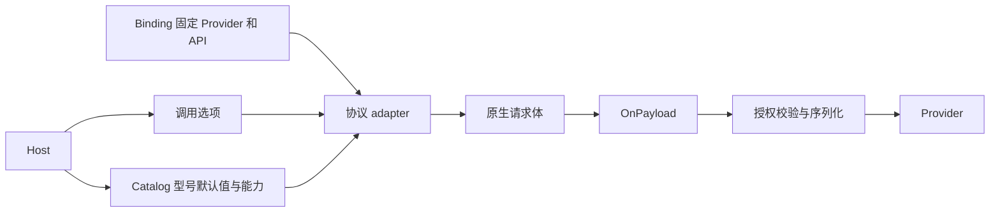
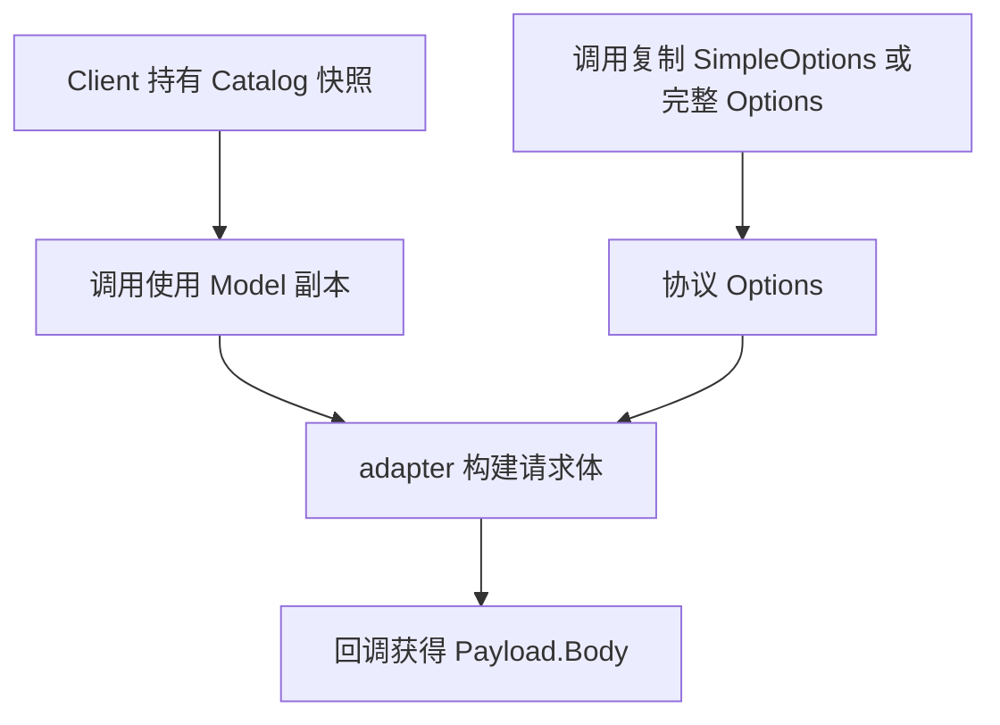
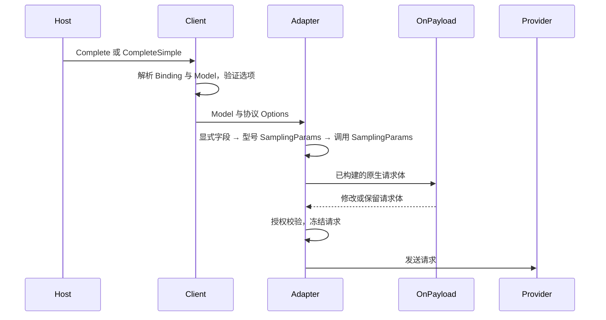

# barness-ai 采样参数与 Provider 行为

当前实现没有统一的 temperature 或 top_p 默认数值。内置目录 `2026-10-08.5` 的 87 个聊天型号都没有配置 `Model.SamplingParams`；未提供这些字段时，请求不会主动填写，数值由模型服务处理。OpenAI 和 DeepSeek 使用同一套参数覆盖顺序，Anthropic 和 Google 使用各自的协议字段。

## 范围与验证

问题是“当前 barness-ai 的采样参数怎么确定，涉及哪些 Provider”。范围覆盖聊天调用的选项来源、覆盖顺序、参数保留规则、协议转换与宿主请求回调；图像和分类只说明是否参与这套机制。

代码基线为 `39ab6a5`，核对日期为 2026-10-11。使用公共 Client、受控本地 Provider 和现有 E2E 场景执行，两次运行共 318 个证据用例，全部 PASS。通过临时 Go 程序调用 `BuiltinCatalog()`，观察到 87 个聊天型号、6 个 Provider 与协议组合，以及空的 `modelsWithSamplingDefaults` 列表。该结论描述本地实现及发出的请求，不给出厂商当前服务端默认数值。

## 参数来源与协议边界

Host 提供调用选项和可选的自定义 Catalog。Binding 固定 Provider 与 API 协议；型号按 Provider、API 和型号 ID 定位，adapter 按 API 选择。内置聊天目录来源是冻结的 pi-ai 1.0.0 数据，目录不会在线更新（[catalog.go](/Users/cyber/RestoX/barness/ai/catalog.go:24)）。



核心数据都由 Host 提供或选择；Client 构造时冻结目录，每次调用复制选项、map 和原始 JSON，避免请求之间共享可变参数。

| 类型 | 职责与生命周期 | 定义 |
| --- | --- | --- |
| `Model.SamplingParams` | Catalog 内的型号默认值，适用于 Responses 和 Chat Completions | [catalog_models.go](/Users/cyber/RestoX/barness/ai/catalog_models.go:29) |
| `SimpleOptions` | 单次调用的协议中立选项，随后转为协议选项 | [options.go](/Users/cyber/RestoX/barness/ai/options.go:27) |
| `ResponsesOptions` 与 `ChatOptions` | 单次调用的显式字段和原生字段 map | [responses_options.go](/Users/cyber/RestoX/barness/ai/responses_options.go:15)、[chat_options.go](/Users/cyber/RestoX/barness/ai/chat_options.go:18) |
| `Nullable[T]` | 保留未设置、null、具体值三种状态，0 也是具体值 | [nullable.go](/Users/cyber/RestoX/barness/ai/nullable.go:8) |
| `Hooks.OnPayload` | 可信 Host 的请求体回调，在协议构建后修改或替换请求 | [hooks.go](/Users/cyber/RestoX/barness/ai/hooks.go:31) |



## 一次调用中的覆盖顺序

OpenAI 和 DeepSeek 的 full 与 simple 入口都遵循同一顺序，后写入的同名字段胜出：

1. adapter 编码 `Temperature`、`MaxTokens`、推理强度等显式字段。
2. 按键应用 `Model.SamplingParams`，覆盖第一步的同名字段。
3. 按键应用调用级 `Options.SamplingParams`，覆盖前两步的同名字段。
4. 如果 Host 设置了 `OnPayload`，回调还能修改最终请求体；之后执行授权校验和序列化。

对应构建入口为 [responses_request.go](/Users/cyber/RestoX/barness/ai/responses_request.go:177) 和 [chat_request.go](/Users/cyber/RestoX/barness/ai/chat_request.go:151)，覆盖实现在 [applySamplingParams](/Users/cyber/RestoX/barness/ai/responses_options.go:197)。它逐个替换顶层字段，不递归合并对象，也保留 JSON null。



已有 E2E 的具体观察：Responses 的 `simple-sampling-merge` 场景设置显式 `temperature=0.7`，自定义型号默认 `temperature=0.1`，调用 map 只设置 `top_p=0.9`，最终请求温度为 `0.1`。Chat 的 `full-model-sampling` 场景设置显式温度 `0.7`、型号默认温度 `0.2`，最终温度为 `0.2`，调用设置的 `top_p=null` 原样发送。DeepSeek Chat 的 map 把显式 `maxTokens=64` 改为 `max_tokens=128`，并覆盖 thinking 开关。

## 各 Provider 的行为

| Provider | 聊天 API 协议 | `SamplingParams` | `Temperature` |
| --- | --- | --- | --- |
| OpenAI | Responses、Chat Completions | 应用型号默认值和调用覆盖值 | 写入顶层 `temperature`，仍可被 map 覆盖；显式 null 保留 |
| DeepSeek | Responses、Chat Completions | 同上；字段名采用目标协议的原生名称 | 同上 |
| Anthropic | Messages | 型号 map 和 SimpleOptions map 都不应用；完整选项没有该字段 | 仅当 `ThinkingEnabled` 非 true、非 Managed Effort 且型号支持温度时发送 |
| Google | Gemini Developer API | 型号 map 和 SimpleOptions map 都不应用；完整选项没有该字段 | 写入 `generationConfig.temperature`；null 与未设置都省略，0 保留 |

忽略 map 不代表整个 Provider 没有采样控制。例如 Anthropic 的 `top_k`、Google 的 `generationConfig.topK` 可由可信 Host 的 `OnPayload` 添加，现有 `TestProtocolCallbacks` 验证了这些请求体修改。

Anthropic 的温度条件见 [anthropic_request.go](/Users/cyber/RestoX/barness/ai/anthropic_request.go:212)，Google 的字段映射见 [gemini_request.go](/Users/cyber/RestoX/barness/ai/gemini_request.go:144)。这套 map 行为是对冻结 pi 的兼容约定，见 ADR-0011、ADR-0012。

整个模块还支持 TypeSafe Provider，但其分类 `TypeSafeOptions` 是空结构，不参与聊天采样选项（[classifier.go](/Users/cyber/RestoX/barness/ai/classifier.go:27)）。OpenAI 和 Google 的图像操作使用各自图像选项，不复用聊天 `SamplingParams`。

## 输出预算与校验

`MaxTokens` 是输出预算，与随机采样数值分别处理。simple 入口未设置或为 null 时取 `Model.MaxTokens`，再根据上下文估算和 4096 token 安全余量裁剪。完整选项中，Responses 映射为 `max_output_tokens`，非零值至少 16；OpenAI Chat 使用 `max_completion_tokens`，DeepSeek Chat 使用 `max_tokens`；Anthropic 未设置或 null 时取型号最大值；Google 未设置或 null 时省略。OpenAI 兼容路径的 map 后写入，因此也能覆盖此前计算的预算字段。

显式温度只检查有限数值，不提供统一温度范围。`SamplingParams` 检查每个值是合法 JSON，并拒绝模型、历史、工具、原生续接状态、缓存键、存储与流契约相关的保留字段；其他字段名称、取值范围和组合是否有效由 Provider 判断（[options.go](/Users/cyber/RestoX/barness/ai/options.go:112)）。

## 保持为黑盒的模块与设计观察

| 接口 | 输入与输出 | 本次不展开的原因 |
| --- | --- | --- |
| Binding 与 Credential Resolver | 租户作用域和目标 → 固定服务配置及凭据快照 | 只需确定 Provider 和协议，凭据流程不决定采样值 |
| 历史转换与 token 估算 | 消息历史 → 协议历史与估算输入量 | 只影响 simple 输出预算，不决定温度或 top_p |
| SDK 与流解码器 | 原生请求体 → 流事件和结果 | 采样字段在 SDK 发送前已构建完成 |

型号默认 map 高于调用显式字段，是需要特别记住的兼容行为。自定义目录一旦提供 `temperature`，仅设置调用 `Temperature` 不能改掉该值，调用者需要在调用 map 中覆盖它。若重新设计对外契约，我会考虑将“型号默认值低于调用显式字段”作为独立版本的语义；当前实现遵循冻结 pi，直接改顺序会改变已有契约。

后续如果需要 Anthropic 或 Google 的强类型 top_p、top_k，应在各自协议选项中设计，并同步评估 pi 差异，不应把目前静默忽略的通用 map 当作已支持。厂商当前默认数值是另一个问题，需按具体型号和官方协议文档核对。

## 可重复验证的证据

- [参数及型号约束证据清单](/Users/cyber/RestoX/barness/.evidence/barness-ai/20261011T015517.670771000Z/manifest.json)：233 个 PASS 用例。
- [宿主回调及 DeepSeek Responses 约束证据清单](/Users/cyber/RestoX/barness/.evidence/barness-ai/20261011T015628.236608000Z/manifest.json)：85 个 PASS 用例。

重放相同的有效测试集合：

```sh
go test ./ai/e2e -run '^(TestOptions|TestChatOptions|TestAnthropicOptions|TestGeminiOptions|TestDeepSeekChatOptions|TestModelSamplingRejects|TestManagedEffort)$' -count=1
go test ./ai/e2e -run '^(TestTrustedCallbacks|TestProtocolCallbacks|TestDeepSeekResponsesUnsupported)$' -count=1
```

每份清单包含场景独立重放命令、请求抓取、断言报告和文件哈希。验证仅使用离线受控 Provider，未调用厂商真实服务。
