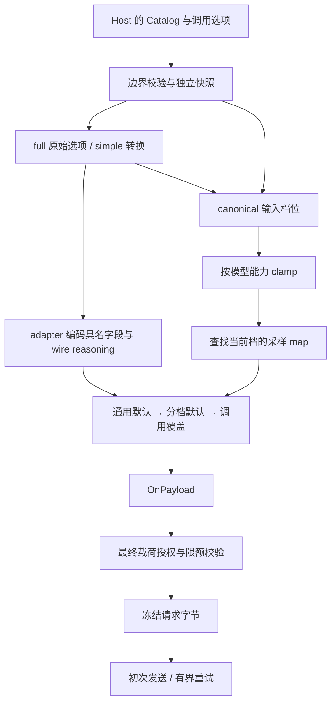

# barness-ai thinking level 采样映射：详细设计

Status: ready-for-agent
Updated: 2026-10-11

本文件是[规范](spec.md)的实现落点与迁移设计，描述目标状态；公共实现及来源/差分已完成，完整发布验证尚未通过。实际 live/effect 和压力状态见 evidence.md。需求编号 R01–R12 以规范为准。测试场景见[验收矩阵](acceptance.md)。

## 1. 领域边界与模块职责

Host 选择租户、Binding、Chat Model 与调用选项；Catalog 保存不含秘密的型号元数据。API adapter 决定协议支持哪些采样配置，Provider 身份决定实际路由与授权；两者不可混为一谈。采样映射是一轮 Chat 请求构造的一部分，不属于 Agent 任务策略或推理反馈系统。

| 模块边界 | 新职责 | 依赖方向 |
|---|---|---|
| Chat Model / Catalog | 保存分档 map，验证、深拷贝、计算内容哈希 | 元数据不依赖 adapter 请求 DTO |
| thinking level 规则 | 沿用 supported-level / clamp，保持 canonical 与 wire 分离 | 只依赖 Model 与既有 ThinkingLevel |
| 采样请求构造 | 根据入口的 canonical 输入选择分档；按三层 map 覆盖具名 JSON | 两个消费协议共享这项已存在的业务语义 |
| Chat / Responses adapter | 给出采样输入档位；各自保持 reasoning wire 编码 | adapter 调用采样规则，不由通用规则反推协议字段 |
| 可信回调与授权 | 采样之后回调，随后复核最终载荷 | 沿用现有 Hook 生命周期 |
| 逻辑调用与重试 | 固定一次快照、一次最终请求 | 不重新解析当前目录或档位 |

不新增接口注册中心、通用策略引擎或公开采样 resolver。共享采样函数服务两个已存在的协议用例；它只封装档位选择与顶层应用，不能兼任配置继承、授权或 reasoning wire 编码。



图中的 clamp 不回写 full 选项，wire reasoning 与采样选档没有反馈箭头。

## 2. 公共数据契约

目标字段类型为 `map[ThinkingLevel]map[string]json.RawMessage`，外层 JSON 名称 `samplingParamsByThinkingLevel`，使用 `omitempty`。不引入额外公开类型，也不新增 `ThinkingOff` 调用枚举；Host 可用既有字符串 key 类型表达目录的 off。

以下为目标 API 的元数据示例；数值仅演示覆盖关系，当前版本还不能编译这个新字段：

```go
model := ai.Model{
    Provider: ai.ProviderOpenAI,
    API: ai.APIOpenAICompletions,
    ID: "synthetic-chat",
    Reasoning: true,
    SamplingParams: map[string]json.RawMessage{
        "temperature": json.RawMessage(`1`),
        "top_p": json.RawMessage(`0.95`),
    },
    SamplingParamsByThinkingLevel: map[ai.ThinkingLevel]map[string]json.RawMessage{
        ai.ThinkingLevel("off"): {
            "temperature": json.RawMessage(`0.7`),
        },
        ai.ThinkingHigh: {
            "temperature": json.RawMessage(`0.8`),
            "top_k": json.RawMessage(`20`),
        },
    },
}
```

Host 在自己的完整 Catalog/Binding/Policy 装配中使用该模型，已有模型的其他必需元数据仍由 Host 提供。正式用户文档需补充可执行装配示例，不把这段合成片段当作完整 Client 配置。

| 位置 / 形状 | 目标语义 |
|---|---|
| 外层缺失、nil 或空 map | 无分档覆盖；omitempty 不输出空外层 |
| 某档缺失 | 选中该档时仅保留通用与调用 map |
| 某档 `{}` | 有效，无新增覆盖 |
| 某档 `null` / Go nil 内层 map | 配置错误：分档应为对象 |
| 档内参数值 `null` | 有效 JSON 值，覆写前值，最终请求保留 null |
| 档内参数值为空 bytes 或非法 JSON | 配置错误，未选中也拒绝 |
| 档位 `none`、`MINIMAL` 或拼写错误 | 配置错误，不是 canonical key |

新字段只属于 Chat Model，不加入 ImageModel、ClassifierModel 或请求级 Options。不增强已有 JSON 解码器为 models.json schema；类型解码不能保证的条件由 Catalog 边界验证。

## 3. 档位输入、夹取与 wire 的关系

| 入口 | 采样输入 | wire reasoning |
|---|---|---|
| Chat full | ReasoningEffort 非空，否则 off | 既有 ChatOptions.encode 行为 |
| Responses full | effort 非空；否则 summary 非空取 medium；否则 off | 既有 ResponsesOptions.encode 行为 |
| 两种 simple | 显式 reasoning 先按既有规则转换；省略或转换为 off 时，以 off 起算 | 既有 simpleOptions 省略 off effort 的行为 |
| 非推理模型 | 上述输入最终 clamp 到 off | 既有非推理分支，不因 profile 启用 thinking |

有序 canonical 集合为 `off < minimal < low < medium < high < xhigh < max`。普通档未标 null 即支持，xhigh/max 要求显式非 null；已支持档原样保留，不支持档先向上再向下找，全部 null 最终 off。未知请求档位由既有 Options 校验拒绝，不用本 helper 接受非法运行时值。

| 输入与模型 | effective key | 需要保留的结果 |
|---|---|---|
| minimal 映射为 low | minimal | 使用 minimal profile；wire 可以是 low |
| off 映射为 none | off | 使用 off profile |
| off=null，minimal 支持；省略 reasoning | minimal | 使用 minimal profile；不会额外补发显式 effort |
| low/medium=null，high 支持；full low | high | 采样 high；wire 仍可能 low |
| 同一模型 simple low | high | 采样 high；simple wire 为 high 的厂商值 |
| Responses 仅 summary，medium=null，high 支持 | high | 采样 high；wire effort 仍 medium |
| xhigh/max 没有显式 map | 通常 high | 即使目录有 xhigh profile，也不能单靠它开启支持 |
| 非推理模型，调用 high | off | 仅应用 off profile |
| 所有档位均 null | off | 保留 pi 兜底；不声称厂商必定接受 wire |

DeepSeek Chat 的 enabled/disabled 开关按既有 compat 编码。省略 reasoning 且 off=null 时不写 disabled，但采样可选择 minimal；这是客户端选档，不是已证明厂商默认为 minimal。

调用 SamplingParams 或 OnPayload 可以在既有授权范围内覆写 reasoning 字段，选档不会再运行。既有 reasoningExpected 用量策略也不因此改为读取最终载荷；这一已有边界需在用户文档说明。

## 4. 单次应用、校验与隔离

保留既有 JSON 顶层应用机制：先编码具名请求字段，然后依次应用通用、当前分档、调用三个来源。可选择私有分档选择函数配合既有 variadic 应用函数，避免生成无必要的合并缓存；不让两个 builder 复制 clamp/优先级算法。实现时将共用采样职责从 Responses 专属文件边界提取到小模块，删除旧位置实现，不添加 shim。

SimpleOptions 转换只搬运调用覆盖与既有选项，不提前塞入模型默认。pi simple 的内部两次合并在这两个协议下产生相同 effective key，Go 单次应用保留相同外部 JSON。证据必须验证此结论，不能只因实现更短而假定等价。

浅合并示例：具名 temperature=0.2，通用 temperature=1/top_p=0.95，high 档 temperature=0.8/top_k=20，调用 temperature=0/top_p=null；最终为 temperature=0、top_p=null、top_k=20。通用 `extra={a:1,b:2}` 与分档 `extra={b:3}` 得到 `extra={b:3}`。不递归合并，不以 null 删除字段。

校验顺序采用确定性档位顺序和参数 key 顺序，使错误可重现。新 map 的结构和 JSON 在所有 Chat Model 上有效，消费协议才校验保留键：

| API | 既有保留键，分档沿用全部规则 |
|---|---|
| Responses | model、input、stream、tools、previous_response_id、conversation、prompt、prompt_cache_key、store、background |
| Chat Completions | model、messages、stream、tools、functions、prompt_cache_key、store、web_search_options |

校验包含 inactive 档位。错误只给模型位置、档位、字段位置与原因，禁止嵌入原始参数值。新 map 接受任意合法 JSON 参数值，厂商是否接受参数由服务决定，不能把 metadata 校验等同于厂商 schema。

快照深拷贝需覆盖原目录、Client 内部目录、查询结果、枚举结果、返回目录；内层 RawMessage bytes 必须独立。构造完成后修改原配置不影响 Client；修改返回值不影响后续查找；最终调用冻结后修改宿主配置不影响重试。用同步屏障控制测试时序，不在调用方与构造器之间并发读写同一 Go map 制造非法测试。

Catalog 仍是 Client 的型号快照，不新增按租户查询 profile 的层次。同一 Client 上的多租户隔离用不同调用覆盖验证；Host 如为同一型号设置不同模型默认，可分别装配独立 Client/Catalog，测试其同 ID 配置不串扰。

沿用现有授权：分档不能绕开保留键，OnPayload 的最终载荷仍复核模型/托管资源权限和请求限额。重复尝试不再选择 profile 或调用回调，取消与失败资源归零保持原合同。Observer 不增加采样内容。

## 5. 本地实现落点

下表为当前代码位置指引，实施前核对实际代码；它不规定所有职责必须留在原文件。

| 当前落点 | 目标变化 | 需求 |
|---|---|---|
| [catalog_models.go](../../ai/catalog_models.go) | Chat Model 增加可选分档字段与边界注释 | R01 |
| [catalog_validate.go](../../ai/catalog_validate.go) | 新 map 全档结构/JSON 校验，按 API 复用保留键 | R06 |
| [catalog_snapshot.go](../../ai/catalog_snapshot.go) | 外层、每档、bytes 深拷贝；确定性 Hash 包含新字段 | R08–R09 |
| [reasoning.go](../../ai/reasoning.go) | 复用支持/夹取规则；不扩大 Reasoning 输入 | R02 |
| [responses_options.go](../../ai/responses_options.go)、[chat_options.go](../../ai/chat_options.go) | 保留 full/simple wire；向共享采样路径传 canonical 输入 | R03–R04 |
| [responses_request.go](../../ai/responses_request.go)、[chat_request.go](../../ai/chat_request.go) | 具名编码之后应用三层 map；两个 builder 用同一规则 | R04–R05 |
| [hooks_run.go](../../ai/hooks_run.go) 与既有调用生命周期 | 原顺序不变，通过 E2E 确认授权及冻结 | R07–R08 |
| [oracle runner](../../ai/internal/testkit/pioracle/node/runner.mjs) 与冻结 npm 目录 | ModelPatch 已能携带新字段；升级一套 oracle，不增平行协议入口 | R10 |
| [目录快照](../../ai/release/catalog-snapshot.json)、[追溯](../../ai/release/traceability.json)、[发布门禁](../../ai/release/cmd/releasegate/main.go) | 同步目录、基线约束、新增需求和固定合同哈希 | R09–R11 |

每个文件保持在 500 行以下。请求 DTO 不携带整个 Model 或可变 profile 引用；协议无关元数据不泄漏为厂商字段。无新生产依赖。

## 6. 冻结基线与目录迁移

| 维度 | 当前事实 | 目标交付 |
|---|---|---|
| pi-ai | 1.0.0 / a13d35a742c6ef8462812a28fbe1d8c8b7431c32 | 1.1.0 / abe508e1b89912adde45528136c3221eb69acdd7 |
| oracle 数量 | 一套 | 仍一套；删除旧运行依赖与旧 guard |
| 发布数据 | 当前 1.0.0 已有 provenance | 1.1.0 来源与逐文件等价核验尚待实施 |
| 采样元数据 | 通用 map；无分档 map | 通用 map + 分档 map；值由冻结发布数据或 Host 提供 |
| 正式目录 | 2026-10-08.5；研究时 87 个 Chat Model 条目 | 按真实内容升级版本，不预填目标数量和哈希 |
| 差分与发布记录 | 已有 1.0.0 合同 | 更新版本/commit/数据 hash；不减少旧需求 |

迁移必须先取得官方 `@earendil-works/pi-ai@1.1.0` tarball、integrity、gitHead、实际依赖及生成目录数据，核对与固定 tag 的关系；相关 telemetry 包按实际发布依赖核验，不臆定版本号或构建等价。源码 tag 不含生成数据时，只补入该发布件对应数据，不调用线上 generate-models。

按 ADR-0004 重建适用 dist 并逐文件比较，在两个干净环境记录复现命令、工具链、内容清单与哈希。发布件若不能证明等价，保留具体差异与工单，不能把未经证明的 npm 副本标成已验证源码 oracle。

迁移清点覆盖全部既有差分子集、错误/事件边界、目录已携带字段、原生扩展路线豁免和当前 SDK 依赖。差异逐条关联需求与工单；已批准 extension 只有在原原因和 case 范围仍成立时保留，新能力不能笼统登记为 extension。新增模型/Provider 不在此清点的产品交付范围内。

目标生成数据必须核验每个既有型号的通用/分档默认与硬约束，扩展目录字段比较覆盖两种 map。缺字段不自动制造值；若目标数据确实没有分档默认，明确记录该事实，公共能力仍由 Host 合成模型 E2E 验证。目录变更同步 Version、Hash、价格快照与 evidence pins，保留已有非聊天条目及其独立来源规则。Hash 沿用现有编码机制，只要求新增两层 map 的插入顺序稳定，不引入 RawMessage 内部对象键的规范化服务。

基线迁移在同一实现分支分步完成。请求映射尚未实现期间，新场景可以保持 linked pending/预期失败；这属于施工状态，不能发布，不能重置 ledger 来抹去失败。最后一次全量零 pending 运行与完整发布包才使目标基线正式生效。

## 7. 发布、失败处理与回滚

按 ADR-0017 的现行完整合同运行发布 gate，包括全部差分子集、离线与 race 的差分/压力、两种 vet、九组合当前 live 证据和独立业务效果证据。影响矩阵由实际基线/SDK/adapter/目录变化决定；不能以未修改某个 adapter 为由复用与新目录哈希不一致的旧 live 包。新增采样场景进入追溯与固定选择器，扩展路线继续明确跳过 pi 原生差分。

采样特性专项离线通过与整版发布通过分开记载。外部凭据等条件缺失时，保留已完成的代码和离线 artifacts，将缺项记为 NOT_RUN 并保留发布阻断，不把研究 probe、回放或历史 live 填成 PASS。

发布件等价失败阻止 oracle 切换；新硬约束未解决阻止相关目录与完整迁移；未解释差分阻止对应协议与正式基线完成；证据审计发现秘密阻止验收。没有无界重试或自动降级到旧 oracle。

回滚整套已发布版本：生产实现、目录/价格快照、oracle lock/provenance、ledger 和发布合同一起恢复。Host 回退版本时恢复匹配的旧 Catalog 配置，不增加新旧映射双写；旧版本的实际 decoding 行为不作为自动兼容承诺。保留历史证据供追踪，不把历史包当当前验证。

## 8. 实施顺序

| 工单 | 所有权 / 交付范围 | 依赖 | 主要验收 |
|---|---|---|---|
| [01 发布件核验](issues/01-verify-pi-1.1-release.md) | 来源、生成数据、两环境等价证明、迁移差异清点 | 无 | B01 |
| [02 单一基线迁移](issues/02-migrate-single-oracle.md) | oracle、基线校验、ledger 与迁移必需的兼容修正 | 01 | B02–B03 |
| [03 目录元数据](issues/03-catalog-profiles.md) | 数据字段、全档验证、深拷贝、Hash/Version、来源默认 | 02 | S18–S25 |
| [04 请求映射](issues/04-resolve-sampling.md) | 两个协议 builder、full/simple 输入、三层覆盖 | 03 | S01–S17 |
| [05 生命周期与差分](issues/05-isolation-and-differential.md) | 回调授权、重试、并发、全量差分及证据审计 | 04 | S26–S30、B03 |
| [06 契约与发布](issues/06-document-and-release.md) | 用户文档、主规范/ADR、追溯/固定合同、完整发布包 | 01–05 | B04 |

需求与失败场景先进入 E2E，再实现；各工单不得补写镜像实现的单测。基线切换不在文档生成这次任务中执行。

## 9. 依据与实施前必须核验的事实

当前实现依据[采样现状报告](../barness-ai-sampling/report.md)；目标语义依据[pi 研究](../pi-1.1.0-thinking-sampling/research.md)，尤其第 3、4、6、9 节。约束来自 ADR-0003、0004、0005、0011–0015、0017、0018、0019、0020。

研究已验证固定源码 helper 的 16 条离线断言，未核验 1.1.0 npm 生成数据、发布件构建等价、全部 upstream 测试或 live 请求。因此不得预写 1.1.0 的模型采样数量、数据 hash、依赖版本或正式发布通过结论；工单 01 将这些未知量转换为可审查来源 artifacts。
