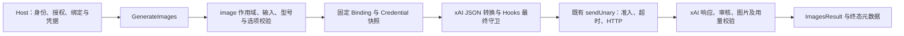

# xAI Imagine 经 barness-ai image 路径接入方案

Status: ready-for-agent
Updated: 2026-10-29
Baseline: `1e244ee26f024ce3534eed0600c43f6317d77adb`

本文是用户于 2026-10-29 确认的设计方案，Q1–Q7 均已达成共同理解。ready-for-agent 表示方案可供后续实施使用，本轮只交付研究和设计，不自动开始代码实施。官方事实见 [research.md](research.md)。已确认 image 路径、文生图＋有序参考图编辑、全球 2.0、按张估算、能力上限、沿厂商默认、独立 USD 报告费用。代码、正式目录和真实支持状态尚未改变。

## 1. 设计结论

通过既有 `Client.GenerateImages` / `HookedClient.GenerateImages` 接入同步文生图与参考图编辑。复用 `ImagesRequest`、`ImagesResult`、`ImagePolicy`、调用作用域、凭据快照、Hooks、逐次准入、取消、有限重试和 Observer。

首期型号为 `grok-imagine-image-2.0`，全球目标 `https://api.x.ai/v1`，Provider 沿用 `xai`。定义 `xai-images` 协议和封闭的 `XAIImagesOptions`；路径相同不表示 wire 契约相同。该协议的请求 DTO、最终请求守卫、响应和计费转换独立，实现继续使用 Client 唯一 HTTP 客户端及 `sendUnary`。

按张价格和 token 价格是两个不同计量口径。对现有 ImagePricing 增加明确的按张价格分支，复用 Attempt.CostEstimate 表达完整、区间或未知估算；保持 Usage token 字段的含义。另用 Attempt.ReportedCostUSD 保留厂商报告的本次收费，不把它装进估算。

## 2. 当前代码证据与修改面

| 当前接缝 | 已有行为 | 建议变化 |
| --- | --- | --- |
| `ai/images.go` | 唯一同步图片入口；当前分派 Google，否则 OpenAI | 增加 xAI 显式分派和选项快照，避免落入 OpenAI 默认分支 |
| `ai/images.go` 中 ImagesRequest/ImagesResult | 提示＋有序内联参考图；整组校验后发布 | 继续使用，厂商资源 DTO 留在适配边界 |
| `ai/binding.go` | 已有 ProviderXAI，图片协议为 openai-images / google-interactions | 新增 APIXAIImages；调整 ProviderXAI 只描述聊天的注释 |
| `ai/xai_binding.go` | 拒绝 xAI 的非 chat/openai-responses 组合 | 精确允许 image/xai-images，继续使用全球目标校验 |
| `ai/call_runtime.go` | image 分派仅允许 OpenAI、Google | 增加 image/xai/xai-images 的可调用身份 |
| `ai/catalog_validate.go` | 显式拒绝 xAI ImageModel；所有图像按 token 费率校验 | 增加真实子集校验及按张价格分支 |
| `ai/catalog_operations.go` | ImageCapabilities 已有张数、ImageSizes、AspectRatios、Qualities | 尽量复用这些字段表达候选能力；无须新增能力注册框架 |
| `ai/image_policy.go` | 内联图片、MIME、字节、提示和输入张数校验 | 保留宿主限额；在 xAI 边界再收紧本协议的参考数和 MIME |
| `ai/unary.go` | 冻结请求后发送；2xx 后不重放；共享超时与正文限制 | 直接复用，不增加轮询、下载器或第二套网络栈 |
| `ai/image_usage.go`、`ai/cost_estimate.go`、`ai/retry.go` | 当前按模态 token 计价；已有 usageEstimate 记录估算 | xAI 独立转换，禁止把图片张数写成 token；复用已有估算和 Attempt 生命周期 |
| `ai/catalog_snapshot.go` | 目录深复制及内容哈希 | 为按张价格分支补指针/列表复制；价格表纳入快照 |
| `ai/live/`、`ai/internal/testkit/supportmatrix/` | 各路线自身真实捕获与资格 | 为 image/xai/xai-images 增加自身证据，不继承 xAI 聊天或 OpenAI Images 的 PASS |

源码依据均为本次基线；实施前重新核对实际差异。现有依赖见根 `go.mod`，无需为这个同步 JSON 切片新增 SDK。OpenAI 的 Go Images 编辑接口按 multipart 建模，xAI 官方明确编辑要求 JSON，因此沿已有图像 unary 直连模式处理。[官方编辑说明](https://docs.x.ai/developers/model-capabilities/images/editing)；[既有直连决定 ADR-0022](../../docs/adr/0022-barness-ai-openai-images-unary.md)。

## 3. 领域职责与数据流



Host 负责调用主体、租户、账户、参考图访问权、凭据、结果持久化和多轮业务流程。barness-ai 负责单次图片操作的协议转换、限额和诊断。后续编辑由 Host 把上次返回图片作为下次 ReferenceImages 重新提交，无需聊天 Transcript 或原生续接状态。

图片 Binding 必须显式声明 `OperationImage`，白名单只解释在该 Provider/协议/操作下的型号。chat Binding 不能获得图片生成权限；可以按既有凭据契约引用同一真实账户凭据，但不共享调用授权。

## 4. 请求转换建议

建议选项为 N、AspectRatio、Resolution、Quality，均保留 Nullable 的省略/null/值语义；显式 null 拒绝。不复用 OpenAIImagesOptions 的 Size、OutputFormat、Mask 等字段来承载 xAI 的不同语义。

Q4/Q5 已确认的候选范围：生成 N=1–10；编辑参考数1–5、N=1；Resolution 为 1k/1.5k/2k；Quality 为 low/medium/auto。所有上限继续取协议、型号和宿主策略的交集。nil 选项与省略字段沿用厂商默认，不由库注入 low；示例、固定证据和预算运行显式指定质量/分辨率。官方支持的显式宽高比候选列表见研究报告；单图编辑先采用下文保守限制。

| 领域输入 | xAI wire 建议 |
| --- | --- |
| 无参考图 | POST `/images/generations` |
| 一张参考图 | POST `/images/edits`；`image:{type:"image_url",url:"data:...;base64,..."}` |
| 多张参考图 | POST `/images/edits`；有序 `images:[{type:"image_url",url:"data:...;base64,..."},...]` |
| 提示词 | `prompt`，沿用公共入口的有效 Unicode 与 1–32000 字符边界；这是 barness 当前限制 |
| 输出交付 | 固定 `response_format:"b64_json"`，协议内部字段，不开放成可变选项 |
| 张数 | `n`，取协议、型号、ImagePolicy 三者交集 |
| 比例/分辨率/质量 | `aspect_ratio` / `resolution` / `quality`，依明确候选能力验证 |

生成的 n 文档范围为 1–10；参考图官方范围为最多五张。编辑返回张数上限与各字段的精确兼容关系须以 REST schema 和自身真实捕获约束，不将生成上限直接授予编辑。来源：[生成](https://docs.x.ai/developers/model-capabilities/images/generation)、[编辑](https://docs.x.ai/developers/model-capabilities/images/editing)、[多图编辑](https://docs.x.ai/developers/model-capabilities/images/multi-image-editing)。

最新 REST 的编辑 n 没有明确 min/max，建议首期编辑只开放 n=1；若希望编辑一次多输出，另列候选场景确认，而非直接继承生成的 1–10。官方 TypeScript SDK 固定版本的 OpenAPI 说明单图编辑沿用输入图比例、aspect_ratio 只用于多图编辑；最新 REST 的字段描述不足以裁定全版本行为。建议单图首期拒绝显式 AspectRatio，多图允许明确比例，并将该限制记录为保守候选边界，来源差异详见研究报告。

回调前完成已知输入和编码长度检查；回调后独立冻结、严格解析和重验最终字节。请求目标、授权型号、同步执行和 base64 返回方式是固定边界。拒绝外部 URL、file_id、未知/重复字段、非法 null、deferred、stream 及不能由本操作表达的资源/状态。不从聊天协议复制 store:false、include 或续接字段；图片接口未文档化这些字段。Hook 能修改已授权的内容与选项，但不能把已选 generations 端点变成 edits，或反向变更；编辑输入须维持合法形状与数量。

输入仅使用本次已授权的内联图片，按最终输入计数、字节和能力检查。应用现有按长度先拒绝、再编码与验证的策略，复用严格 base64 和图片文件头函数；不机械复制 OpenAI 专用的 `image_url` 对象守卫。

## 5. 响应、失败与资源

固定请求 base64，返回规范 ImageOutputImage。b64_json 为裸 base64；根据 xAI 的原始 MIME 及实际文件头校验，不能继承 OpenAI 默认 PNG。REST 允许 mime_type 缺失/null，建议此时用已支持 PNG/JPEG/WebP 的文件头确定规范 MIME；未知格式或声明/文件头冲突失败。该回退只识别内容类型，不下载外部资源、不转换图片格式。整组图片通过后才发布 Content；错误时清空 Content，保留已经取得的合法用量和费用事实。

响应解析须明确处理审核、返回数量、实际服务型号、缺图、URL、无效 base64、MIME 冲突、未知异步状态和超限。明确审核失败为 upstream_error；损坏协议为 protocol；容量为 resource_limit；取消沿已有 aborted 行为。若同组含被过滤结果，不静默发布剩余图片，也不补发厂商请求。型号字段缺失不伪造；仅因示例中缺省字段，不能声称所有响应必然缺失。

respect_moderation 仅见官方 Python SDK 使用示例，REST schema 没有承诺该字段必返；不能因 REST 未返回此字段就拒绝一切正常响应。对实际出现的明确拒绝信息分类，结合合法图片/数量和完整响应判定成功；自身捕获固定真实字段形状。

返回 URL 不能触发自动下载。HTTP 202、request_id 或 deferred 结果不能被当作同步成功。响应 ID、实际型号和 ProviderRequestID 只保留真正上报的诊断事实，不伪造、不当作后续请求状态。输出 MIME、审核字段和 usage 的准确 presence 合同由研究报告及自身捕获继续固定。

共享策略覆盖请求字节、总响应字节、输入单图、输出单图/总图像字节、图片数量、排队、准入与取消。不要为本次引入新的后台任务或持久状态。2xx 后的审核/解码/图片失败不重试；默认不重试，宿主显式配置的初始请求重试仍须说明可能重复计费。

## 6. 按张价格和独立报告收费

当前 ImagePricing 是每百万 token，不能真实描述 xAI 的图片计费。候选扩展只解决本次已存在的第二种真实计量口径，不设计通用计费引擎。

| 候选口径 | 建议表达 |
| --- | --- |
| token 价格 | 现有字段和含义保持；原目录快照保持原字节 |
| 按张价格 | 显式独立分支：输入每张单价、输出 quality × resolution 单价表、官方来源和日期 |
| 图片数量 | 与 token 用量独立，按厂商上报与已验证返回事实区分；不把请求 n 当作实际扣费张数 |
| token 未报告 | UsageReporting 保留 unreported/partial 事实，不填造 token |
| 估算成本 | 使用现有 CostEstimate；不能从 UsageReporting 推导费用完整性 |
| 厂商报告收费 | 独立可选 Attempt 金额事实，不能写入 CostEstimate 或将缺失解释为免费 |

2026-10-29 官方表中，2.0 输入每图 $0.01；输出 low 的 1K/1.5K/2K 为 $0.04/$0.05/$0.06，medium 为 $0.06/$0.07/$0.08。[官方定价](https://docs.x.ai/developers/pricing)。生成指南列举漏了 1.5K，但 [官方 REST 完整 Markdown schema](https://docs.x.ai/developers/rest-api-reference/inference/images.md) 在生成和编辑的 resolution 枚举均包含 `1k` / `1.5k` / `2k`；因此可以列为官方候选能力，自身接受性仍待真实证明。

官方 [Cost Tracking](https://docs.x.ai/developers/cost-tracking) 明确 `usage.cost_in_usd_ticks` 是厂商报告本请求实际已计费金额，`10^10 ticks = 1 USD`；它不是从本地目录计算的费用。Q6 已确认新增 `Attempt.ReportedCostUSD Nullable[float64]`，JSON 为 reportedCostUsd，沿现有金额类型输出 USD；原生捕获保留精确整数 ticks 供验算。wire 计数先严格校验非负 int64，拒绝小数、溢出和重复字段，再换算有限金额。缺失/null 不赋值，显式零保留为零。公共金额不承诺逐 tick 无损累计，不另加一份整数金额双写。

按张价格形状为可选 `ImagePricing.PerImage *ImagePerImagePricing`：输入每张费率＋输出质量/分辨率费率表；与旧 token/cache 费率互斥。建议子类型字段为 InputImage Nullable[float64]、Output []ImageOutputPrice，其中每行含 Quality、ImageSize、Price Nullable[float64]；单位明确为 USD/张，Source 继续记录官方链接与日期。仅对按张分支豁免“每个模态必须有 token 费率”，不写假零费率。对开放的 low/medium × 分辨率组合校验唯一、完整、非负有限价格，补目录深复制；auto 是选择策略，不虚构单一 auto 费率。仍依既有版本/hash 固定来源，新指针省略时不改变旧目录 JSON 含义。

[REST 示例](https://docs.x.ai/developers/rest-api-reference/inference/images) 的 token 计数可为 null 或缺失，却有收费。建议保持 Usage token 与其 Reporting 的既有合同：token 全缺时 Usage 保持零，按张估算只由 Attempt.CostEstimate 返回，厂商收费只由独立字段返回。不要为了给 Usage.Cost 填值，悄悄改变 UsageUnreported 的现有语义。若未来需要公开图片计费数量，增加独立图片依据；目前 wire 未承诺一个通用计费张数 counter，不凭收费反推张数。

因此既有 CostEstimate 注释中“bounded 的 Usage.Cost 为下界”须明确其原 token 路径适用范围；本图片路径的金额从 Attempt.CostEstimate 读取，即使 token 为 unreported 也可以有有据的估算。这是文档合同的显式补充，不将错误或缺失 token 填造出来。有效厂商报告费用须在图片校验前保留；估算在数量与档位依据成立后登记，图片失败导致依据不完整时保持 partial/unreported，不用请求 n 假装已收费输出数量。Observer 随 Attempt 携带独立收费标量，只需增加元数据审计白名单，不能加入图片、提示或错误正文。

批量编辑还有一个未裁定的计费事实：当 n>1 时，输入图费按请求计一次还是随每个输出重复计入。官方费率表没有给这个公式，因此不承诺精确的批量编辑估算。首期编辑 n=1 可避开此歧义；扩大前需官方说明或自身有界真实证据。已报告收费不受该估算歧义影响。

`quality:auto` 当前文生图选 low、编辑选 medium，收费跟随实际质量。Q5 已确认保留厂商默认，不能永久假设 auto 的映射。[官方迁移说明](https://docs.x.ai/developers/migration/imagine-image-quality-nov-2)。完整成功且计费计数、质量、分辨率均确定时估算点值；只知有限边界时用区间；计费事实缺失时保留未知，禁止把成功交付数量直接等同全部收费事实。未返回可确认质量时，在已固定的 low/medium 价格之间形成费用区间；若分辨率或其他事实也不能限定，则继续保留未知。厂商收费独立显示，不因本地估算有区间而丢失。

若响应确实报告 token，独立转换原始计数：input_tokens 已含文本和图片，cached_tokens 是文本子集；output_tokens 已含重写提示词、reasoning 与 image，Reasoning 只作输出内分项。对完整可核对关系检查非负整数、溢出和总量一致性，不重复相加；缺项保留 partial/unreported。这些 token 仅作为厂商用量事实，不进入按张费率计算。[官方 REST schema](https://docs.x.ai/developers/rest-api-reference/inference/images.md)。

### 公共装配示意（拟议新增类型，尚未实现）

```go
binding := ai.Binding{
    TenantID: tenantID, BindingID: "imagine", Version: "image-binding-1",
    Enabled: true, Operation: ai.OperationImage,
    ProviderID: ai.ProviderXAI, API: ai.APIXAIImages,
    Endpoint: "https://api.x.ai/v1", AuthKind: ai.AuthAPIKey,
    AccountScopeID: accountScopeID, CredentialRef: credentialRef,
    AllowedModels: []string{"grok-imagine-image-2.0"},
}
// Host 将此 Binding 与配对凭据存入既有 resolver，使用含候选型号的
// 独立 Catalog 及显式 ImagePolicy 创建 client，不在库内读取环境 Key。
result, err := client.GenerateImages(ctx, scope,
    ai.Target{BindingID: binding.BindingID, ModelID: "grok-imagine-image-2.0"},
    ai.ImagesRequest{Prompt: "一只蓝色纸鹤停在木桌上"},
    ai.XAIImagesOptions{
        N: ai.Value(1), Resolution: ai.Value("1k"), Quality: ai.Value("low"),
    })
```

参考图编辑使用同一入口与选项，把本次已授权的 `[]ai.Image` 传入 ReferenceImages。Host 读取 Content 的规范图片、Metadata.Attempts 的目录估算与独立厂商报告费用，不从空 token 或 StopReason 推导免费。

## 7. 实施和验证顺序建议

遵循 [测试流程 SOP](../../docs/agents/verification.md)，后续先完成失败场景再实现，优先公共 Client E2E。本文仅定义未来验证建议，本次没有运行测试或厂商调用。

1. 已完成：确认设计树上的范围、型号、计价和默认行为，形成当前 spec 与本设计；公共边界和计价决定已记为 accepted ADR-0056。以下为未来实施顺序，本轮未执行。
2. 先写公共入口失败场景：身份/选项/输入、请求冻结、审核/解析、计价、取消/释放与租户隔离；再做最小运行时与候选目录实现。
3. 通过受控上游验证 JSON 和全生命周期，保留请求/响应、Result、Observer、目录、图片和 audit 的可重放产物。增加 OpenAI/Google Images 与 xAI 聊天的受影响回归，尤其覆盖 Binding 校验分支。
4. 将最终候选版本和真实场景冻结，列明调用数、输出图数、输入图数、质量/分辨率和 USD 预算。之后按 SOP 独立申请所需真实执行授权；研究请求本身不代表付费执行授权。
5. 本组合真实证据覆盖生图、单图编辑、多图顺序、所声明的选项及真实用量/费用。文档和离线夹具不能替代自身接受性；声明更宽能力须有相应证据。
6. 按实际修改面提出人工 race/压力选择，保留未执行状态。完成适用证据后评估正式目录和发布，不继承聊天路线或其他图片 Provider 的资格。

公共 E2E 至少覆盖：chat/image 跨入口拒绝且零凭据/HTTP、同名不同租户 Binding、错误型号/选项、typed nil/null、参考数与字节边界、生成/编辑 JSON、Hook 对固定项与最终资源的修改、正确/缺失/非法计数、auto 费用未知或区间、审核拒绝、部分图片失败整组清空、2xx 后不重放、取消/超时、资源归零、价格和结果副本隔离。

本方案无数据库迁移。回滚通过 Host 禁用该 image Binding 并更新版本，已固定调用按原快照结束或取消。保留旧价格快照和证据；不回退聊天路径、不自动切换旧别名。

## 8. 设计树与待决问题

| 节点 | 状态 | 结论或后续 |
| --- | --- | --- |
| 走 barness-ai image 路径 | 已由用户确定 | 使用 GenerateImages，OperationImage |
| Q1 首期能力 | 已确认 | 同步文生图＋有序参考图编辑；视频独立 |
| Q2 型号 | 已确认 | 全球 2.0；旧版与别名不纳入 |
| Q3 计价交付 | 已确认 | 本次包含正确按张估算 |
| Q4 能力上限 | 已确认 | 生成最多10张、最多5参考/编辑输出1张，分辨率三档；正式声明须有自身证据 |
| Q5 选项默认和 auto | 已确认 | 省略沿厂商默认，示例与验收显式固定质量/分辨率 |
| Q6 厂商收费精度 | 已确认 | 独立 USD 浮点金额，原生捕获保存整数 ticks |
| 同步 JSON 与内联图片 | 既有契约推导的方案 | 遵守既有图像边界；若需求改变则重开讨论 |
| 新公共协议与价格形状 | 已确认 | 见 [accepted ADR-0056](../../docs/adr/0056-barness-ai-xai-images.md)；尚未改代码 |
| Q7 整体共同理解 | 已确认 | 本方案的协议边界、保守限制和交付顺序已确认；本轮只交付研究和方案 |
| 实施/付费/发布 | 本轮未执行 | 本次产物为研究和方案，后续执行按新任务及 SOP 推进 |

设计 frontier 已收敛；剩余未知项为研究报告明确列出的厂商待证事实，不授予额外能力。当前唯一进度见 [spec.md](spec.md)。
