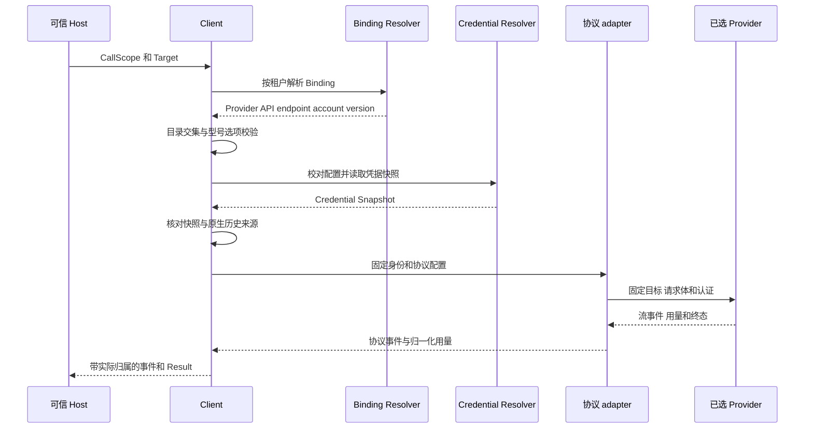

# barness 地区 Provider 支持设计

Updated: 2026-10-20

采用独立 Provider 表达 GLM、MiniMax 的中国站和国际站，型号、价格、账户授权和支持证明分别归属各自服务；共同的协议行为继续使用现有 adapter。本文描述实现结构，[spec](spec.md)定义需求与验收，[ADR-0049](../../docs/adr/0049-barness-ai-regional-provider-identities.md)记录架构决定。当前实施与验证状态统一见 spec 的“当前状态”。

## 1 业务目标与设计依据

Host 必须能在同一个 Client 中同时使用两个市场，并为同名型号分别配置能力、思考档位、采样默认和价格。市场差异由模型服务身份承载，租户权限由 Binding 承载；一个市场更新型号或发生故障，不改变另一市场的配置或授权。

沿用 [GLOSSARY](../../GLOSSARY.md) 和 [ADR-0020](../../docs/adr/0020-barness-ai-model-operations-and-binding-authorization.md) 的 `(Operation, Provider, API, ModelID)`。不增加 Site 字段，不将品牌加入调用身份，也不将不同地区归一化成一个 Provider。官方端点与价格依据使用 [research](research.md) 中 2026-10-20 的一手来源；型号能力、实际 wire 和账户资格仍分别取证。

## 2 服务身份与交付范围

| 服务 | Go 常量 | Provider ID | 处理方式 |
| --- | --- | --- | --- |
| 智谱中国站 | `ProviderZhipu` | `zhipu` | 保留现有语义 |
| Z.AI 国际站 | `ProviderZAI` | `zai` | 新增独立身份 |
| MiniMax 国际站 | `ProviderMiniMax` | `minimax` | 保留现有语义 |
| MiniMax 中国站 | `ProviderMiniMaxCN` | `minimax-cn` | 新增独立身份 |

首批标准 API 接入覆盖四个 Provider 的 Chat Completions、Responses、Messages。GLM 两站各以 `glm-5.3`、`glm-5.2` 为首批目标，MiniMax 两站各以 `MiniMax-M3` 为首批目标：共 12 个 Provider × API 路线、18 个型号身份，其中新增 6 条路线、9 个型号身份。这个计数仅指本功能的四个 Provider，不替代整版发布清单。

这些型号是独立候选与正式验收目标，不是从现有目录复制即可发布的条目。某条路线缺少资格或自身证明时维持未完成，不能删去目标凑齐交付。`MiniMax-M3.1-Flash` 的新增、旧 Preview 名称迁移、图片和视频接入不在本次首批范围；其后续加入继续走独立 Model 数据和支持证明，不再修改地区身份模型。现有其他型号、套餐候选及其历史状态保持原合同。

## 3 模块职责与依赖

| 边界 | 职责 | 不承担的职责 |
| --- | --- | --- |
| ProviderID | 表达实际模型服务身份 | 品牌分组、账户、协议、网络代理 |
| Model 与 Catalog | 保存每个完整型号身份的能力、默认值、约束、USD 估算价格及版本 | 租户授权、凭据、套餐识别 |
| Host | 鉴权、配置可信 Binding、匹配服务和凭据来源、声明使用资格 | 通过 URL 或 key 文本猜测权益 |
| Binding 与 Credential Resolver | 按租户解析配置与凭据，固定账户和版本 | 跨站寻找可用 key 或型号 |
| 协议能力配置与 codec | 选择该 Provider 已接入的请求、响应、用量和原生历史形状 | 更改 Provider 身份、授予 Model 访问权 |
| Native State | 核对真实来源，决定原生回放或安全降级 | 以共享 codec 证明来源相同 |
| 支持矩阵与发布工具 | 核对每个服务、型号、协议的自身证明 | 用共同实现的 PASS 认证另一个服务 |

依赖方向保持 Host → 公共 Client → 目录与绑定解析 → 协议 adapter。Catalog 不依赖协议 DTO；adapter 不依赖 Host 的秘密存储、套餐产品或 UI。品牌与地区的展示分组由 Host 维护少量静态显示数据，不引入运行时 Vendor、SiteRegistry 或可写能力注册中心。

## 4 公共契约与型号目录

### 4.1 公共接口

在 `ai/binding.go` 增加两个常量；保留 Target、Binding、Credential、Model、消息、Result 和 NativeStateEnvelope 的现有字段形状。四种聊天入口及 WithHooks 继续工作。调用者只提交 BindingID 与实际 ModelID，Provider、API、endpoint、account 和 credential 从可信 Binding 获得。

`AdmissionRequest` 增加 `ProviderID ProviderID`，由已固定的 Binding 填写；回调接口签名不变。Host 的账户级准入可用 `(ProviderID, AccountScopeID)` 区分不同服务，同时仍可按明确政策让多个租户共享同一真实账户额度。库内租户 / 进程限额保持原义，不新增配额引擎。使用位置式 struct literal 或固定字段集合断言的调用方需更新；采用 keyed literal 的 Host 不必改变 Admit 方法签名，接入多地区时仍必须审核账户聚合键。

新增 Provider 不会扩大 image / classifier 的路由授权。未知 Provider 的现有自定义聊天接入行为也不在本次全局收紧；四个已知地区服务必须逐协议使用明确配置，不能依赖未知 Provider 的原厂默认分支。

### 4.2 目录所有权

每个 `Operation × Provider × API × ModelID` 保存一份完整记录。同名 ID 可以跨 Provider 或 API 共存；重复完整身份仍在 NewClient / Catalog.Hash 失败。ModelID 就是厂商请求中的 `model`，不追加地区后缀，不添加本地别名翻译。

每条记录独立保存 Input、ContextWindow、MaxTokens、Reasoning、ThinkingLevelMap、DefaultThinkingLevel、SamplingParams、SamplingParamsByThinkingLevel、Compat 和 Cost。数据不从兄弟 Provider 动态继承，不由一个协议条目生成其他协议条目。重复的事实随目录注明独立演进原因；协议算法的复用与目录事实的独立维护分开处理。

Host 可提供包含多个地区的自定义 Catalog；其元数据仍受对应 Provider 协议能力限制。AllowedModels 只是目录交集，不能覆盖型号价格和能力，也不能授予另一个 Provider 的同名型号。目录按 Provider / API 查询返回深复制，构造和调用快照不受后续 map、slice 或配置修改影响。

Model 或价格内容变化必须更换 Catalog.Version 并产生新 Hash。现有目录只有整个快照的版本和 Hash，本期不引入每 Provider 独立热更新；市场数据可以分别修改，但发布仍使用一个固定 Client 快照。

### 4.3 价格与来源

每个市场、型号、协议的价格依据独立归档，至少包括完整身份、官方 URL、读取时间、原始内容 Hash、币种、计价单位、档位条件和候选目录版本。人民币价格转换记录汇率日期、来源、方向和计算过程；运行时继续使用 USD / 百万 token，不在调用中抓价格或换汇。

公开价格表未列某型号，不等于模型不存在；缺少可用费率也不等于免费。合成价格只进入明确标记的离线 fixture，不能晋升正式目录或被展示为真实套餐扣费。缓存写入缺价、缺少 usage 和已知零用量继续按现有用量契约分别处理，不通过本次拆分绕过保护。

## 5 协议实现共享

### 5.1 协议内选择实现

保留现有 `chatCompatOf`、`responsesCapabilitiesOf`、`anthropicCapabilitiesOf` 三个内部配置入口。各自增加协议私有的实现选择值，和既有能力布尔值一起返回不可变配置：Chat 与 Responses 可选择现有 standard、DeepSeek、GLM、MiniMax 实现；Messages 可选择现有 Anthropic、GLM、MiniMax 实现。枚举由各协议拥有，不建立跨协议的大型 Provider 驱动接口。

每个入口以完整 ProviderID 显式选择自身配置。`zai` 可以在核验相符的部分选择 GLM 实现，`minimax-cn` 可以选择 MiniMax 实现；有差异的字段或事件由该协议内的独立分支表达。没有核验的能力缺省关闭，不能因为同品牌、同协议或相似 schema 全量启用。

这种选择只决定 codec 和最终校验器，实际 Model.Provider、Binding.ProviderID、消息来源及归属始终是原始 ID。能力配置不保存租户、账户、key、请求缓冲区或“当前 Provider”，不存在跨调用可变状态。

### 5.2 分支迁移范围

实施前列出生产路径中所有 `ProviderZhipu` / `ProviderMiniMax` 判断，逐项分类。请求、流、错误、用量和可回放内容的协议形状判断改用协议配置；授权、来源相等、目录索引、计价和归属比较继续使用真实 ProviderID。不能用统一的 `isGLMFamily` / `isMiniMaxFamily` 判断替代这两类语义。

需覆盖的具体路径包括最终 payload、thinking 默认与开关、tool_stream、reasoning_content / reasoning_details、Responses 内容投影与终态、Messages 块顺序与签名、工具 ID 转换、usage 细节、错误结构、请求 ID 头及 Hooks 后的复核。历史处理既要根据目标选择编码，也要根据源 Provider × API 识别原始形状；源身份不被改写。

旧 Provider 的最终请求和可见行为维持原合同；第 8 节的缓存键升级是唯一预先明确的共享 wire 变化。临时分支在同一次迁移中删除，不保留旧字段 shim、Provider 别名或双套生命周期。实现文件接近 500 行时按协议职责拆分。

## 6 端点与可信 Host 配置

### 6.1 标准 API 预设

| Provider | Chat base | Responses base | Messages base |
| --- | --- | --- | --- |
| `zhipu` | `https://open.bigmodel.cn/api/paas/v4` | `https://open.bigmodel.cn/api/v1` | `https://open.bigmodel.cn/api/anthropic` |
| `zai` | `https://api.z.ai/api/paas/v4` | `https://api.z.ai/api/v1` | `https://api.z.ai/api/anthropic` |
| `minimax` | `https://api.minimax.io/v1` | `https://api.minimax.io/v1` | `https://api.minimax.io/anthropic` |
| `minimax-cn` | `https://api.minimax.cn/v1` | `https://api.minimax.cn/v1` | `https://api.minimax.cn/anthropic` |

这些是 Binding.Endpoint 的 base。adapter / SDK 添加 `/chat/completions`、`/responses` 或 `/v1/messages`；实际生成地址、SDK 查询参数、版本头和认证方式分别由最终捕获核对，避免重复 `/v1`。Chat / Responses 使用 Bearer；Messages 沿用现有 x-api-key 路径，不允许 Hooks 附加第二套认证。

### 6.2 端点和凭据来源校验

官方 Host 装配入口按明确的 Provider × API 选择预设，并用 URL 解析核对 scheme、host、port、path；拒绝另一市场地址、userinfo、fragment 或带凭据的查询参数。末尾斜杠的规范化不改变市场。域名相似、请求语言和本机位置都不参与身份推断。

核心继续允许可信 Host 注入符合已有规则的 endpoint / Transport，避免破坏网关和受控测试。使用非官方入口必须是单独、显式的 Host 配置，固定原服务身份与授权目标，不提供自动代理发现或失败回退；受控回环测试通过现有 AllowLoopbackHTTP 装配。官方预设的防错是 Host 的配置职责，不宣称核心已实现域名白名单。

Credential 公共 DTO 不增加 Provider 字段。Host 的凭据记录必须保存 Provider 归属和账户归属，Resolver 在读取秘密前核对 Binding 的服务、租户、账户、用途与自身记录；不匹配返回现有拒绝错误。不同服务不得复用同一租户内的凭据记录；同服务、同账户、同用途且获准的多个协议可共享 CredentialRef。核心继续核对租户、CredentialRef、AccountScopeID、BindingVersion 和凭据版本。

标准 API、Coding Plan、M Plan 资格由 Host 明确声明。端点不决定 Key 的计费用途，不解析 key 字符串，不用国际资格授权中国站。新地区的套餐资格不由现有标准 API 接入自动获得；已有套餐候选不在此次迁移中改名或晋升。

## 7 调用数据流与故障语义



原生历史转换可以在内部提前准备，但只有快照核对成功才发布已解析身份。准入与发送沿用现有边界；一个 Logical Call 的 endpoint、Provider、API、Model、账户、凭据版本及重试请求体保持固定。

并发验收中，两个租户复用相同的 BindingID / CredentialID；同一租户的四个 Provider 使用各自唯一的 BindingID / CredentialRef。AccountScopeID 和 SessionID 则刻意跨 Provider 同名，验证来源、缓存、账户级准入与归属仍能正确区分服务。

白名单或目录不匹配在读凭据前失败；Host 拒绝凭据归属时不发请求；最终 payload / header 校验在 Hooks 后、发送前执行。认证、余额、限流和网络错误都不导致换站、换 key、换协议或换型号。只有既有 Retry Policy 允许的初始请求重试，流开始后不重放。取消、超时、背压、请求体关闭与许可释放复用现有生命周期。

## 8 原生状态与缓存隔离

### 8.1 原生状态

NativeStateEnvelope 继续精确比较 Tenant、AccountScope、Provider、API、Model。即使其他字段和实现选择相同，跨 Provider 历史也不能原生回放。可见文本及工具结果按现有跨模型规则保留，签名、密文和账户专有引用按既有规则去除或转换，并记录 NativeStateDowngrades；不整体拒绝合法的同租户跨模型会话。

持久化读回仍须 Host 验证完整性后调用 TrustNativeState；凭据轮换不改变同账户状态的适用性。新增 Provider 不改变封套 JSON，不回写历史 Provider，不把旧中国区 MiniMax 捕获重新标为当前支持。无签名但协议仍要求按 native kind 回放的内容，也必须进入来源检查。

### 8.2 缓存派生键

将 cacheScope 增加 Provider，统一使用新派生规则：

```text
hex(SHA256(
  UTF8("barness-ai/prompt-cache-key/v2") ||
  LP(TenantID) || LP(ProviderID) || LP(AccountScopeID) || LP(SessionID)
))
```

`LP(x)` 是 UTF-8 字节数的 uint64 大端编码，后接原始 UTF-8 字节；各字段不做大小写或 Unicode 归一化，输出保持 64 位小写十六进制。Provider 从已固定的 Binding 取得，不能由请求覆盖。CredentialRef / Version 不参与，因此同账户换 key 不改变路由键。

所有使用现有 cacheScope 的 Provider 统一切换 v2；不保留 v1 回退或双发。发送缓存字段与亲和头的资格、SessionID 省略和 retention=none 的行为仍由原协议配置决定，新增维度不承诺服务端缓存安全性、命中率或驻留期限。Hooks 必须保留本次派生键。

升级会使既有服务的缓存与亲和标识发生一次变化，可能暂时降低命中率；不改变授权、会话正文或持久化封套。冻结差分记录这项精确差异，旧 Provider 的其他 wire 继续逐项核对。回滚整体实现即可恢复旧算法，不为追求缓存连续性发送两个键。

## 9 支持证明与发布

新增候选按完整身份保留自身请求、原始 SSE、Result、usage、账户别名、端点、SDK、目录 Hash 和执行来源。共享 codec、另一型号通过、历史 CN 失败或同名国际型号通过，都不能满足新身份资格。

沿用现有支持矩阵和证据消费者，增加 `zai-chat/responses/messages`、`minimax-cn-chat/responses/messages` 的明确条目；每条路线中每个目标型号均须有自身完整场景。消费者使用报告实际 Provider 与 endpoint 校验，不能从兄弟服务套标签。候选未通过时不提前写入 BuiltinCatalog；正式报告还须绑定晋升后的目录快照。

现有支持与四项效果等原合同继续有效约束发布。新身份要求只能追加，不能通过重写旧组合、删除失败型号或放宽来源检查完成。纯元数据变更也须检查整个 Catalog Hash 对证明消费的影响；共享 codec 或缓存来源改变时，按实际依赖重新判断旧证明适用性，不能直接刷新旧 Hash、时间或源码标记。

本次不更新冻结 pi 版本。逐完整路线判断能否适用现有差分；不在冻结数据中的服务 / 型号用自身协议 fixture 与扩展账本表达，不能借同 codec 计作 pi 通过。真实验证按身份、范围、资格和预算单独授权；race 依 [verification.md](../../docs/agents/verification.md) 由人类明确选择。

## 10 实施落点与交付顺序

| 落点 | 变更 |
| --- | --- |
| `ai/binding.go` | 两个 Provider 常量，注释保留地区契约含义 |
| `ai/catalog_*` 与各自来源数据 | 独立候选 / 正式条目、完整身份、快照及价格依据；GLM / MiniMax 不合成通用目录继承器 |
| 三套协议能力配置 | 协议私有实现选择，四地区 Provider 显式配置 |
| 请求、响应、历史、错误与 usage 分支 | 仅迁移协议形状判断；身份比较保持精确 |
| `ai/call.go` 与 `ai/cache_key.go` | 将实际 Provider 固定到 cacheScope 并切换 v2 |
| `ai/admission.go` 与 `ai/call_runtime.go` | AdmissionRequest 增加实际 Provider，Host 示例与受控准入按服务和账户聚合 |
| `ai/examples/glmhost`、`ai/examples/minimaxhost` 及其调用者 | 显式选择服务，核对官方端点、凭据来源与用途；内部签名调整直接迁移，无旧入口 shim |
| `ai/e2e`、既有 testkit / live / release 消费者 | 新身份与跨服务场景、完整原件、精确来源及追加门禁 |

先建立 spec 的失败场景和现有公共 Client 基线，再迁移协议分支与缓存，随后接入独立候选数据与 Host 示例。完成普通 E2E、脱敏与来源检查后冻结源码；取得新身份自身真实证明才晋升目录，再执行完整发布阶段。任何阶段失败都保留原工件，不靠额外自动轮次或换工作目录重开消费。

## 11 迁移与回滚

已有 `zhipu` / `minimax` 的 Binding、历史封套和型号 ID 不迁移、不重解释。新增服务创建新的 BindingID、账户配置和 CredentialRef；不能把已有 Binding 就地从一个 Provider 改成另一个 Provider 来迁移会话。确需切换服务时由 Host 显式新建调用目标，历史走跨 Provider 降级。

关闭一站先禁用相应 Binding 或撤销其型号授权，影响新调用；已固定快照的调用按原版本结束。软件回滚前先禁用新增服务全部 Binding，并从旧进程将加载的 Catalog 移除新身份，再回滚进程与目录快照；旧 Host 不加载新身份的自定义目录。这样新目标按禁用或目录缺项明确拒绝，不依赖旧代码的未知 Provider 默认分支识别不支持。保留新服务产生的原始历史和消费记录，不回退到兄弟服务。缓存 v2 的一次失效是已知回滚代价，不能因此引入兼容层。

ADR-0049 只扩展 ADR-0042“当前仅接入国际站”的目标范围，保留其地区独立、无回退、预算和原件不可改写原则。GLM 中国站与 MiniMax 国际站原规格的协议合同继续作为各自回归依据；新服务的实际差异由独立数据和明确实现表达。
