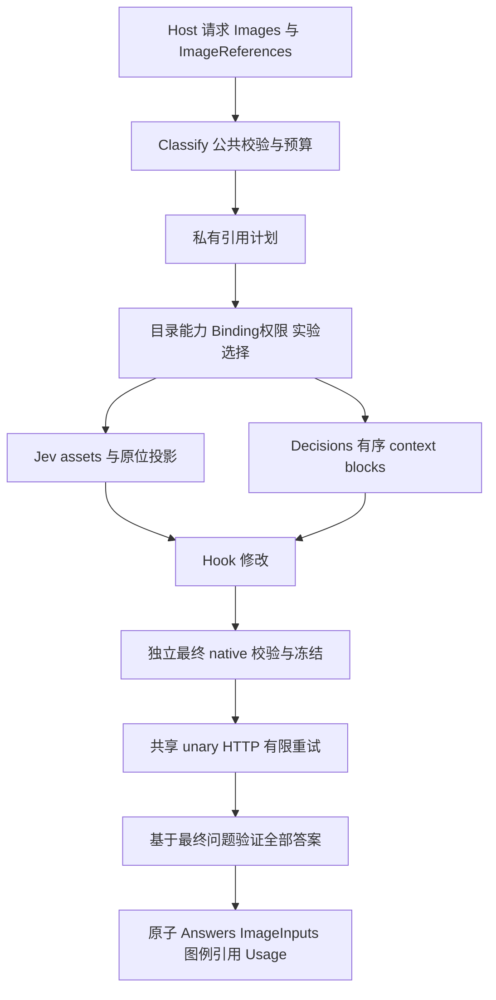
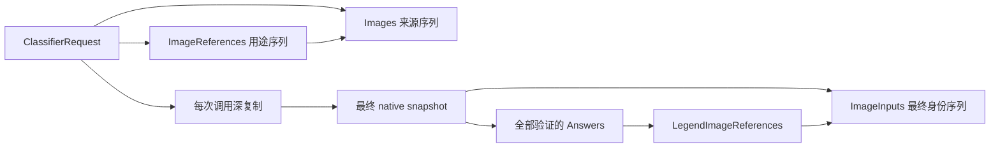
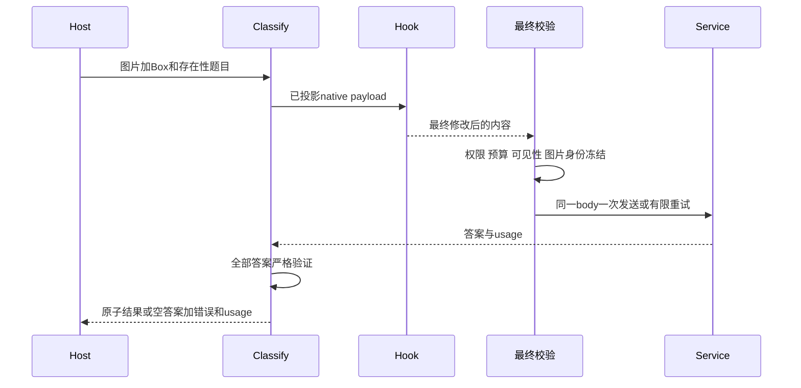

# Jev 1.14 统一图片引用与Box人工审查导读

按当前`main`的`f5cf5362610a8bdb8f3e170f408f3858c149e540`固定行号。实际目录拼写是`jev-1.14-multimodal-box`。

这项工作把“公共图片与放置声明”接入既有Classify入口：Jev获得context/State/单题说明/视觉标准和Box；Decisions继续只支持context，但使用相同图片来源与引用语义。新增内容还包括Host可执行示例、独立视觉效果任务、候选/正式协议证据以及11路线的整版发布门禁。

本导读用于人肉review，说明改动与风险；不是重新宣称所有代码都已人工无缺陷审计。代码路径来自本次逐模块静态阅读；执行结论来自本会话已经完成并封存的公开E2E/normal/race/真实服务记录。本次导读没有重新读取.env、发真实调用或重跑整套压力测试。

## 固定范围和如何看差分

- `d918842`是第一个运行库实现提交；其前一提交`6b893c4`是实现差分基准。`6b893c4..f5cf536`共83个提交，482个变更路径，其中1份Claude订阅研究与本任务无关，故任务相关481个路径。
- 为把开工前的Jev回归基线复核也收全，完整时间索引采用`291d2e5..f5cf536`，共85个提交、487个路径；比实现范围多5个基线复核文档/回执。完整索引明确标出范围外Claude文档，不能把它算作Jev代码。
- 实现范围内有181个变更Go文件，其中44个是`ai/`根运行库文件，79个是`ai/e2e`的Go测试文件；其余主要是示例、live进程和内部验收工具。大量新增路径是日志、fixture、Hash回执、研究和工单，不等于同等规模生产逻辑。
- `go.mod`、`go.sum`、冻结Pi oracle未在本实现差分中更改。没有新增依赖、前端页面、数据库迁移或部署动作。现有HTTP/Call运行时继续复用，整版续修另改共享timeout归属。
- 下方所有行号都是`f5cf536`的新侧行号；跳转链接只放一个起始行，旁边文字说明范围。完整新/旧变更块、声明行和文件Hash见changes.json。不是用后续漂移的行号猜测旧提交位置。

```sh
git diff 6b893c4 f5cf536 -- ai/classifier.go
git diff --unified=30 6b893c4 f5cf536 -- ai/typesafe_image_guard.go
git show d918842 -- ai/typesafe_request.go ai/typesafe_guard.go
```

| 阅读材料 | 用途 |
|---|---|
| [运行库44文件逐项说明](/Users/cyber/RestoX/barness/.scratch/jev-1.14-multimodal-box/human-review/runtime.md:1) | 每个运行库文件做了什么、为何改、应该核对什么。 |
| [示例、探针、门禁和续修](/Users/cyber/RestoX/barness/.scratch/jev-1.14-multimodal-box/human-review/validation.md:1) | 沿“使用→效果→正式支持→整体发布”看验收链，含14组E2E入口。 |
| [代码和工具完整文件索引](/Users/cyber/RestoX/barness/.scratch/jev-1.14-multimodal-box/human-review/files-code.md:1) | 所有ai路径的A/M、增删行数及每一个当前变更块。 |
| [文档和证据完整文件索引](/Users/cyber/RestoX/barness/.scratch/jev-1.14-multimodal-box/human-review/files-records.md:1) | 所有工单、设计、日志、验证脚本和回执，范围外/前置内容单列标识。 |
| [85个提交的顺序清单](/Users/cyber/RestoX/barness/.scratch/jev-1.14-multimodal-box/human-review/commits.md:1) | 回到任一切片的实际实现/修复提交看前后差异。 |
| [机器可核对的差分元数据](/Users/cyber/RestoX/barness/.scratch/jev-1.14-multimodal-box/human-review/changes.json:1) | 固定SHA、487文件清单、全部old/new范围、声明和文件内容Hash。 |

## 架构与所有权

把Images理解为“文件柜”，ImageReferences理解为“哪些文件放在哪里”。公共层只表达宿主意图，不暴露Jev的assets或Decisions的data URL。Adapter把同一份意图翻译成各自协议；Hook后再从实际native字节重新建立事实。



| 数据结构 | 当前定义 | 谁拥有、解决什么问题 |
|---|---|---|
| ClassifierRequest | [classifier.go L12](/Users/cyber/RestoX/barness/ai/classifier.go:12) | Host提供；L127深复制后调用拥有自己的State、问题、图片表及引用表。 |
| ImageReference / classifierImagePlan | [references L20/L82](/Users/cyber/RestoX/barness/ai/classifier_references.go:20) | 公共声明与私有归一计划；不承载权限、Provider资源或隐式模板。 |
| ClassifierCapabilities / Policy / Binding | [catalog L89](/Users/cyber/RestoX/barness/ai/catalog_operations.go:89)、[引用预算 L7](/Users/cyber/RestoX/barness/ai/classifier_reference_policy.go:7) | 分别定义可表达能力、有限资源和租户访问许可；互不替代。 |
| typeSafeRequest / typeSafeImageSnapshot | [native请求 L12](/Users/cyber/RestoX/barness/ai/typesafe_request.go:12)、[图片快照 L36](/Users/cyber/RestoX/barness/ai/typesafe_image_guard.go:36) | Adapter拥有Hook后的最终独立native数据与key→最终索引关系。 |
| ClassifierResult / BoxAnswer / ScoreAnswer | [结果 L25](/Users/cyber/RestoX/barness/ai/classifier.go:25)、[Box L27](/Users/cyber/RestoX/barness/ai/classifier_box.go:27)、[Score L17](/Users/cyber/RestoX/barness/ai/classifier_answers.go:17) | 仅所有答案通过后一起发布；结果不借用Hook对象，图片只返回MIME/hash。 |



## 三条可以手工跟下去的场景

### 场景一 相同两张图按 1 0 1 顺序作上下文

公开请求的Images有两项，ImageReferences是[1,0,1]。[归一计划](/Users/cyber/RestoX/barness/ai/classifier_references.go:84)验证索引和每源至少使用一次；[引用预算](/Users/cyber/RestoX/barness/ai/classifier_reference_policy.go:71)按3次出现记展开字节。

- Decisions在[L53–60](/Users/cyber/RestoX/barness/ai/openai_decisions_request.go:53)输出3个图片block，所以ImageInputs也有3项，第一/第三项Hash相同。
- Jev在[L47–100](/Users/cyber/RestoX/barness/ai/typesafe_images.go:47)上传2个assets，在[L41–57](/Users/cyber/RestoX/barness/ai/typesafe_state_images.go:41)放3个引用；最终ImageInputs按首次使用记录2个asset，顺序是源1再源0。
- 这两条协议均没有按文件Hash偷偷合并来源；只是native表达不同。已有公开执行场景为[TestJevContextProjection](/Users/cyber/RestoX/barness/ai/e2e/jev_context_test.go:11)及[TestDecisionsReferencesOrder](/Users/cyber/RestoX/barness/ai/e2e/decisions_references_test.go:25)。

### 场景二 把一张图放在 state.photo 的 null 槽

Host提供`state={"photo":null,"n":9007199254740993}`并声明value指向`/state/photo`。[目标解析](/Users/cyber/RestoX/barness/ai/classifier_reference_values.go:12)只接受存在的null；[能力检查](/Users/cyber/RestoX/barness/ai/classifier.go:162)在凭据pin之前确认Provider支持State位置。

Jev通过[原位投影](/Users/cyber/RestoX/barness/ai/typesafe_state_images.go:12)只替换photo节点，数字用json.Number保留精度。没有context时不包裹原State；若另有context，则State整体成为native的state子树，context图片放在外层images数组。问题说明中的自然语言路径不会自动改写。Decisions遇到此局部用途直接拒绝，不上移成全局图片。公开回归见[StateProjection](/Users/cyber/RestoX/barness/ai/e2e/jev_state_test.go:11)和[DecisionsValues](/Users/cyber/RestoX/barness/ai/e2e/decisions_references_values_test.go:10)。

### 场景三 Hook换图并同批问 Box 与存在性

Hook执行完，[L50–64](/Users/cyber/RestoX/barness/ai/typesafe.go:50)从最终bytes重验请求和assets，[最终遍历](/Users/cyber/RestoX/barness/ai/typesafe_image_occurrences.go:17)重新检查该Box是否真能看到图片；结果身份重新从实际图片计算。服务响应在[decoder](/Users/cyber/RestoX/barness/ai/typesafe_response.go:10)先保留usage，再验证全部题目；某个Box缺边或图例不匹配，整批Answers/ImageInputs清空。

Box合法也不表示目标存在。[native Box decoder](/Users/cyber/RestoX/barness/ai/typesafe_box.go:5)保留原始Box和nullable confidence；Host根据独立Bool概率决定是否消费框。[Host解释L86–119](/Users/cyber/RestoX/barness/ai/examples/classifierimages/interpret.go:86)还要求显式搜索图身份，并自行从送入图坐标还原裁剪/旋转。已有失败/成功场景见[BoxAnswers](/Users/cyber/RestoX/barness/ai/e2e/jev_box_answers_test.go:11)、[BoxVisibility](/Users/cyber/RestoX/barness/ai/e2e/jev_box_scope_test.go:10)及[BoxFinalHooks](/Users/cyber/RestoX/barness/ai/e2e/jev_box_hooks_test.go:12)。



## 14张工单与实现切片

14张工单当前全部为resolved。每票的原失败方式、RED/GREEN及验收回执在对应目录；不能只从父规格的旧状态推断实现情况。

| 票 | 用户可感知变化 | 主要实现提交 | 先读模块 |
|---|---|---|---|
| 01 | TypeSafe文本行为不变，Hook后问题由独立native快照持有 | `d918842` | typesafe_request/guard/response |
| 02 | Decisions按统一引用排序、复用context图片 | `4d837da`、`84a0875`、`15b66fd` | classifier_references/reference_policy、openai_decisions_request |
| 03 | 返回实际最终送图MIME/hash身份 | `b6175d7` | classifier_image_inputs、openai_decisions/guard |
| 04 | 显式选择Jev JSON图片实验，context闭环 | `5615b02`、`7bfec2e`、`724a0a7` | typesafe_images/image_guard/image_limits |
| 05 | State根/嵌套值的图片原位引用 | `3a6fb7b`、`6793760` | classifier_reference_values、typesafe_state_images |
| 06 | 单题Instructions图片和有序混合内容 | `60f33a8`、`5449e59` | typesafe_question_images、image_occurrences |
| 07 | Choice/Score/Bool视觉criteria及公共图例引用 | `53edb35` | typesafe_question_images/legend_images、classifier_answers |
| 08 | Box强类型回答与独立存在性问题 | `443fc30` | classifier_box/box_visibility、typesafe_box |
| 09 | 两租户两协议并发、Hook预算、取消重试及撤销完整性 | `c6bdfcd`至`e429932`的防护系列 | image_payload_fields、typesafe_reference_payload、multimodal_runtime E2E |
| 10 | 可重放Host图片、图例、Box、拒绝和撤销例子 | `773588d`、`5d2d6ac` | examples/classifierimages |
| 11 | 隔离候选协议探针与完整可验证产物 | `cf55cbd`、`59e2dbc` | live/multimodal_*及verify-11-evidence.py |
| 12 | 固定图片任务独立测分类/存在性/IoU与误报 | `d4cd265`及完整性修正 | examples/visualeval |
| 13 | 正式目录新增固定1.14与独立model-specific支持 | `527f633`、`e633b3f`、`1721024` | catalog_typesafe、testkit/jevformal、supportmatrix/jev |
| 14 | 完整追溯、11支持及4效果、门禁与历史压力阻断 | `ceb4625`后整合系列，最终`dbddd79` | release、续修01–04及14-remaining-real |

工单完整路径、状态及每份证据的位置见files-records.md；每个提交精确标题见commits.md。

## 推荐的人肉review顺序和问题

1. **先公共合同**：读classifier.go、classifier_references.go、classifier_reference_values.go、classifier_box.go。确认输入的作用域、完整声明、null语义、旧默认行为和结果三态是否符合你的API预期。
2. **再读两条转换主线**：先Jev的prepareTypeSafeImages→State/Question投影→final freeze，再读Decisions编码。尤其确认context包裹、无context原位、局部题可见性和两协议ImageInputs条数差异。
3. **集中读最复杂的安全部分**：typesafe_reference_payload、typesafe_image_payload与image_payload_fields。核对“Go对象预检→encoding/json→最终guard”的语义是否一致，重点是嵌入结构体、,string、[]byte、RawMessage、Unicode及自定义encoder。
4. **看结果原子性**：typesafe_response/answers/legend_images/box，加classifier.go失败出口。任何一个坏答案是否都清空Answers和ImageInputs，usage却如实保留？图例是否先完整匹配再变成公共引用？
5. **看共享影响面**：timeouts.go的deadline归属修改影响所有使用watchedTransport的协议，不限Jev；测试Provider的64KiB TCP缓冲只影响受控夹具，不能误当生产调参。
6. **最后审验收链是否可信**：probe的真实开关与预算→visualeval固定任务→jevformal双包验证→supportmatrix合并→release完整执行。既有回执不代替当前源码/目录和输入集合的一致性检查。

## 可以刻意当作黑盒的旧模块

| 接口与位置 | 输入/输出与作用 | 本导读为何不展开 |
|---|---|---|
| [NewClient](/Users/cyber/RestoX/barness/ai/client.go:92) | Config→不可变Client，验证配置并持有resolver/transport/observer | 入口未在本任务差分中改写；新增能力与策略在运行库表中具体说明。 |
| [beginCall](/Users/cyber/RestoX/barness/ai/call_runtime.go:30)、[pin](/Users/cyber/RestoX/barness/ai/call_runtime.go:121) | CallScope/Target→调用生命周期及固定Binding/Credential | 继续复用多租户快照、许可、observer等旧合同；本任务主要新增取凭据前的图片拒绝和回归证明。 |
| [sendUnary](/Users/cyber/RestoX/barness/ai/unary.go:15) | header/body/path→有界HTTP response或诊断错误 | 复用既有有限重试与body/permit生命周期；本任务没有新增一套Jev重试调度器。 |
| 冻结Pi oracle与各聊天SDK | 现有差分基线与协议SDK | 版本未改；新增图片/Box属于有限独立扩展，不能宣称oracle也覆盖它。 |

## 设计取舍与需要你判断的地方

- **稳定公共语义换取Adapter复杂度**：公共端只新增来源引用，不暴露各Provider素材细节。代价是Jev的key生成、位置投影、Hook后出现次数校验和图例还原代码较多；看代码应沿一次实际请求，不按文件名零散跳读。
- **提前预算与最终权威校验并存**：预检能在大分配前拒绝已知过载，但无法预测自定义encoder；最终bytes必须再验。两层有意不合并，否则容易同时失去资源边界或真实协议语义。
- **严格源码一致性有实际费用**：formal包固定整个ai Go文件集合，改一个测试也可能要求重新付费采集。它提供强证据身份，代价是验证工具与服务代码更新都能使协议证据过期。是否长期继续用此粒度，值得作为独立证据契约决策评估，本导读不修改它。
- **若重新安排实现，我会更早集中审查JSON预检等价性**：typed payload相关修正在09阶段连续出现，说明这是比业务投影更隐蔽的风险。优先把字段选择/Unicode/编码结果的约束集中写清并按公开边界验证；这是阅读后的设计意见，不是已证明的新缺陷，也不是建议立刻新增通用抽象。
- **文档状态有历史口径**：[ADR0030](/Users/cyber/RestoX/barness/docs/adr/0030-barness-ai-unified-classifier-image-references.md:2)仍proposed且L10写“尚未实施”；[design](/Users/cyber/RestoX/barness/.scratch/jev-1.14-multimodal-box/design.md:3)、[spec](/Users/cyber/RestoX/barness/.scratch/jev-1.14-multimodal-box/spec.md:3)、[ticket-plan](/Users/cyber/RestoX/barness/.scratch/jev-1.14-multimodal-box/ticket-plan.md:7)也保留初次发布叙述。它们作为原始规格被保留，实际交付应以14张工单、ADR0031及最新验收为准；若作为当前读者入口，这些措辞需要你决定是否另做编辑同步。
- **效果结论的边界**：固定合成视觉任务和中文小任务用于可重复验收。Jev local与Decisions supplemental不等价；Box confidence不是存在性概率；raw absent boxes不能藏在消费门控之后。尚未由本任务证明生产业务分布的长期效果。

## 已有执行结论与后续复核入口

当前有效整版报告执行提交为`fc8f02b`，最后Go内容为`9a8ea45`；最后的`dbddd79`/`f5cf536`是封存和文档提交。normal/race各9098 PASS、0 FAIL，各有861 Pi和33 UC14，10项门禁全PASS、17个输入审计零发现；11条当前真实支持和4个独立效果包均完成。真实阶段新增312 Calls/Attempts，前两轮TypeSafe102另有历史授权和记录。

最终静态双轴审查Standards/Spec各0剩余发现，独立seal --verify只运行一次、exit0，检查600Go/731固定文件及5棵树636346条目。旧FAIL、NOT_RUN、中止race和DeepSeek原失败包保留，未改成PASS。

- [最终验收说明](/Users/cyber/RestoX/barness/.scratch/jev-1.14-multimodal-box/14-remaining-real/verification.md:1)、[封存回执](/Users/cyber/RestoX/barness/.scratch/jev-1.14-multimodal-box/14-remaining-real/evidence.json:1)、[最终双轴审查](/Users/cyber/RestoX/barness/.scratch/jev-1.14-multimodal-box/14-remaining-real/code-review.md:1)。
- [实际公开门禁原报告](/Users/cyber/RestoX/barness/.evidence/ticket14-full-recovery-20261017074119Z/gate/release-report.json:1)、[独立命令与退出码](/Users/cyber/RestoX/barness/.evidence/ticket14-remaining-integrity/standards-final-verify-result.json:1)。
- 本报告的changes.json可按固定Git差分重算文件集合、范围和Hash；本导读只新增human-review目录，不编辑旧证据或源码，也不会触发额外真实调用。
