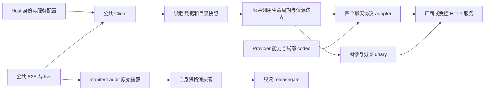
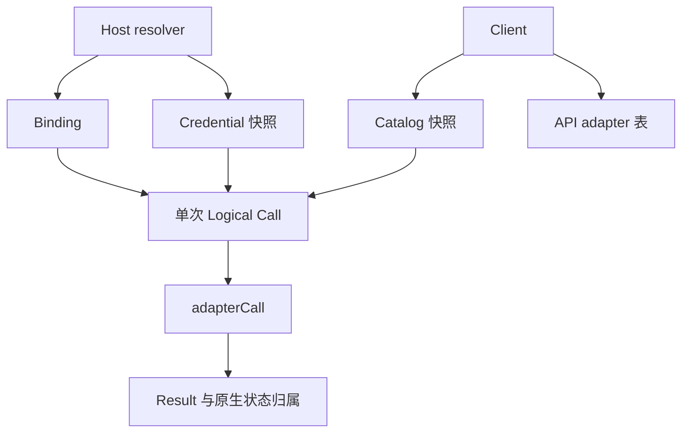
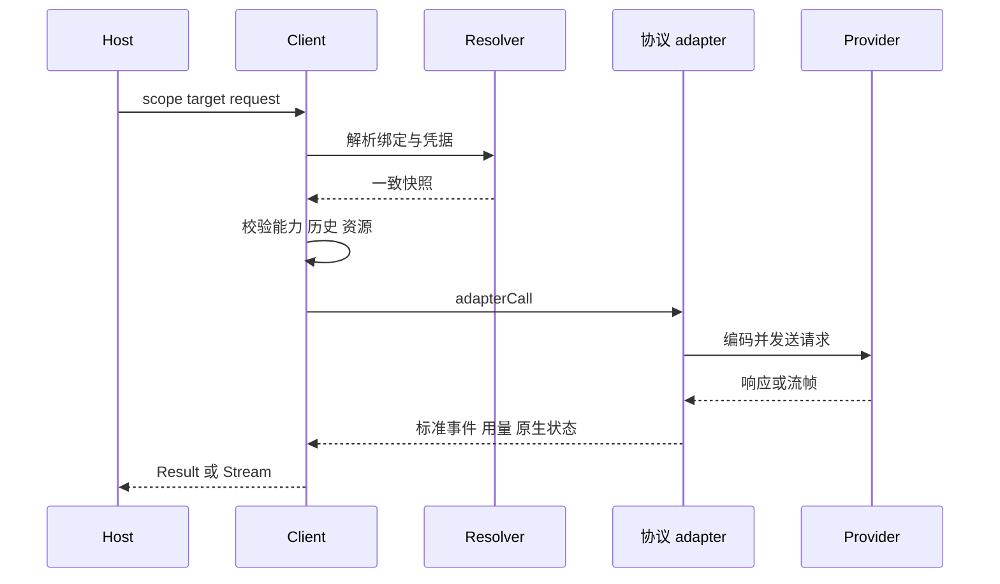

# Provider 接入交付与工程复杂度审查

截至 2026-10-27，当前工作区定义了 **12 个 Provider 身份**，实现范围覆盖 **29 条操作 × Provider × 协议路径**；其中 Kimi 六条仍为候选。实际运行 `BuiltinCatalog()` 得到版本 `2026-10-26.1`，含 **106 个聊天身份、2 个图像身份、3 个分类身份**。这里的“身份”包含协议，同一型号可以出现多次；目录存在不等于正式发布完成。

**判断：协议层的复用和领域拆分基本合理；验收、资格续期和历史治理存在较强的过度工程证据。** 最值得收敛的是跨 Provider 的资格失效范围、活动代码中的固定历史轮次，以及重复嵌套的验证进程。单凭测试数量不能认定测试多余。

## 1 审查范围与事实来源

审查对象是当前工作区的全部 Provider 定义、公共目录、协议路由、公共 E2E、原生 live、资格消费者，以及各功能唯一当前状态。未修改产品实现、旧证据、授权或原有状态；未发厂商请求、未运行 race/压力，也未重新进行发布判定。

- 当前提交：`69ff4af880e68ef3ca245e5128bdae5e59a2ef7b`。
- 普通验收实际受测提交：`dcf73abd6740d2107352909ba3cd3d07ad6684fb`。
- 本次实际运行：隔离环境中的 `go run <临时 catalog.go>`，调用公共 `BuiltinCatalog()` 和 `Catalog.Hash()`，退出 0；运行统计脚本退出 0。这证明当前目录可以实际编译和读取，不代表重新执行了业务验收。
- 既有完整普通验收实际命令：`go test -json ./ai/e2e ./ai ./ai/internal/testkit/release ./ai/internal/testkit/supportmatrix -count=1 -timeout=20m`，退出 0，墙钟 665.060 秒。
- 本次逐文件比较确认：该回执绑定的 **2068 份来源和 175 项输入集合及内容与当前一致**。同时核对了 receipt、主 manifest、audit 的引用哈希；既有 audit 为零发现。本次没有重新审计全部原件内容。

统计可用 `python3 .scratch/provider-integration-audit-20261027/inventory.py` 重复执行。入口见 [inventory.py](inventory.py)，编译后的公共目录见 [catalog.json](catalog.json)，完整统计和来源相等性见 [inventory.json](inventory.json)，逐 case 归属见 [cases.csv](cases.csv)。这是一份固定日期审查，不取代各功能的唯一当前状态。

## 2 全部 Provider 接入与交付状态

下表中的历史正式支持、最近真实运行和当前功能发布是三个不同事实。旧 Provider 曾完成交付，不会因本次 Grok 功能尚未闭环就变成“从未支持”；同样，历史 PASS 不能冒充当前版本的正式资格。

| Provider | 已实现协议与操作 | 当前内置型号身份数 | 交付状态 |
| --- | --- | ---: | --- |
| OpenAI `openai` | 聊天 Responses、Chat；图像 Images；分类 Decisions | 53：聊天 51、图像 1、分类 1 | 已有正式交付基线；最新完整真实轮次的两条聊天路线已通过。当前 Grok 功能的来源复验及发布尚未闭环。 |
| Anthropic `anthropic` | 聊天 Messages | 16 | 已有正式交付基线；最新真实轮次 Messages 通过。 |
| Google `google` | 聊天 Gemini Developer API；图像 Interactions | 18：聊天 17、图像 1 | 两项操作已有正式交付基线；最新真实轮次聊天通过，图像保留自身历史支持。 |
| DeepSeek `deepseek` | 聊天 Responses、Chat | 3 | 两条路线已有正式交付基线；最新真实轮次两条均通过。 |
| TypeSafe `typesafe` | 分类 System One，Jev 1.13 与 1.14 | 2 | 已有正式交付基线；1.14 图像与 Box 保留实验开关及显式授权边界；未纳入 Grok 这次 17 条聊天路线。 |
| 智谱中国站 `zhipu` | 聊天 Chat、Responses、Messages | 6 | 三协议已有正式交付基线；最新轮次 Chat、Messages 通过，Responses 保留自身历史报告。 |
| Z.AI 国际站 `zai` | 聊天 Chat、Responses、Messages | 6 | 已候选晋升并进入内置目录；地区项目最终验收仍暂停、release=false。后续 Grok 真实轮次 Chat、Messages 各通过，不能据此关闭整个地区项目。 |
| MiniMax 国际站 `minimax` | 聊天 Chat、Responses、Messages，M3 | 3 | 2026-10-19 原功能 COMPLETE；最新轮次 Chat、Responses 原生通过但资格器拒绝，相关软件问题已修复、未重新真实验收；Messages 有真实读取中断 FAIL。M3.1 未正式晋升。 |
| MiniMax 中国站 `minimax-cn` | 聊天 Chat、Responses、Messages，M3 | 3 | 已候选晋升并进入内置目录；最新真实轮次三路线通过；地区项目最终闭环仍暂停。 |
| Kimi 国际站 `moonshot` | 聊天 Chat、Responses、Messages，K3 | 0 | 实现与普通验收已交付，三条自身候选路线完整通过；六路线 formal、目录晋升、race/压力尚未完成，正式目录 inactive。 |
| Kimi 中国站 `moonshot-cn` | 聊天 Chat、Responses、Messages，K3 | 0 | 实现与普通验收已交付；旧来源三条候选通过，Kimi 当前状态要求的新来源中国站候选及六路线 formal 尚未完成。 |
| xAI `xai` | 聊天 Responses，Grok 4.7 | 1 | 实现、自身候选、脱敏回放及正式 harness 已接入；集成分支预接最终内置目录。旧来源正式轮次 18 项通过；当前来源正式 live 暂缓、race/压力 NOT_RUN、release=false，尚未正式支持或发布。 |

状态入口：[原完整交付基线](../barness-ai-minimax/delivery-status.md)、[地区项目当前状态](../barness-provider-sites/spec.md#当前状态)、[Kimi 当前状态](../barness-ai-kimi/spec.md#唯一当前状态)、[Grok 当前状态](../barness-ai-grok/spec.md#唯一当前状态)。

### 测试数量的统一口径

下表计数来自最新普通验收的主 `./ai/e2e` manifest，单位是**有独立 case ID 的验收记录**。按既有 P01–P10、GLM、MM、UC、XAI 等 case 家族，以及明确的完整 Provider/route 子测试名归属；跨 Provider、通用运行时或目标不明确的 case 单列，不向每个 Provider 重复分摊。家族归属表达测试套件责任，不保证每个 case 都发送该 Provider 请求；其中也包含预检和资格器测试。

这不是断言数、测试文件数、Go 父子 PASS 节点数、代码覆盖率或每个型号的真实验证次数。没有明确归属的共享测试仍可能覆盖表内 Provider，所以较小数字不等于薄弱覆盖。

| Provider | 归属 case PASS | 归属 case NOT_RUN | 最近可明确列出的真实场景证据 |
| --- | ---: | ---: | --- |
| OpenAI | 3185 | 0 | 最新聊天 Responses 9 PASS；Chat 10 PASS + 1 固定 UNSUPPORTED。旧矩阵另有 Images 3 PASS、Decisions 9 PASS。 |
| Anthropic | 293 | 0 | 最新 Messages 12 PASS。 |
| Google | 593 | 0 | 最新聊天 7 PASS；旧矩阵图像 2 PASS。 |
| DeepSeek | 690 | 0 | 最新 Responses 9 PASS、Chat 12 PASS。 |
| TypeSafe | 1336 | 0 | 旧矩阵 Jev 1.13 为 3 PASS、Jev 1.14 为 12 PASS。 |
| 智谱中国站 | 2040 | 1 | 最新 Chat、Messages 各 24 PASS；旧矩阵 Responses 22 PASS。 |
| Z.AI 国际站 | 274 | 0 | 最新 Chat、Messages 各 20 PASS；Responses 有地区恢复 6 的旧来源完整 18 PASS。 |
| MiniMax 国际站 | 1489 | 7 | 最新 Chat、Responses 各 14 原生 PASS，但自身资格拒绝；Messages 13 PASS、1 FAIL。软件修复不追认旧资格。 |
| MiniMax 中国站 | 213 | 0 | 最新 Chat、Responses、Messages 各 10 PASS。 |
| Kimi 国际站 | 913 | 0 | Kimi 功能冻结来源下三路线候选各 9 PASS，共 27；formal 未完成。 |
| Kimi 中国站 | 885 | 0 | 旧来源三路线候选各 9 PASS，共 27；新来源候选未完成。 |
| xAI | 738 | 0 | 旧来源正式轮次 18 PASS；当前来源正式验证暂缓。 |
| 共享或未明确归属 | 2473 | 206 | 跨 Provider、共用运行时、证据消费和发布等；不分摊。 |
| **总计** | **15122** | **214** | 不同来源、阶段的真实场景数不能相加充当当前版本支持率。 |

214 个 NOT_RUN 均属于显式压力/设计负载及其消费者范围。普通阶段不执行它们符合 SOP，不能记成失败或已测通过。另有 GLM 32 个、MiniMax 6 个原生辅助 case 已通过，独立于上表主包统计。

重新解析原始 `stdout.jsonl` 得到 **16038 个 Go PASS 节点**，其中包含父测试及子测试；主包 15918、核心包 26、release 15、supportmatrix 79。它们与 15122 个主包原生 PASS 采用不同口径，不应并列当作新增覆盖。

最近完整真实批次为 [gf6 固定检查点](../../.evidence/barness-ai-grok/live-batches/gf6-20261026T233415Z-ceb8d8c1/completed-checkpoint-v1.json)：17 路中 **14 个资格通过、2 个资格器拒绝、1 个原生失败**。该批新增 270 逻辑调用 / 267 HTTP，238 项场景为 236 PASS、1 UNSUPPORTED、1 FAIL。后续软件改变来源后，这些属于旧来源事实。最新 [record-v18](../barness-ai-grok/verification/record-v18.json) 及 [只读判定](../../.evidence/barness-ai-grok/release/readonly-v18/native/release-report.json)仍为当前 17 路 live NOT_RUN、race/压力 NOT_RUN、release=false；维护者已明确暂缓真实验证。

## 3 架构与数据关系

协议层存在四个聊天 adapter，由固定 `Binding.API` 选择；Provider 差异通过内部能力配置和局部请求/响应转换承载。图像与分类走各自 unary 路径。没有按地区再复制六套聊天引擎，也没有为 Grok 新建一套公共协议。

| 结构 | 创建与持有者 | 生命周期及边界 |
| --- | --- | --- |
| `Catalog` / `Model` | Host 选择，Client 校验并持有快照 | 身份为操作、Provider、API、型号；发现能力不授予调用权限。 |
| `Binding` / `Credential` | Host resolver 返回 | 固定租户、账户、目标、协议和允许型号；一次逻辑调用固定快照。 |
| `call` / `adapterCall` | Client / 调用生命周期 | 输入独立复制；adapter 只获取本调用需要的不可变配置。 |
| `Native State Envelope` | Client 产生，持久化读回由 Host 担保 | 原生续接状态的租户、账户、Provider、协议和型号边界。 |
| manifest / report / grant | 验收进程及显式授权 | 与产品运行对象分离；消费者验证完整性、来源、预算及真实场景。 |

这些边界符合多租户、本地和云端的已声明需求；凭据隔离、固定快照、取消与释放、原生状态降级、未知用量不冒充免费，都有具体可达场景。不能为减少代码量直接删除。

## 4 具体调用与验收链路

静态跟踪路径为公共入口 → `newCall` 复制 → `Client.run` → `execute` → scope / 请求校验 → resolve binding / catalog → 能力和选项 → 凭据及一致性 → adapter 编码 → 每次 attempt 的 admission → HTTP → assembler / Result / Observer。主要入口见 [call.go](../../ai/call.go)、[adapter.go](../../ai/adapter.go)、[能力配置](../../ai/responses_capabilities.go)。本次只实际运行目录路径，业务链路的运行依据采用现有公共 E2E 原件，没有新增动态跟踪。

对照验收链路，问题发生在调用之外的治理层：既有 GLM 包装使用 10 秒公共调用 context，却在里面启动完整 native 测试和封存。实际出现内层断言完成、manifest/audit 未完成、父进程已失败后仍写入的问题。修复后形成 native 180 秒 → wrapper 240 秒 → nested Go 300 秒 → collector 360 秒 → workflow 480 秒的多层预算，并复用 Python 进程组采集器完成收尾。这是已发生的故障，不能简单删掉取消逻辑；更值得追问的是为什么一次普通验证需要这些嵌套执行层。

证据：[工单 21](../barness-ai-grok/issues/21-glm-controlled-process-budget.md)、[实际包装实现](../../ai/e2e/grok_history_glm_process_helper_test.go)。

## 5 过度设计与过度工程判断

### 高可信度问题

| 问题 | 具体证据 | 判断与影响 |
| --- | --- | --- |
| 资格失效范围跨越真实产品影响 | `receipt_files.source_snapshot` 与 release 的独立扫描默认绑定整个 `ai/` 和验证工具，含测试与其他路线夹具；Grok 21/22 改验收代码后，四个 native map 与八个二进制仍相同，但全局新来源 17 路仍待重新资格/授权适用性判断。 | **高风险**。来源可追溯合理，但验收实现与厂商行为资格耦合过宽，形成冻结、完整普通、授权输入变化、再次完整普通及跨路线付费复验的循环。不能由此断言每次历史复验都无必要。 |
| 固定历史轮次进入活动实现 | `minimaxlive/renewal.go`、`renewal_report.go` 显式列出恢复 4/5/6/7；`RenewalGrant` 有 First/Third/Fourth/Fifth/Sixth cohort 字段；历史校验固定原轮文件名及 39/36 等消费事实。 | **高风险**。历史不可篡改是必要约束；把项目某轮历史固化成新验证的活动分支，则使代码复杂度随历史轮次增长。MiniMax 新授权曾误入 legacy origin，直接造成两条真实已通过路线资格拒绝。 |
| 验证执行层过多 | GLM 普通验收嵌套 Go、Python capture、native 和资格消费；真实触发 10 秒截断、后代未停止、未封存原件，需新任务修复。 | **高风险**。验证系统开始显著消耗验证自己的时间。应收敛执行入口和进程所有权；保留真实超时、取消、原件完整性要求。 |
| 支持状态难以直接读取 | README 仍以 2026-10-19 的 96 个聊天身份、17 支持身份 COMPLETE 为开头；实际目录已有 106 个聊天身份；默认矩阵保留 6 条地区 NOT_RUN，Grok 无行，而后续原件已存在部分正式通过。 | **中高风险**。保留历史是正确的；当前实现、历史支持和当前发布缺少一个清晰读入口，增加误判交付状态的成本。不能覆盖旧报告来修复展示问题。 |

上述代码和规则见 [来源采集](../../tools/verification/receipt_files.py)、[独立来源核验](../../ai/internal/testkit/release/record_files.go)、[历史授权模型](../../ai/internal/testkit/minimaxlive/renewal.go)、[历史消费校验](../../ai/internal/testkit/minimaxlive/final_renewal_history.go)、[新旧权威分派](../../ai/internal/testkit/minimaxlive/origin.go)、[ADR 0049](../../docs/adr/0049-barness-ai-regional-provider-identities.md)、[Grok 当前状态](../barness-ai-grok/spec.md#唯一当前状态)。

### 规模信号与判断限制

| 代码范围 | 文件数 | 物理行数 | 顶层 Go Test 函数 |
| --- | ---: | ---: | ---: |
| `ai/` 根运行代码 | 212 | 30767 | 0 |
| `ai/e2e` | 584 | 70358 | 812 |
| `ai/live` | 121 | 17243 | 74 |
| `ai/internal/testkit` | 214 | 28874 | 54 |
| `tools/verification` | 17 | 2574 | 不按 Go 计 |

后四项合计 119049 行，约为根运行代码的 **3.87 倍**。其中 `minimaxlive` 为 88 个 Go 文件、12014 行，`supportmatrix` 为 59 个 Go 文件、8159 行。统计包含注释与空行，按目录归属；不是纯测试断言与纯业务实现的严格比值，图像/分类效果示例也未纳入分母。所有扫描到的 Go/Python 文件均未超过 500 行。

这说明维护成本值得审查，但不能仅按比例判定冗余。四个公共入口、Hooks、三种协议、两站身份的组合测试可以验证真实差异。应先确认是否经过同一转换和拒绝边界，再对等价错误输入做代表性组合；不同协议的 wire、账户、原生状态和用量差异应继续逐项验证。目前没有逐断言证明哪些 case 可删，不给出虚构的“冗余百分比”。

按 Provider 看：OpenAI、Anthropic、Google、DeepSeek 的协议实现未发现明显推测性框架；TypeSafe 的分类/图像扩展有真实业务语义。智谱、Z.AI、MiniMax 的风险主要在验收和历史资格；Kimi 的两站拆分和费用区间有需求与真实失败依据，资格工具仍有收敛空间；Grok 的局部协议实现克制，但整版验收扩散风险高。

## 6 建议收敛顺序

1. **先改善状态表达。** 用现有索引形成可重建的 Provider 汇总视图，明确“实现、目录、最近自身 live、当前适用性、功能 release”。继续引用原件和唯一当前状态，不再人工复制一份可变真相；无需新建调度系统。
2. **重新讨论资格失效边界。** 区分产品运行代码/依赖/协议数据变化与纯验证代码变化。产品变化按影响选真实路线；消费者改变时，优先对留存 raw 做完整离线重验，只有厂商行为事实或实际执行 payload 改变才提出对应 live 范围。不能把这个建议当作当前规则下已经可沿用旧资格。
3. **隔离历史治理代码。** 保留旧原件及可核验能力；新一轮不继续增加 recovery8/recovery9 专用字段或分支。确定现有证据消费义务后，把固定历史核验限制在归档消费边界，当前执行采用已有单次 grant、预算及明确来源，不再递归进入历轮流程。
4. **减少普通验证的子进程嵌套。** 保留少量完整原生 CLI 正反例证明进程合同，其余协议语义使用现有公共 Client + 受控 Provider。复用已有进程所有权与取消实现，避免为合并 runner 再创建通用编排框架。
5. **最后才精简测试矩阵。** 对同一共享校验的相同错误先用代表性入口；对实际不同 wire/历史/用量保持逐路线验证。以漏检能力和真实回归为依据，不按 case 数设删除指标。

第 2、3 项会重开或调整 [ADR 0051](../../docs/adr/0051-scoped-verification-receipts.md)、[ADR 0053](../../docs/adr/0053-verification-tool-ownership.md)及部分历史原生资格合同；不是在现行合同内直接跳过检查。本次只提出可审查的方向，没有修改契约、授权规则或发布资格。

## 7 有意未展开的部分与剩余问题

| 黑盒 | 输入与输出 | 本次不深入的原因 |
| --- | --- | --- |
| OpenAI / Anthropic SDK 内部 | 已编码请求 → HTTP / SSE | 本次判断 barness 的接入与验证复杂度；未发现需以 SDK 内部解释的阻塞。 |
| 厂商在线能力及账户现状 | 真实请求 → 真实服务结果 | 采用仓库自身实际捕获，不发起新的付费验证，也不把网络中断原因猜成厂商缺陷。 |
| 既有全部证据包内部 | 原始捕获 → audit / 资格结果 | 本次核对入口、统计及引用哈希；不是对所有原件重新做资格审计。 |
| Agent / TUI / 云端持久化 | 上层业务 → 公共 Client | 超出 Provider 基础模块范围。 |

剩余工作是确定允许收窄的证据有效性合同，以及确认哪些测试真正等价；这两项需要独立、有限的设计/验证任务。本次没有充分证据声称 Provider 业务实现普遍过度抽象，也没有把暂停的真实验证视为失败或擅自恢复。
