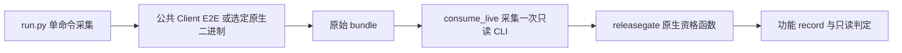

# Provider 验收与资格治理精简方案

日期：2026-10-27。状态：已于本次用户指令采用，实施见 [唯一当前状态](../verification-simplification/status.md)。依据当前提交 `69ff4af880e68ef3ca245e5128bdae5e59a2ef7b` 与 [审查报告](report.md)。本次只交付方案和逐文件处置清单，不改变现行合同、源码、历史证据、暂停状态或执行授权。

目标是让维护成本随实际协议差异增长，让新增 Provider、修改消费者或补测试不再自动牵动其他 Provider 的付费复验。继续使用现有 Client、采集器、单次 grant 和只读发布工具；不新增工作流引擎、恢复轮次框架、动态依赖图或资格服务。

## 1 必须先分开的三个事实

| 事实 | 它回答的问题 | 判定方式 |
| --- | --- | --- |
| 当时的测量 | 当时实际执行了什么，是否完整成功？ | 原始命令、二进制、构建来源、实际输入、原生捕获、manifest/audit、原始授权与消费；不可修改。 |
| 当前的适用性 | 当时的测量还能证明当前这条路线吗？ | 已审实际差异、对应型号数据、公共回放和当前消费者；不能要求历史测量的全库哈希等于当前全库。 |
| 本次执行权限 | 现在是否允许再花钱执行一次？ | 已有 `livegrant` 绑定的具体 scope、二进制、实际输入、期限、预算和一次性 claim；历史 PASS 不授予新权限。 |

新消费者可以拒绝旧原件，也可以对原来被消费者错误拒绝的完整原件重新给出结论。所有新结论另写回执，旧 PASS/FAIL、时间、来源和账本不重写。原始 grant 的期限按实际执行时刻检查；已过期 grant 不能启动新执行，也不因此让过去合法测量失真。

## 2 保留 删除和合并清单

### 保留的职责

| 位置 | 保留内容 | 保留原因 |
| --- | --- | --- |
| `tools/verification/run.py`、`run_process.py`、`receipt_files.py` | 显式单命令、环境隔离、日志/退出、进程组终止与收尾、不可覆盖 attempt、来源与输入哈希 | 都对应已经发生的失败；完整来源仍用于追溯和检查执行中漂移。 |
| `tools/verification/consume_live.py` | 采集一次只读资格 CLI 的实际退出与输出 | 已经复用 `capture`，无需为了减少入口数再套一层或重写。 |
| `ai/internal/testkit/livegrant/`、`ai/live/cmd/processgrant/` | 单次批准、精确 scope、claim、持久消费与有限预算 | 足以承载当前一次执行；不需要第二套 renewal 权限。 |
| `ai/internal/testkit/evidence/`、`audit/` | 脱敏、有限库存、原件哈希、原始失败与取消 | 是证据成立的必要条件。 |
| `supportmatrix` 各路线原生校验 | 官方目标、身份、原生历史、wire、usage、完整场景、真实资源释放 | 厂商之间确有差异，不能只比较统一报告的 PASS 字段。 |
| `minimaxlive/history.go`、`usage.go`、`verify_call.go`、`facts.go` 等 | 模型原生续接、用量和捕获语义 | `history.go` 校验的是模型对话历史，必须保留。 |
| `minimaxlive/ledger.go`、`ledger_evidence.go` 的当前过程部分 | 本次调用预留、实际 attempt、未知消费与预算上限 | 移除历轮依赖后仍需防止重复消费和超额。 |
| `tools/verification/cleanup*.py` | 独立的清理入口及既有保留规则 | 本次不重做证据清理，更不删除 grant/claim/账本。 |

采集器与 Go 消费者的独立库存检查，以及 producer 与 consumer 对完整场景的独立定义继续保留。它们用于交叉核验，合成一份共享“自证通过”的定义会削弱证据。

### 从活动实现删除

| 删除对象 | 精确范围与处理 | 替代方式 |
| --- | --- | --- |
| 按轮次写入 Go 的历史治理 | `minimaxlive/renewal*.go`、`final_renewal*.go`、`second_renewal*.go`、`recovery*.go`、`historical_*.go`、`closed_cohort.go`、`cohort_files.go`、`stage_path*.go`，连同只验证这些旧轮次的测试 | 依赖摘除后删除；本基线共 66 文件、9413 行，其中实现 34、测试 32。原版本由原 Git/封存源码及历史只读消费者保留。 |
| Scratch 中固定轮次控制器 | `.scratch/barness-provider-sites/tools/` 的 64 个 Python 文件、`.scratch/barness-ai-minimax/tools/` 的 30 个 Python 文件 | 从活动路径和日常测试入口退役后删除，合计 10719 行；逐文件哈希见清单。历史原件引用原固定版本，不把脚本换目录继续作为活动控制器。 |
| 旧轮次命令与环境选择 | `minimaxverify` 的 `-renewal-*`、`-recovery*`，及新路径中的 `BARNESS_MINIMAX_FORMAL_RENEWAL` 分派 | 当前执行只接受明确的一次 grant，不留 wrapper、shim、旧环境兜底或双写。 |
| 递归校验所有前序的执行前置 | 每次请求重新读取前几轮 canonical 目录、原账本、前序批次 seal、历史总额的调用链 | 当次执行只校验当次 scope/claim/ledger；历史消费与预算留存在原记录。 |
| 跨路线失效条件 | 用整个当前 `BuiltinCatalog.Hash()`、整个源码集合或相同 feature/commit 拒绝所有历史 live 的当前适用性判断 | 改为第 3 节的路线适用性判断；完整旧哈希仍保留在原测量中。 |

上述约 2 万行是退役候选量，不是承诺的净删除量。`origin.go`、`verify.go`、`source.go`、`ledger.go` 等还需修改调用点；必要的当前预算和捕获逻辑保留。任何移出的通用能力先落在已有所属模块，不新建历史兼容包来维持旧流程。

这里的删除针对代码与失效流程。授权、nonce/claim、账本、失败/UNKNOWN、暂停交接和原始捕获一律不在删除清单。现有另外位置仍被公共测试读取的 rollback/只读回放脚本不属于这 94 个控制器文件，按实际用途另行保留。

### 合并与修改

| 现有位置 | 目标 |
| --- | --- |
| `minimaxlive/origin.go`、`verify.go`、`process_evidence.go`、`process_scope.go` | 当前过程统一走 `livegrant`；删除 legacy origin fallback 和 renewal 分派。历史授权的检查由固定历史消费者承担。 |
| `supportmatrix/regional_grant.go`、xAI 自身 grant、通用 ProcessGrant | 共用已有一次性身份、scope 和 claim 机制；保留各路线原有 USD、token、间隔等具体约束，不做任意属性注册表。 |
| `minimaxverify`、`regionalverify`、`glmformal` 的重复资格入口 | 当前资格消费集中到现有 `releasegate -live-bundle` 路由；保留原生校验函数和独立效果校验，摘掉重复编排与重复拉起进程的 CLI。目录晋升继续是显式独立动作。 |
| `release/record_live.go`、`record_verify.go`、`live_consumer.go` | 区分原测量、当前消费者和适用性；允许引用其他 feature/旧提交的真实证据，检查内容与影响依据，而非强制路径前缀和 commit 相同。 |
| `RegionalExecutionSource`、`GLMExecutionSource`、`minimaxlive.ExecutionSource` | 采集原执行事实，停止用含消费者、其他厂商夹具的集合决定所有路线过期。各次执行前后仍验证实际构建与读取输入未漂移。 |
| 当前矩阵与 README 状态 | 从唯一功能状态及已验证路线引用生成只读汇总；只更新本次受影响行，其他行保留原报告与测量时间。 |

资格 CLI 与最终 release 判定调用同一份原生校验实现。最终判定仍独立检查原件完整性与语义；不要仅信任一个自报 `pass=true` 的回执，也不要在一次判定中递归调用 CLI/构造器重复验证同一包。

## 3 避免所有 Provider 再次复验的判定规则

### 3.1 完整来源用于追溯 路线差异决定复验

保留 `Record.Source`、每次 stage 的完整来源、原始 commit、build argv、binary SHA 和输入清单。移除“全部阶段的 `SelectedInputs` 必须相同”与“旧报告 commit 必须等于当前发布 commit”这类跨阶段恒等要求。每个回执在自己的实际执行来源和输入下成立，最终以明确依赖连接各阶段。

在现有 `Impact` 中记录实际变更文件、受影响路线、需要离线重验的路线、需要 live 的路线及理由。一个功能仍只有一份当前状态和不可变发布索引；不创建新的 per-route 状态机。

规则是：

1. 当前验收工具的来源改变，重验对应工具和消费者，不自动宣告厂商行为变化。
2. Provider 特有请求、解析、历史或能力分支改变，只扩大到会进入该分支的路线。
3. 共享协议代码改变，扩大到实际使用该协议的路线；公共生命周期改变，才评估全部经过该路径的操作。
4. 未归类的产品源码变更不得写“无影响”。先补明确差异审查；无法收窄时扩大相应范围。范围扩大仍不自动授权付费。
5. 完整文件增删改清单由工具独立枚举；影响选择经审查，不能只相信提交者填写“test-only”。同包的二进制哈希变化也不等于每条路线行为变化。

首期使用静态规则表、实际 diff 和既有公共回放。新增普通文件若未能明确分类就要求审查；不实现函数级哈希、自动 AST 依赖分析、动态覆盖推导或签名平台。

### 3.2 目录按实际型号数据核对

当前全局目录比较同时出现在 `release.qualifiedLive`、`minimaxlive.VerifyCapture`、`ProcessScope` 和地区原生消费者中，必须一并修改，避免只修外层。

- 原报告仍携带当时完整 CatalogVersion/Hash，并与当时捕获互证。
- 判断当前适用性时，只核对该原生合同实际使用的操作、Provider、API、型号及其能力、采样、价格等所需字段。合同还调用了其他辅助型号的，也全部纳入，不能只取报告首型号。
- 新增 Grok 型号、变更无关 Provider 的价格，不使 MiniMax、GLM 等未受影响型号过期。
- 只改名称/展示文案不需要 live；只改价格且不改变发送、停止或预算行为时，用旧 raw usage 离线重算成本。
- 能力、默认采样、输出限制、原生状态或实际预算控制改变时，评估对应路线 live；账户、地区和用途不能互授资格。

型号投影直接从已有目录类型确定性生成，不增加一套平行型号配置。缺少旧完整快照、构建来源或必要捕获时，该条证据待补，不能猜测一致。

### 3.3 判定表

| 实际变化 | 普通/离线范围 | 需要新增 live 的范围 |
| --- | --- | --- |
| README、case 清单或普通测试新增 | 文档/集合检查，对应普通测试 | 0；新测试若揭示真实行为缺口，另按缺口分类。 |
| 消费者 JSON 解码、legacy origin 分派修复 | 公共资格 CLI 正反例，重新消费原始完整捕获 | 捕获足够则 0；不能把消费者缺陷作为重买 17 路的默认理由。 |
| `run_process.py` 取消与收尾修复 | 实际进程树、超时、写入及取消回归 | 0，前提是厂商请求及场景事实未改变；race/压力按实际并发影响选择。 |
| 原生 harness 修改提示词、原生历史来源或线上场景 | 对应 harness 的受控过程及捕获语义 | 仅该变化覆盖的路线；采集行为确有缺项时不能沿用旧缺项材料。 |
| 只改变 xAI Responses 分支 | xAI 请求/历史/用量回放及同 adapter 必要回归 | xAI Responses；无依据扩大到 Chat、Messages 或其他 Provider。 |
| Responses 公共编码/解析改变 | 所有受影响 Responses 公共 E2E/真实捕获回放 | 各受影响 Responses 路线；其他协议保留。候选路线继续按候选阶段判断。 |
| 新型号进入目录，旧型号字段不变 | 新型号目录/授权回归、投影相等性 | 新支持身份所需真实证明；旧 Provider 为 0。 |
| SDK 或公共生命周期改变 | 实际依赖该 SDK/路径的全部受影响范围 | 确实受影响的路线；公共路径全部受影响时允许完整范围。 |

这套规则保证“没有影响依据，不扩大付费范围”，不承诺任何共享产品变更都能避免全量验证。

## 4 精简资格续期与候选晋升

资格续期改为普通的“新一次有界验收”：形成具体范围、取得明确批准、领取新的一次 grant、记录本次消费。不再新增 `Recovery8`、上一轮 cohort 字段或一套 schema 来表达下一次执行。

- 每次执行绑定实际冻结二进制、build 来源、读取输入、账户/地区、场景和预算。执行期间不能换 payload；当前工作区后续改变不意味着可以重绑旧 grant。
- 批准后只对新 grant/config 做无 Key 的 scope、参数与预算检查。若这些文件不是普通测试的实际输入，不因增加授权文书再次跑完整普通包；确实读取它们的测试只补相应范围回执。
- 历史累计消费保留在原账本和审计汇总中。新批准若受总额度约束，事前明确各路线分配和累计上限；当次执行不再逐请求递归验证所有历史目录，未花余额不自动转入下一次。
- 保留各路线已有的 call/attempt/token/USD 停止条件、未知消费与一次性领取。金额估算不冒充厂商账单；不扩展重试，不提供删除 claim 后恢复权限的入口。
- 历史普通完整 PASS 可以被多个后续验收步骤引用。来源或实际输入发生相关变化时取得新的普通回执，而不是为了凑同一套全部输入重复运行。

候选晋升的最终资格可以引用一次已经完成的真实候选测量，条件是正式要求的身份、payload、协议能力、全部场景、原生来源、账户、SDK、价格/预算相关事实均已覆盖，且当前差异通过离线校验。另写正式资格决议，原测量继续保留 candidate 标识；不修改报告 mode/stage 或补造正式执行。任何缺项只补对应路线，缺少真实场景不能靠离线产生。

这是对当前“晋升后必须另做 fresh formal”的合同调整，须随新 ADR/SOP 采用后生效，不能现在据此宣称 Kimi 已正式支持。

## 5 历史治理只保留事实与只读核验

历史留存采用已有 Git、原固定源码/依赖、原只读消费者及原输入，不新增一个长期维护旧 schema 的兼容库。

1. 删除活动历史分支前，确认旧回执、消费者版本/构建方法、被实际读取的 grant/claim/ledger/原件仍可定位；逐文件处置清单绑定原路径、Git 和 SHA。
2. 已有原生验收或暂停状态保留原义；旧批次仍关闭或暂停。保留原来可核验的包，不把当时未封存的包补成成功。
3. 历史核验只运行固定版本的只读消费者，使用无凭据环境，输入为当时快照；它只证明历史事实，不能签发当前执行权限或当前支持资格。
4. 当前消费者需要沿用旧测量时，另检原件和对应实际差异，留下新的消费/适用性回执。检查失败只影响该条依赖；若共享根因确实覆盖多条，再明确扩大。
5. 原始失败、未知、已消耗与暂停材料永久保留要求沿用。文件回收仍单独执行既有清理 SOP，本方案不执行隔离或 purge。

例如 MiniMax v6 的 Chat/Responses 原生完整 PASS、旧资格器拒绝，可以在修复后的消费者下重新检查原件；Messages 的真实读取中断仍是 FAIL。不能把三条路线一起宣布修复通过，也不能因为旧消费者错了就默认三条全部重买。

## 6 普通测试与进程链路收敛

公共协议 E2E 直接使用 Client + 受控 Provider。少量进程 E2E 使用预先编译的 CLI/native 证明真实命令、环境、退出、取消与最终写入；删除 E2E 内再执行 `go test` → Python 外层 → 第二个 `go test` 的循环调用。构建与运行的原件分别留存，构建不会隐式启动 live。

保留 `run_process.capture` 作为进程组所有者；原生调用有自身有界 timeout，外层只有明确的启动/收尾余量。不再为普通调用、包装器、nested Go、collector、workflow 分别维护五级关联数字。多级子进程确实存在的 CLI 测试仍验证后代停止；这些既有故障能力不能随包装器一同删掉。

测试处置遵循行为：

- 保留 scope/授权、真实 wire、原生来源、usage/成本、取消/释放、背压、一次性 claim、并发同 grant 拒绝及证据篡改回归。
- 删除已退役轮次的逐代 schema、固定 cohort、原轮 canonical 文件名组合测试。
- 相同共享校验的错误输入选代表性入口；完整入口×Hooks×协议组合保留证明其调用方式有差异的场景。没有等价性证据之前不按数量删 case。
- 普通选择按受影响范围；主包与辅助包身份保留。减少进程嵌套不等于把 32 个辅助场景打包成一个父 PASS。
- race 与压力继续人工选择实际范围。纯展示/无并发影响的变更应允许有依据的 race 不适用；修改 claim、锁、进程终止与共享资源仍需对应并发验证。该条须同步修订当前总要求 race 的合同。

## 7 实施顺序与阶段完成条件

| 顺序 | 实施内容 | 完成条件 |
| --- | --- | --- |
| 1 | 采用新的适用性规则；补 ADR，修 SOP 与工具合同；冻结处置清单和历史锚点 | 明确替代哪些全局相等、fresh formal 和固定续期规则；旧事实可读；不改现有 PASS/FAIL 或暂停授权。 |
| 2 | 修改 release/原生消费者：原测量与当前适用性分离，目录投影，阶段各自输入 | 新增型号、test-only、消费者修复的受控反例先失败，再实现；修改共享产品代码却谎称无影响必须拒绝。无厂商请求。 |
| 3 | 当前执行统一已有单次 grant；摘除历史依赖；删除 66 个 Go 历史文件及失效 CLI 分支 | 新旧权限不能混用，过期/双领/部分写入/超额仍拒绝；当前捕获语义测试保持；原历史消费者只读可核验。 |
| 4 | 删重复资格 CLI/包装循环；退役 94 个 Scratch 控制器及调用它们的日常测试 | 新普通路径没有自嵌套 `go test`；取消后无后代继续写入；实际命令/退出与主辅 case 完整。 |
| 5 | 用现有原件逐条建立当前适用性，生成状态汇总 | 仅报告实际适用或缺项；缺真实证明只列具体路线；不预先要求重买 17 路，也不把迁移完成写成所有 Provider 发布通过。 |

当前索引是内部格式时直接切换至新版本，不在活动路径长期保留 v1/v2 双写或兼容 shim。旧 record 与解释它的固定消费者继续作为历史原件保存；回滚时成组回退实现、合同及新索引入口，不修改已消耗 grant 或旧证据。

## 8 先建立的失败场景与验收标准

实施前先通过公共 Client/CLI/子进程写失败场景，遵循仓库测试 SOP。重点是范围与真实行为，不能只断言内部列表常量。

| 场景 | 必须观察到的结果 |
| --- | --- |
| 只新增 Grok 目录条目，旧型号数据不变 | 旧 Provider 证据与测量时间保持；无需旧路线 live。 |
| 新增普通 E2E / 修改采集器收尾 | 新来源可追溯，对应普通过程完成；live 选择集合不自动增加。 |
| 消费者修复后重读完整旧正式捕获 | 原件哈希不变，产生新的只读消费回执；不读取凭据、不新增 claim/HTTP。 |
| Responses 公共请求语义改变，但影响分析声称 test-only | 差异审查/选择检查失败；明确受影响 Responses，未涉及协议保持。 |
| 本路线型号能力或实际发送的预算改变 | 该路线进入所需真实验证范围，其他无关 Provider 保持。 |
| 原件缺终态、缺 raw、stage 不符或被篡改 | 不得沿用；补该条缺口，不能靠 applicability 文书变成 PASS。 |
| 旧轮次已消耗 grant、复制 session、并发二次领取 | 当前入口明确拒绝；保留既有持久一次性语义。 |
| 进程被取消或最终封存写失败 | 返回真实非通过，子树停止，旧包与失败原件不覆盖。 |

方案实施自身只改验收与治理时，按证明范围完成普通、受影响回放及必要人工并发验证即可；缺项原件导致厂商事实不足时另列路线，取得相应明确授权后再执行。不能提前保证迁移后全部旧证据都适用。

可核验的收敛指标：活动代码不再包含 recovery4–7/续期 cohort 类型和分派；不再存在全目录漂移导致所有路线失效的分支；工具/测试变更的公共验收显示零新增 live 路线；当前普通入口没有自嵌套 `go test`；未改变的矩阵行及测量时间保持；原历史失败和消费事实可定位。

## 9 需要明确替代的既有合同

- [ADR 0047](../../docs/adr/0047-current-source-formal-renewal.md)、[ADR 0050](../../docs/adr/0050-final-acceptance-renewal-authority.md)：固定续期、递归前序以及按当前完整源码判资格的部分；原授权、预算、不复活旧权限与原件留存约束继续有效。
- [ADR 0049](../../docs/adr/0049-barness-ai-regional-provider-identities.md)：消费者变化使多 Provider 旧 formal 同时过期、仅标签晋升也必须重采的部分；地区身份与账户隔离继续有效。
- [ADR 0051](../../docs/adr/0051-scoped-verification-receipts.md)、[ADR 0053](../../docs/adr/0053-verification-tool-ownership.md)：完整执行追溯保留；跨阶段输入恒等、全局来源等价和相应的 live/race 判定按本方案调整。
- [测试 SOP](../../docs/agents/verification.md)、[工具合同](../../tools/verification/README.md)、[地区 live 合同](../../ai/live/REGIONAL.md)、各功能资格与晋升条件：同步说明旧测量引用、当前适用性、阶段输入和授权独立。

上述替代已由 ADR-0055 采用，实施事实见唯一当前状态。本方案不发放任何付费执行、发布、清理或恢复暂停轮次的权限。
