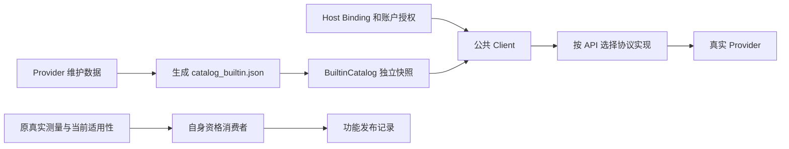
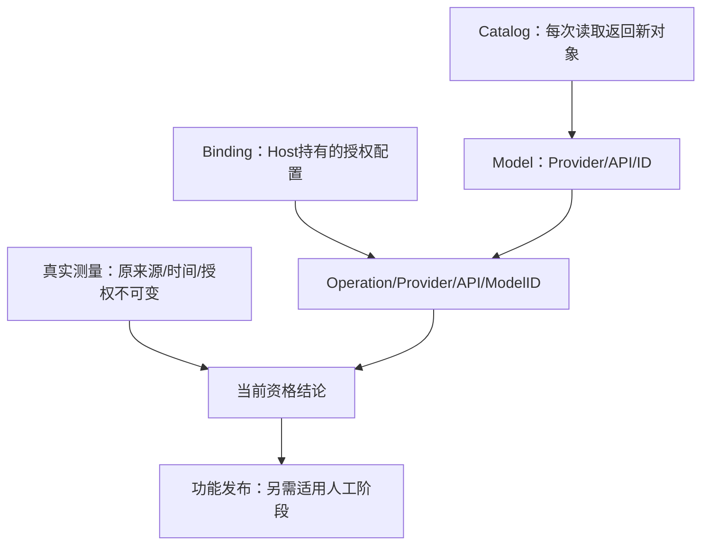
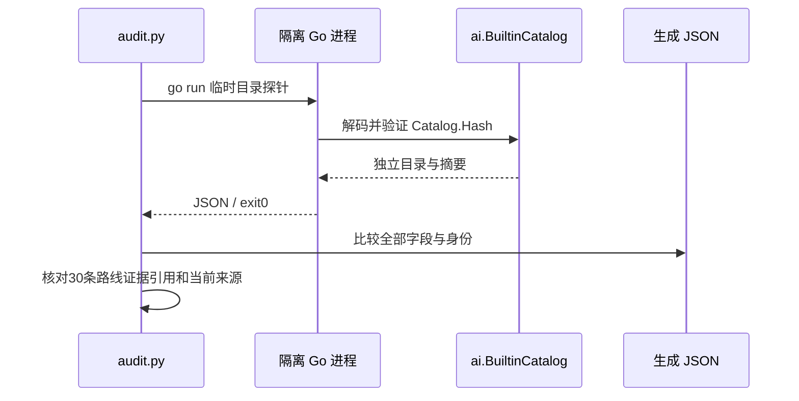

# Provider 接入与交付状态核对（2026-11-02）

Kimi 已在内置目录：国际站 Provider 为 `moonshot`，中国站为 `moonshot-cn`，型号均为 `kimi-k3`，各有 Chat Completions、Responses、Messages 三条路线。品牌名与 Provider ID 不同，不能通过寻找 `provider=kimi` 判断缺失。2026-10-28 六条路线已通过正式资格消费并激活；旧材料中的候选、9/10、inactive 属于历史状态。

当前实现有 12 个 Provider、30 条操作 × Provider × API 路线。每条路线均能追溯到自身完整真实合同证据；这不表示目录中每个型号均已真实测试，也不表示所有功能的人工阶段及最终发布已经完成。

## 1. 范围与执行事实

- 对象：当前 checkout 的内置目录、Provider 身份、协议装配、既有资格消费者与功能交付记录。
- 当前分支 `codex/barness-catalog-integration`，HEAD `37a283ee4ef743f93d3a12132d1bc2c3211fb1e5`；开始时工作区干净。
- [本次已执行] `python3 .scratch/provider-integration-status-20261102/audit.py`，exit 0。脚本在隔离环境运行公共 `ai.BuiltinCatalog()` 与 `Catalog.Hash()`，禁止 Go 模块下载，不读取厂商凭据，不发送厂商请求。编译后目录与生成 JSON 完全一致。
- 目录版本 `catalog-f2a93c1e05020afbf0d9d77f9d2d0799d4afed6f7daf6704d62ef81b22354860`，Hash `sha256:e935a3ad0804ea48ce50c5e53cc106416407bf69d33d2b9e8076260ba2112c9c`。
- 原始身份数：112 chat、3 image、3 classifier。身份包含 API；不是按型号 ID 去重后的数量。
- [本次已执行] 核对所引用消费者/阶段回执的记录哈希与成功状态；没有重新审计全部传递证据包，没有重新执行资格 CLI，没有发起新发布判定。
- [本次已执行] 最新完整普通回执的 2154 个执行来源及 150 项输入与当前完整集合及内容相等。原实际受测提交 `ada85f43923e5ca35e53de5f478947e1386bd7b0`，原普通 PASS/exit0；不是本次重跑测试。
- 本次仅保存固定日期审查报告与可重复清单，不更改产品、既有唯一当前状态、历史矩阵或旧证据。没有新增测试、race、压力或付费执行。

可重复入口：[audit.py](audit.py)；本次机器结果：[inventory.json](inventory.json)；实际编译目录：[catalog.json](catalog.json)。结果标签：下述自身验收与交付状态来自留存证据；本次运行只直接证明目录读取、集合相等和引用核对。

## 2. 按 Provider 确认

Chat 指 `openai-completions`，Responses 指 `openai-responses`，Messages 指 `anthropic-messages`。真实合同项含取消、预检、声明不支持等，不等同付费调用数。

| Provider / 品牌 | 路线数与接入范围 | 自身真实证据 | 交付结论与尚未完成项 |
| --- | --- | --- | --- |
| `openai` / OpenAI | 4：Chat、Responses、Images、Decisions | Chat 10 PASS + 1 固定 UNSUPPORTED；Responses 9 项；Images 3 项；Decisions 9 项 | 已有完整交付基线，四条路径证据可追溯。Chat 推理历史不支持的原语义保持。 |
| `anthropic` / Anthropic | 1：Messages | 12 项完整真实合同 | 已有完整交付基线。 |
| `google` / Google | 2：Gemini、Interactions Image | 聊天 7 项，图片 2 项 | 两项操作已有完整交付基线。 |
| `deepseek` / DeepSeek | 2：Chat、Responses | Chat 12 项；Responses 9 项 | 两条路径已有完整交付基线。 |
| `zhipu` / 智谱中国站 | 3：Chat、Responses、Messages | GLM-5.2/5.3；24、22、24 项 | 已有完整交付基线；Responses 后续来源适用性已离线补齐。 |
| `zai` / Z.AI 国际站 | 3：Chat、Responses、Messages | GLM-5.2/5.3；20、18、20 项 | 实现、目录及自身完整证据齐备；地区功能原最终验收、正式 race/发布仍暂停，未发现后续关闭记录。 |
| `minimax` / MiniMax 国际站 | 3：Chat、Responses、Messages | Chat/Responses 各14项；Messages 原13＋新1，共14/14，FORMAL_APPLICABLE | 原功能交付基线 COMPLETE；后续 Messages thinking-on 缺口已由成功单项补齐。旧失败不改写。 |
| `minimax-cn` / MiniMax 中国站 | 3：Chat、Responses、Messages | 三条各10项完整合同 | 实现、目录及自身完整证据齐备；地区功能原最终验收、正式 race/发布仍暂停，未发现后续关闭记录。 |
| `moonshot` / Kimi 国际站 | 3：Chat、Responses、Messages | 三条各原9＋新1；正式外层消费者均 PASS/exit0 | 正式目录已激活；原 Kimi 功能 race、压力及最终发布尚未记录完成。激活任务无新增并发/负载影响，不替代原功能人工阶段。 |
| `moonshot-cn` / Kimi 中国站 | 3：Chat、Responses、Messages | 三条各原9＋新1；正式外层消费者均 PASS/exit0 | 与国际站分别授权和验收；正式目录已激活，原功能人工阶段及最终发布尚未记录完成。 |
| `xai` / xAI | 2：Responses 聊天、Images 图片 | Grok 4.7 聊天18项；Imagine 图片6个真实场景 | 图片正式资格、race、压力及只读发布门禁 PASS，已合入本地 main。聊天有完整自身证据和适用性，但原 Grok 项目人工阶段/最终发布仍待收尾。 |
| `typesafe` / TypeSafe | 1：System One 分类 | Jev 1.13：3项；Jev 1.14：12项，分别有自身证据 | 已有完整交付基线；1.14 图片与 Box 仍遵循实验开关和显式授权边界。两个版本不重复计为两条协议路径。 |

证据入口：

- 既有基线与29条路线：[完整交付基线](../barness-ai-minimax/delivery-status.md)、[29条逐路线原件索引](../../.evidence/provider-final-readiness/delivery-matrix-v2.json)、[六条来源补齐](../provider-source-retrace/status.md)、[Jev/GLM三条来源修正](../provider-source-scope/status.md)。
- MiniMax Messages：[当前单项状态](../minimax-thinking-resample/status.md)、[14项组合结果](../../.evidence/minimax-thinking-resample/composition-result-v1.json)。
- Kimi：[目录激活状态](../kimi-catalog-activation-20261028/status.md)、[完成索引](../../.evidence/kimi-catalog-activation-20261028/completion.json)、[六条正式资格索引](../../.evidence/kimi-catalog-activation-20261028/formal-qualification-v4.json)。每组保留两份独立测量，不合成一次十项采集。
- xAI：[聊天功能状态](../barness-ai-grok/spec.md#唯一当前状态)、[图片功能状态](../barness-ai-xai-imagine/spec.md#唯一当前状态)、[图片发布报告](../../.evidence/barness-ai-xai-imagine/release/20261029-07/release-report.json)。图片完成不能关闭聊天功能。
- 原人工阶段：[地区功能状态](../barness-provider-sites/spec.md#当前状态)、[Kimi 原功能状态](../barness-ai-kimi/spec.md#唯一当前状态)。其旧 live/目录描述已由后续专项记录补齐；暂停与未完成人工阶段不能从后续目录 PASS 推断关闭。

## 3. 当前展示存在的滞后

[支持矩阵](../../ai/live/support-matrix.json)现有23行、22条不同路径：TypeSafe 两型号分别占一行。它缺少 Kimi 六条以及 xAI 聊天、图片两条；Z.AI 三条和 MiniMax 中国站三条仍为旧 `NOT_RUN`。这份历史矩阵不能独立回答当前交付状态。

[2026-10-27审查](../provider-integration-audit-20261027/report.md)和[MiniMax补采后的v5矩阵](../minimax-thinking-resample/delivery-matrix-v5.md)都早于 Kimi 激活与 xAI 图片交付。前者的 Kimi 候选说明、后者的六路9/10与inactive均有后续记录；不能按文件标题中的“当前”二字直接沿用。

2026-11-01 [目录维护功能](../barness-ai-dynamic-catalog/status.md)的普通、受影响目录 race/压力及只读发布门禁均 PASS。其范围是目录维护/加载；不构成 Kimi、地区、Grok 等旧功能全部人工阶段完成的证明。当前规则按 [ADR-0055](../../docs/adr/0055-route-scoped-evidence-applicability.md) 与 [ADR-0058](../../docs/adr/0058-barness-catalog-maintenance-and-isolated-loading.md)分别记录原测量、适用性、目录接纳与发布。

## 4. 架构横向与核心数据关系

Provider 表示真实服务身份，API 表示协议。Host 通过 Binding 选择服务、协议、账户和授权；目录提供模型与价格定义，四个聊天 adapter 及独立图片/分类路径负责协议转换。Kimi 两站复用三种协议，不需要名为 `kimi` 的 Provider。

主要代码位置：[ProviderID/Binding](../../ai/binding.go)、[Catalog/BuiltinCatalog](../../ai/catalog.go)、[协议表](../../ai/adapter.go)、[Responses能力](../../ai/responses_capabilities.go)、[Messages能力](../../ai/anthropic_capabilities.go)。此部分为静态阅读；本次未重新发送业务调用。

目录由维护数据生成、ai 包嵌入并独立解码；调用使用固定快照。验收测量与消费者不属于可变业务模型，不通过更新目录重写其历史。

## 5. 本次实际路径与场景

运行结果为12 Provider、118个原始身份、30条路径；目录探针无凭据、无模块下载。脚本同时核对 Kimi 六个外层消费者及相应原生/采集/组合引用；MiniMax 14项组合和 xAI 图片 PASS 读取自各自不可变结果，不修改旧测量。

“没有Kimi”的现象已由实际公共目录读取排除，无可复现的产品缺陷，因此未进入问题诊断技能的假设、修改或回归测试阶段。本次不为品牌展示差异新增产品代码。

## 6. 有意保留的黑盒与取舍

| 黑盒 | 输入与输出 | 本次边界 |
| --- | --- | --- |
| 厂商当前线上服务 | 实际请求 → 厂商响应 | 只核对仓库交付事实，不重新测量在线可用性。 |
| SDK 内部 | 请求对象 → HTTP/SSE | 没有需要由 SDK 内部解释的缺失；只确认既有路由。 |
| 全部传递证据包内容 | 捕获/断言 → 资格结论 | 本次核对引用与成功状态，不声称重新完成全部原件审计。 |

若重新设计当前状态展示，我会在模型列表同时展示品牌和 Provider ID，并从现有资格索引生成固定日期汇总；不再让历史支持矩阵兼任全部项目的当前状态。这里仅提出展示改进，没有引入新状态系统或改写旧矩阵。

后续实际收尾仍应分别核对 Kimi、地区、Grok 聊天和共享验收工具的未完人工阶段，并按对应影响和既有授权执行。当前未发现可将这些阶段全部关闭的记录，也没有依据要求所有 Provider 再做一轮付费验证。本报告为固定日期审查快照，不替代任何功能的唯一当前状态。
