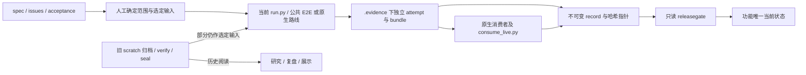
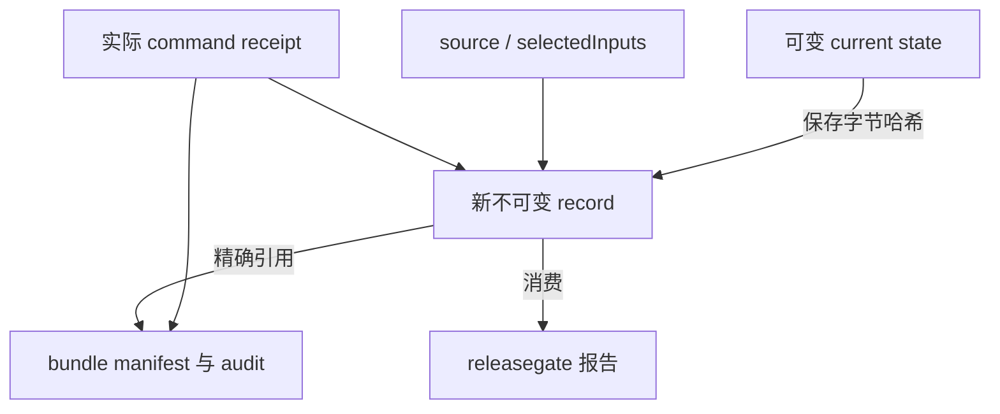
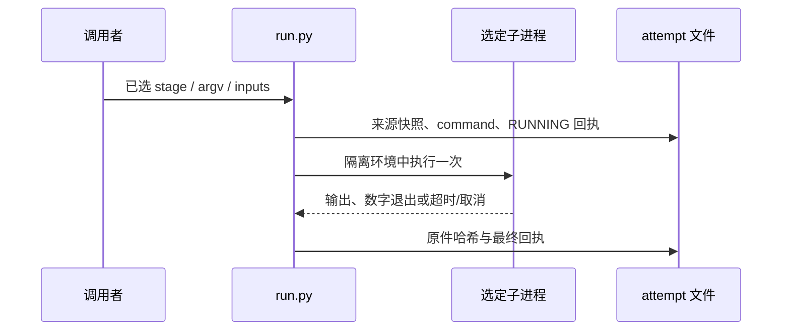

# `.scratch/` 文档与脚本审查报告

日期：2026-10-23（Asia/Shanghai）  
审查基线：`571ca112859211ca5d987906e16ae135f89f54f5`；开始时已有未跟踪的 `.scratch/barness-ai-sop-test-20261022/`，本报告将其纳入盘点。

**结论：这些文件大多有明确工程用途，但 `.scratch/` 已同时承担需求库、研究档案、测试输入、验证工具和历史证据存储五种职责。问题主要是活动入口与历史材料的边界不清，以及普通测试依赖未进入 Git 的本地原件。不能按扩展名或“临时目录”一批删除。**

本轮有 1 项 P1、3 项 P2、1 项 P3 发现；另有两项架构和导航改进建议。没有修改既有功能文档、脚本、状态或证据。

## 1. 范围、方法与实际运行

目标是解释每类附加材料的职责，识别 Python/JavaScript 的实际执行影响，检查它们是否仍适用于当前工程流程；不是重新判定所有功能的发布资格。

- **全量静态盘点**：原有 20 个一级目录、63,051 个物理文件，共 2,470,980,824 bytes，约 **2.30 GiB**；其中 8,757 个文件受 Git 跟踪。统计不包含本报告目录，也不展开压缩包成员。
- **文档检查**：719 份 Markdown 的路径、标题、哈希及显式本地链接；重点阅读各目录的入口、状态、设计/研究说明、工具合同和代表性历史验收材料。没有逐段重审 719 份正文中的全部产品事实。
- **脚本检查**：310 个 `.py`、8 个 `.mjs`，另有 2 份 `.py.gz` 历史源码快照；未压缩 Python 合计 33,073 行。全部做静态分类与语法检查；逐行追踪当前 SOP 主入口及代表性的生成、封存、核验和轮次控制路径。没有对 318 个脚本的每个分支逐一运行认证。
- **实际执行**：4 个已确认无执行副作用的 CLI `--help` 均退出 0；8 个 MJS 的 `node --check` 均退出 0；旧 `update-ledger.py --help` 退出 1，见发现 F04。Python AST 解析 310/310 成功，另两份压缩 PY 快照也可解析；所有独立 PY/MJS 文件均未超过 500 行。
- **压缩包索引**：读取磁盘上全部 47 个 ZIP 的中央目录，无解压、无执行；未发现 TS/TSX 成员。175 个 `.tar.gz` 及其余 300 个 Gzip 文件没有穷尽展开。
- **验证边界**：没有执行 Go E2E、厂商调用、race、压力或证据清理；没有重新核验历史研究所引外部网站的最新事实。以下“当前状态”均表示文档在本次基线的声明，不是本轮重新跑出的通过结论。

证据：[完整库存与哈希](/Users/cyber/RestoX/barness/.scratch/scratch-artifact-review/inventory.json)、[318 个脚本逐项导航](/Users/cyber/RestoX/barness/.scratch/scratch-artifact-review/scripts.md)、[CLI/JS 实际检查](/Users/cyber/RestoX/barness/.scratch/scratch-artifact-review/process-checks.json)、[ZIP 索引检查](/Users/cyber/RestoX/barness/.scratch/scratch-artifact-review/archive-index-check.json)、[压缩源码检查](/Users/cyber/RestoX/barness/.scratch/scratch-artifact-review/compressed-script-check.json)。

## 2. `issues / spec / design` 之外，其他文件负责什么

仓库约定了 feature/spec/issues 和唯一当前状态，但没有要求所有目录都必须拥有相同的三件套。研究、读码、故障调查和一次回归也被放进了 `.scratch/`。约定见 [issue tracker](/Users/cyber/RestoX/barness/docs/agents/issue-tracker.md:5)。

| 文件或目录 | 实际职责 | 阅读和维护方式 |
| --- | --- | --- |
| `research.md`、`implementation-research.md`、`research-international.md` | 官方协议事实、SDK 差异、方案比较、来源和未确认事项 | 查“为什么这么设计”；以所记日期为适用范围，不能把建议当成已接受决定 |
| `map.md` | 实施进展索引、已作决定、阻塞问题和工单入口 | 快速导航；动态结论应指向功能唯一当前状态 |
| `ticket-plan.md`、`implementation-plan.md`、`plan.md` | 工单依赖、实施顺序、验证边界、回滚和维护计划 | 回答“怎么做”；计划完成不等于验收通过 |
| `acceptance.md`、`failure-modes.md`、`*-failures.md` | 用例矩阵、失败方式、预期拒绝和资源行为 | 回答“如何证明”；是先失败后实现的重要输入 |
| `review.md`、`code-review.md`、`REVIEW.md`、`review-fixes.md` | 某次固定来源的审查、发现、修复与复审 | 具有时间与源码范围；历史“零发现”不是当前所有代码的保证 |
| `status.md/json`、`delivery-status.md`、spec 内“当前状态” | 功能唯一可变状态：实际完成、缺口、受测来源和原件入口 | 新工作首先找这一份；不能只看旧验收 README 的 PASS |
| `verification.md/json`、`evidence.md/json`、`*-evidence.json` | 命令、实际退出、来源和证据索引/投影 | 通常是“指针和摘要”，并非完整原件；需追到精确 manifest/audit/receipt |
| `manifest.json`、`assertions.json`、`audit.json`、`SHA256SUMS` | 文件清单、场景断言、脱敏审计与完整性锚点 | 分别回答“有哪些字节”“断言结果”“是否泄漏”“字节是否改变”；单独一个 PASS 或哈希不证明业务正确 |
| `requests/events/result/usage/resources*.json`、日志、JSONL | HTTP/流事件/结果/资源与进程轨迹 | 是定位失败和回放的输入；其中 FAIL/NOT_RUN 也有保留价值 |
| `history/`、`originals/`、`ticket-drafts/`、日期或轮次目录 | 修改前快照、已替代工单、失败和授权沿革 | 保持历史事实；可加外部导航说明，不能把原件重写成当前结论 |
| `tools/`、目录内的 PY/MJS | 采集、核验、封存、生成夹具、控制执行或测试这些工具 | 是可执行源码；必须按调用关系决定维护身份 |
| `*.zip`、`*.tar.gz`、`*.gz`、`*.bundle` | 历史证据树、压缩 JSON/日志/源码快照或 Git 恢复材料 | 可能被现有测试直接消费；Git 忽略不代表无依赖 |
| `reading-report.md`、HTML、`source-index.json` | 代码阅读、交互调用链、源码与验证场景映射 | 帮助理解；不是产品规范或当前发布状态 |
| `process-review-*`、`session-analysis/`、性能 CSV/JSON | 从既有记录分析耗时、失败和流程成本 | 属于复盘投影；不要与原生验收记录混为一谈 |

特别区分：**fixture 是验证前选定的输入，evidence 是执行后的原件，receipt 是把命令、来源和原件绑定起来的回执。** 一份历史 evidence 被普通测试消费后，也成了该测试必须显式管理的输入。

## 3. 20 个目录的职责地图

“MD/PY”是物理文件数，不表示它们均是当前活动输入。MJS 单列在用途说明中；完整后缀统计见库存。

| 目录 | MD / PY | 实际性质与优先阅读入口 |
| --- | ---: | --- |
| `barness-ai` | 36 / 0 | 基础模块规范、34 张工单和研究追溯；基础 spec 的现行基线措辞需修正，见 F02 |
| `barness-ai-call-chains` | 1 / 0 | 调用链读码与 HTML 展示；4,137 个文件主要是已运行场景证据；入口 `reading-report.md` |
| `barness-ai-glm` | 78 / 14 | GLM 接入、13 张实施工单、草案及发布/回滚历史；入口 `spec.md`、`map.md`；历史脚本见 F04 |
| `barness-ai-kimi` | 54 / 0 | 仍在推进的 Kimi 接入；唯一状态在 spec；`history/` 保存历次 spec 字节，证据目录记录阶段性验收 |
| `barness-ai-minimax` | 215 / 133 | MiniMax 接入、后续资格续期与修复；`delivery-status.md` 记录 2026-10-19 完成的固定来源交付，不能外推到后续源码；30 个工具、101 个证据脚本、2 个复盘脚本 |
| `barness-ai-openai-decisions` | 94 / 16 | Decisions 分类能力、用量、图片、隔离、效果及验收；附实施计划/追踪和历史工单替换证明 |
| `barness-ai-pi-1.0` | 70 / 28 | 1.0 时期图像/分类扩展及验收；另有 4 个历史 MJS；54,971 个物理文件中仅 774 个受 Git 跟踪 |
| `barness-ai-race-optimization` | 7 / 0 | 历史验证阶段拆分和性能调查；入口 `status.json`；其声明为普通验证完成、race NOT_RUN、发布受阻 |
| `barness-ai-release-verification` | 9 / 2 | 某次发布续修、原生 socket 失败诊断和封存；README 的全量重现命令已属于历史流程，见 F04 |
| `barness-ai-sampling` | 1 / 0 | 采样逻辑读码报告；不是独立待实施功能 |
| `barness-ai-sop-test-20261022` | 2 / 0 | 一次 SOP 普通回归的 spec/状态；开始审查时未跟踪，指向独立 `.evidence`；不是产品功能 |
| `barness-ai-test-process-review` | 14 / 19 | 当前测试 SOP 的实施、审查与维护工具；入口 `status.md`、`tools/README.md`，8 个工具模块、8 个工具测试/支持文件、3 个复审复现脚本 |
| `barness-ai-thinking-sampling` | 18 / 12 | 分档采样功能及历史发布核验；另有 4 个 MJS；包含直接改夹具与旧账本的生成器，见 F04 |
| `barness-ai-timeout-ordering` | 1 / 0 | 一张 CallTimeout/ReadIdleTimeout 竞争调查工单；现为 needs-triage |
| `barness-provider-sites` | 42 / 64 | 地区 Provider、历史验收轮次及控制器；spec 当前为 recovery7 暂停、release.pass=false，工具 README 滞后，见 F03 |
| `claude-subscription` | 1 / 0 | 订阅/API/SDK 的历史研究；不能据文件名视为已接入能力 |
| `jev-1.14-multimodal-box` | 73 / 22 | 统一图片引用与 Box、02–14 号工单审查/失败/验收记录；部分 Python 核验器仍被 Go 调用 |
| `pi-1.1.0-openai-decisions` | 1 / 0 | 上游 1.1.0 分类能力的前期研究 |
| `pi-1.1.0-thinking-sampling` | 1 / 0 | 上游 1.1.0 思考档位/采样前期研究 |
| `unary-timeout-priority` | 1 / 0 | 另一张同到期 unary 超时调查工单；现为 needs-triage；与前述竞争问题相似，但尚不能仅凭描述合并根因 |

## 4. Python / MJS 的具体作用及执行影响

**当前没有发现独立的 `.ts/.tsx/.js` 文件。用户提到的 TS 程序，在这份工作区中最接近的是 8 个 `.mjs`，它们是 Node ESM JavaScript。** 历史文档会提到上游 TypeScript 源码；未穷尽展开 TAR，因此不断言所有归档内部都没有 TS。

| 代表脚本 / 家族 | 输入 → 输出 | 执行影响与维护身份 |
| --- | --- | --- |
| `test-process-review/tools/run.py` | 已选命令、来源、`--input` → 新 attempt、真实退出、日志、原生包索引 | 当前 SOP 工具；会执行用户给定命令；`stage=live/pressure/race` 不表示已获得人类选择 |
| 同目录 `run_process.py` / `live_environment.py` | 阶段/路线/进程流 → 隔离环境与有界采集 | 当前工具内部模块；普通环境清除 live/压力凭据配置，支持取消、超时和脱敏 |
| 同目录 `receipt_files.py` | 来源及文件 → 哈希、原子 JSON、bundle 校验 | 当前共享基础；默认扫描 `ai/` 和本工具目录，其他实际输入需 `--input` 固定 |
| 同目录 `consume_live.py` | 冻结 releasegate 和原生 bundle → 外层 schema 2 消费回执 | 执行一次资格消费子进程；不请求厂商，仍会创建新消费者目录 |
| 同目录 `cleanup.py` / `cleanup_scan.py` / `cleanup_state.py` | 引用、库存、确切批次/清单哈希 → 扫描、隔离、恢复或删除记录 | 当前维护工具；包含真实 rename/rmtree；只读审查不能顺手执行 move/purge |
| `jev-1.14-multimodal-box/verify-11-evidence.py` | protocol bundle、可选正式目录 → 逐项结构/预算/结果验证、退出码 | 仍被 `jevformal` Go 消费者及测试直接调用，不能按“旧票脚本”删除 |
| `verify-02…10`、`seal-11…14`、`run-14-verification.py` | 固定票号的证据与来源 → 核验/封存或整轮采集 | 职责因脚本而异；`run-14` 历史上会启动整套验证与负载，不能当成普通只读 verifier |
| 各 `*-evidence/verify.py` | 历史 ZIP/TAR、manifest、来源 → 哈希/语义/审计/消费者结果 | 很多会启动 Go 工具、解压临时目录；“不请求厂商”不等于不构建或不写文件 |
| `pack.py`、`capture.py`、`seal.py`、`preserve-*.py` | 既有运行树/固定来源 → 归档、哈希、索引 | 生产证据的辅助程序；固定输出与硬编码路径较多，通常只适用于原轮次 |
| `*-live-evidence/run-live.py`、`launcher*.py` | 路线、授权、冻结二进制、凭据 → 真实报告/账本 | 部分入口会请求厂商并消耗预算；必须读自己的原生合同，不能批量运行所有 PY |
| `minimax/tools/paid*`、`renewal*`、`routed*`、`eleven*`、`repair*` | 固定轮次计划/来源/历史/授权 → claims、执行、续期、资格与发布材料 | 约束很重的验收控制器；prepare/check 也可能构建并运行测试；保留历史不等于续期开新轮次 |
| `provider-sites/tools/final*`、`recovery*` | 固定 cohort/授权/当前来源 → 对应轮次的准备、消费、停止和发布记录 | 64 个文件含测试和共享模块；不是 64 个独立程序；恢复版本不能任意互换 |
| `thinking-sampling/fixture-cases.py` | 当前协议模板 + 脚本内预期 → 四路线 `thinking-sampling.json` | 直接覆盖工作树夹具；模块顶层就执行，不应 import 或作为展示说明运行 |
| `thinking-sampling/update-ledger.py` | 旧 migration manifest + 旧 pidiff ledger → 改写 ledger | 退役维护脚本；当前账本已删除，连 `--help` 都先失败 |
| 两组 `release-verification/*.mjs` | 固定 lock/发布件/上游源码 → 安装、构建、字节等价与失败场景结果 | 历史 pi 发布件核验；`run.mjs` 会联网下载/npm 安装/构建，并非 TS 业务实现 |
| `pressure-loopback`、`native-pressure/reproduce.py`、`replay-red.py` | 固定来源/受控输入/负载参数 → 因果诊断和原件 | 即使全部 loopback，也会制造压力或运行旧源码对照；不属于轻量文档验证 |
| `session-analysis/collect.py` / `build_report.py` | 已有运行、断言、归档 → 失败分类、时间分析、HTML/CSV/JSON | 复盘投影；读取历史材料，不执行捕获的原命令；固定时间窗/路径使其不是通用报表工具 |
| `test_*.py`、`tools/tests/`、`failures.mjs`、`faults.mjs` | 临时仓库、假厂商/假进程、损坏输入 → 负例/进程场景 | 工具自身验证；负例中的 FAIL 可能正是外层预期，不能据此宣布产品失败 |

### 4.1 当前数据流与历史支线

这里有两个不同关系：产品调用主链仍以 Go `ai/` 为中心；验证与原生资格消费则真实依赖 Python/文件系统及 `.scratch` 中的部分输入。后者已经是工程基础设施。

### 4.2 核心数据归属

| 数据 | 创建者 / 生命周期 | 可变性和边界 |
| --- | --- | --- |
| source / selectedInputs | 采集器在执行前固定，执行后复核 | 标识完整来源和实际输入；不是只看 HEAD |
| command / stdout / stderr / exit-code | 实际子进程采集 | 保存真实运行事实；不能由上层自报通过代替 |
| bundle manifest / audit / artifacts | 公共测试或原生生产者 | 消费者读取并复核；旧失败原件保留 |
| current state | 每功能唯一状态维护者 | 可变；历史快照单独保存，已绑定字节变化需新 record |
| record / consumer receipt | 验证事实装配者与外层采集器 | 新版本引用精确路径/哈希；只读门禁消费，不自动补跑阶段 |
| grant / claim / ledger | 原生授权与消费模块 | 累计与一次性边界；不是可重建的缓存 |

### 4.3 实际追踪的两条路径

当前采集路径的静态顺序为 `run.main → parse_args → source_snapshot / selected input hashes → environment → 新 attempt → capture → 复核来源与原生包 → receipt`。本轮 `--help` 仅到参数解析即退出 0，没有进入命令执行；这一运行事实不能代替对完整采集行为的测试。

另一条仍活动的路径是 `jevformal.Verify → Python verify-11-evidence.py → 公共 Classify replay → 独立效果消费`。Go 明确把该 PY 纳入来源哈希，再启动 `python3`，见 [verify.go](/Users/cyber/RestoX/barness/ai/internal/testkit/jevformal/verify.go:150) 和 [调用点](/Users/cyber/RestoX/barness/ai/internal/testkit/jevformal/verify.go:203)。本轮验证了 PY CLI 可达，未运行真实 formal 输入。

## 5. Review 发现

优先级：P1 影响基本可复现性；P2 容易导致错误实施或操作；P3 主要影响资料可读性与追溯。以下均附适用范围，不把历史失败当成当前新缺陷。

### F01 · P1：普通 E2E 依赖被 Git 忽略的本地 ZIP，新克隆缺少输入

[release_rollback_import_test.go:20](/Users/cyber/RestoX/barness/ai/e2e/release_rollback_import_test.go:20) 无条件打开 `runtime-evidence/runtime.zip`，缺失立即 `t.Fatal`；调用它的普通测试包括 `TestReleaseRollbackArtifacts` 和 `TestReleaseRevocationSemanticIntegrity`。

本轮实查：该文件本机存在；`git cat-file -e HEAD:<path>` 退出 **128**，说明当前提交没有该对象；`git check-ignore -v` 命中根 [.gitignore:5](/Users/cyber/RestoX/barness/.gitignore:5)。`jev-baseline/baseline.zip` 也有相同 Git 输入缺口。证据见 [git-input-check.json](/Users/cyber/RestoX/barness/.scratch/scratch-artifact-review/git-input-check.json)。历史复盘已经记录过 ZIP 缺失引发同批测试准备失败，见 [build_report.py:24](/Users/cyber/RestoX/barness/.scratch/barness-ai-minimax/session-analysis/build_report.py:24)。

**影响**：只拉取 Git 仓库不足以执行现有普通回归；“本机全绿”依赖未交付的本地材料。本轮没有实际新建克隆并跑 Go；新克隆失败是由已验证 Git 缺失事实和无条件读取代码推导的结果。

**建议**：把普通消费者所需的最小、已脱敏固定输入纳入 `ai/e2e/testdata/`，或提供可验证、固定哈希、明确失败语义的原件恢复入口与新克隆步骤；历史大归档继续独立保留。不要通过忽略缺文件或跳过用例掩盖问题。验收应在只有 Git 内容及明确恢复输入的新工作区执行定向公共 E2E。

### F02 · P2：基础 spec 仍把冻结 pi 写成“当前唯一基线”，与已接受 ADR 相冲突

[基础 spec:24](/Users/cyber/RestoX/barness/.scratch/barness-ai/spec.md:24) 仍声明“当前实现的唯一兼容基线”是 pi-ai 1.1.0；[研究追溯表:7](/Users/cyber/RestoX/barness/.scratch/barness-ai/research-traceability.md:7) 仍把已删除的 `ai/release/traceability.json` 当作实施后的计算入口。[对外合同:3](/Users/cyber/RestoX/barness/docs/barness-ai/contract.md:3) 又把这个 spec 列为优先权威来源。

但 [ADR-0051](/Users/cyber/RestoX/barness/docs/adr/0051-scoped-verification-receipts.md:10) 已明确：pi 仅作架构参考，冻结 oracle/Node 差分和固定全库发布选择器已删除；当前依据是自身公共契约和分阶段回执。基础 spec/追溯表开头没有相应的取代指针。

**影响**：按旧 spec 接手的维护者可能恢复已退役的执行依赖、错误要求差分门禁，或把旧发布条件视为当前义务。

**建议**：在当前可编辑入口明确 ADR-0051 的取代范围、现行 SOP 和状态指针；历史原文及原测量结论保留。无需重新运行历史差分，更不应重建 oracle 来满足过时措辞。

### F03 · P2：地区工具 README 将 recovery4 标为当前入口，spec 已到暂停的 recovery7

[tools/README.md:3](/Users/cyber/RestoX/barness/.scratch/barness-provider-sites/tools/README.md:3) 明示当前固定入口是 `recovery4_round.py`，第 81 行再次标注“当前准备入口”。而 [spec:9](/Users/cyber/RestoX/barness/.scratch/barness-provider-sites/spec.md:9) 指向 recovery7 当前索引，记录完整 native 普通门禁超时、后续停止、无新授权与正式 race、`release.pass=false`。

**影响**：从最自然的工具 README 进入会选错轮次。旧控制器的关闭检查可以拒绝执行，但文档仍可能诱发无效准备、误解授权或绕回历史流程；本轮未证明存在实际绕过。

**建议**：README 首部只保留当前 spec/暂停交接指针，把 R2–R4 等正文明确放在历史区；旧原件不改写。按当前 SOP，新工作不续建代际恢复控制器，也不能将“更新入口”理解为恢复已暂停任务。

### F04 · P2：历史维护脚本缺少清晰退役边界，部分仍会改当前文件或诱发整套验证

已实际复现：[update-ledger.py:5](/Users/cyber/RestoX/barness/.scratch/barness-ai-thinking-sampling/update-ledger.py:5) 在 argparse 之前读取已删除的 `ai/e2e/testdata/pidiff/ledger.json`，执行 `--help` 都退出 **1 / FileNotFoundError**。见 [legacy-help-repro.json](/Users/cyber/RestoX/barness/.scratch/scratch-artifact-review/legacy-help-repro.json)。

同目录 [fixture-cases.py](/Users/cyber/RestoX/barness/.scratch/barness-ai-thinking-sampling/fixture-cases.py:1) 没有 main guard，顶层循环最终直接 `write_text` 到四路线的当前测试夹具，没有新输出目录或已有内容一致性检查；本轮只读源码，没有运行它。它只能被理解为一次固定历史生成步骤，不能当作通用维护入口。

此外，[历史发布续修 README:12](/Users/cyber/RestoX/barness/.scratch/barness-ai-release-verification/README.md:12) 仍给出“完整门禁重现”命令，注明会连带启动 normal/race、冻结差分与压力；[旧 MJS README:20](/Users/cyber/RestoX/barness/.scratch/barness-ai-thinking-sampling/release-verification/README.md:20) 仍给出下载重建和现行 oracle 描述。GLM 的 [preserve-history.py:14](/Users/cyber/RestoX/barness/.scratch/barness-ai-glm/evidence/ticket-13/preserve-history.py:14) 则固定本机 `/private/tmp` 与 `/Users/cyber` 路径，不能在新工作区直接复用。

**影响**：脚本看起来是辅助材料，实际可能覆盖夹具、改账本、构建联网依赖或启动昂贵验证；旧来源检查失败也可能只是历史不适用，不能自动诊断为当前产品回归。

**建议**：为这些历史入口提供不进入原件哈希的外部用途/退役索引，标出固定来源、写入范围和替代入口。新工作用当前 SOP；确有第二个真实生成需求时再设计显式输出及覆盖校验，不应为旧脚本加兼容账本或重建已删除路径。

### F05 · P3：历史快照与临时绝对路径降低了资料的可追溯性

显式 Markdown 本地链接扫描得到 **4,197 处引用，349 处按文档当前位置解析的目标不存在**。这不是 349 个当前缺陷：其中 **206 处**来自 Kimi `history/` 中保持原字节的 spec 快照，其相对路径本来应按原 spec 位置解释；另外还有已删除源码链接和厂商文档快照中的网站根相对链接。检查不包含锚点语义，结果须分类消费。

一个明确的可用性问题是 [current-source-applicability.md:3](/Users/cyber/RestoX/barness/.scratch/barness-ai-minimax/evidence/ticket-09/final-closure/current-source-applicability.md:3) 将完整逐文件库存链接到 `/tmp/barness-ticket17-current-source-applicability.json`；该目标当前不存在，另一份审查副本也保留这个地址。本轮没有穷尽 TAR，不能断言归档里没有另存同字节副本。

**建议**：给保留快照记录 original path/base、受测提交和来源；在外部索引为失效临时地址提供已确认的永久证据指针及哈希。已封存原件保持不动，禁止通过批量改链接使旧哈希失真。[缺失目标候选表](/Users/cyber/RestoX/barness/.scratch/scratch-artifact-review/missing-links.json) 只供逐项复核，不能直接作为删除/修改清单。

## 6. 架构判断与整理方向

### 6.1 应按调用者和生命周期确定工具归属

当前 `.scratch` 并非产品运行时的一层，但现有 Go 原生消费者、普通 E2E 和 SOP 已依赖其中的 Python、JSON 和 ZIP。优点是每轮原件、失败和授权有丰富上下文；代价是新克隆准备复杂，长期活动工具与一次性历史脚本难区分。

**我会优先调整的设计**：稳定且长期活动的验证入口应有正式工具归属；feature 目录保留需求、设计、工单、状态和指向证据的索引。普通验证的最小稳定输入应位于 testdata，原生运行证据放 `.evidence`，历史脚本随固定来源档案保留。当前 SOP 的 `run/consume/cleanup` 是合理的分责，没必要再造一个自动编排所有阶段的总控制器。

这需要单独变更：先固定失败场景、更新 Go 调用点与来源选择器，再迁移活动工具；直接删除旧内部路径，不加 shim。历史证据若绑定原路径/哈希，应按原来源阅读或在外部建立指针，不能双写或偷偷改 pin。**本轮只提出方向，没有搬迁。**

### 6.2 增加一份顶层导航，减少“每个目录都应是 feature”的误解

当前 20 个目录中还包含研究、展示、复盘和一次回归。建议顶层索引为每个目录只列：类型、权威 spec/状态、当前工具入口、历史材料位置、是否存在普通测试直接依赖。现有命名可先保留，无需为研究报告补造 spec/design/issues。

新验收说明继续遵守 [SOP §8](/Users/cyber/RestoX/barness/docs/agents/verification.md:129)：scratch 只保存命令、退出、哈希和原件指针，不再复制整棵胶囊。现有 ZIP/TAR 约 **1.70 GiB**，但大小不能证明它们可删除；本轮没有进行真实维护 scan/plan/move/verify 或 purge。

## 7. 刻意未展开的支线与后续顺序

| 支线 | 输入 / 输出 / 影响 | 本轮边界 |
| --- | --- | --- |
| 各厂商 API 与账户资格 | 真实请求 → 返回与计费 | 未请求；历史研究不作为当前线上事实认证 |
| Go releasegate / 各原生资格消费者的所有内部算法 | record/bundle → 只读判定 | 追踪了调用边界和输入依赖，没有重审所有资格规则或宣称新发布通过 |
| 175 个 TAR 中的全部源码和原件 | 固定归档 → 历史字节与报告 | 未穷尽展开；不能据当前链接缺失断言历史证据灭失 |
| 所有轮次授权和账本的真伪/完整性 | 人类记录、claim、原生预算 → 执行资格 | 阅读代表性合同与状态；没有续期、补发、重放或消费 |
| HTML 的实际交互行为 | 源码索引/场景 → 展示页面 | 只确认其读码/展示用途，没有作为浏览器产品验收 |

建议处理顺序：**F01 的可交付测试输入 → F02/F03 的当前权威与操作指针 → F04 的历史脚本边界 → F05 的外部追溯索引 → 活动工具归属及顶层导航。** 每项修复独立评估影响，纯文档改动核对引用/状态；输入或消费者改动按 SOP 建立失败公共场景后验证。现有暂停、未执行阶段和历史通过范围均保持原状。

## 8. 本报告的验收与交付文件

本轮属于“纯文档、审查记录”，按测试 SOP 检查引用、来源和选定输入相等性，不制造新的产品测试结论。最终 [review-checks.json](/Users/cyber/RestoX/barness/.scratch/scratch-artifact-review/review-checks.json) 记录本次基线、脚本/文档复核、报告链接检查和交付文件摘要。阅读次序：本报告 → 脚本逐项导航 → 按需查询机器库存和检查回执。

现有代码、文档、当前状态、历史归档及授权均未被改写；新增内容全部位于本报告目录。回滚本轮交付只需移除本报告目录，不涉及产品回滚或证据清理。
